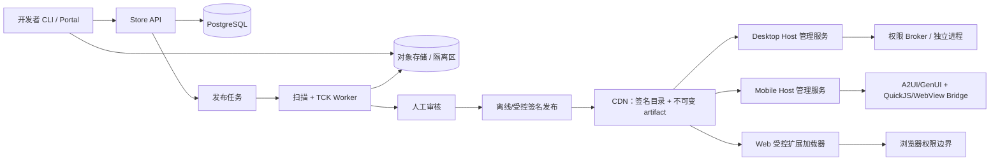

# 插件商店：技术与接口方案

状态：评审草案（2026-10-15）。以 `Muse-Client` 当前 Manifest v2、Host/Plugin/DSH 边界为输入；本文中的新服务与接口尚未实现。

## 1. 系统边界与数据流

商店服务**不远程执行安装**。它接受发布、审核、签名并提供目录；客户端 Host 对目标设备做最后的兼容、权限和安装事务判定。Cloud/GoTrue 只提供开发者身份，不能替代设备授权。用户浏览公共目录可匿名；发布、审核和私有 beta 要求身份。

## 2. 选型

| 层 | 建议 | 理由 / 约束 |
| --- | --- | --- |
| API 与发布 Worker | Rust + Axum + SQLx，OpenAPI 3.1 合同先行 | 与现有 Rust 协议/后端能力一致；共享可验证的数据模型。Worker 通过进程/容器隔离执行构建验证，不在 API 进程运行上传物。 |
| 数据库 | PostgreSQL | 发布者、插件、release、审核、权限、下载事件和审计事务；唯一约束保证 `{pluginId,version,channel}` 不可变。 |
| Artifact 与媒体 | S3 API 对象存储（本地 MinIO）+ CDN | 基于 SHA-256 内容地址存储；上传隔离桶，批准后复制到只读发布桶；大文件直传，API 不代理字节。 |
| 异步任务 | 首期 PostgreSQL job/outbox + 独立 Worker；规模扩大后再引入队列 | 减少早期基础设施；状态变更与任务入队同一事务。Redis 可做限流/缓存，不作为发布事实源。 |
| 身份 | 复用 GoTrue 的用户身份，服务侧验证 JWT；发布者组织/RBAC 在本服务 | 已有账号可复用，发布权限与普通账号权限分离；审核员与签名操作再分权。 |
| 开发者门户 | Next.js + TypeScript + MDX | 对齐现有 `Muse-WebSite` 技术栈；文档可版本化，上传与审核状态来自 Store API。独立构建部署，不把公开商店服务塞进营销站。 |
| 目录与验签 | 静态签名元数据 + 客户端本地验签，HTTPS/CDN 负责传输 | 目录离线缓存、镜像和服务故障不应改变信任结果。采用 TUF 的 root/targets/snapshot/timestamp 职责与防回滚机制；先做与现有 Mobile Ed25519 envelope 的迁移适配与合同测试，发布前必须完成密钥轮换/过期/撤回演练。[TUF 规范](https://theupdateframework.github.io/specification/v1.0.33/)。 |
| 构建来源 | 固定 Git commit、依赖锁、SBOM、构建证明 | 发布记录能追溯输入和产物 digest；可按 [SLSA provenance](https://slsa.dev/spec/v1.0/provenance) 格式记录，但不能只凭声明宣称某一安全等级。 |

不要把 GitHub Releases、npm 或单一 `market.json` 当权威商店。它们可用于源码协作或上游依赖下载，最终安装必须来自受签名元数据约束的精确 artifact。

## 3. 合同与版本

`Muse-Client/schemas/openmuse.plugin.v2.schema.json` 与对应 Rust/Dart 解析器目前是 Manifest 真源。新仓库通过固定 Client 提交/发行 tag 导入校验夹具，禁止手工 fork 出另一份 v2。需要新增 `minHostApi`、`a2uiProfile`、`webBridgeApi`、跨生态依赖、数据迁移声明时，先以 v2 的受控扩展或 v3 RFC 修改真源，并提供旧客户端 fail-closed 行为和 Rust/Dart/Web 的 TCK。外部 release 元数据单独定义，不把商店文案、下载数塞进运行时 Manifest。

推荐发布 identity：`pluginId + releaseVersion + channel`。一个 release 包含 `target + runtimeKind + artifactDigest + size + ABI + requiredHostApi + permissionSet + optionalDependencies`；发布时版本与 artifact 永久不变。允许同一 release 不覆盖所有平台；`supported` 仅表示有已验证交付物，不能由营销元数据声明。客户端用自身 OS/arch/libc、Host API、A2UI profile、Bridge API 与发行渠道解析一个确切版本；计划固定所有 digest，不能在安装中途改选 `latest`。

## 4. API 草案

公共查询以 CDN 签名快照为安装依据，在线 API 负责搜索和详情索引。最小端点：

| 接口 | 语义 |
| --- | --- |
| `GET /v1/catalog?platform=&channel=&cursor=` | 搜索展示；结果包含 `snapshotId` 与 `signedIndexUrl`，不直接赋予安装信任。 |
| `GET /v1/plugins/{id}` | 公开详情、可用平台、版本、权限、开发者、媒体、举报入口。 |
| `GET /v1/plugins/{id}/releases/{version}` | 精确版本、兼容矩阵、artifact digest、依赖与审核状态。 |
| `GET /metadata/...`、`GET /blobs/sha256/{digest}` | 经 CDN 提供签名元数据和不可变二进制；支持 ETag/Range。 |
| `POST /v1/developer/uploads` | 鉴权创建上传会话，限制类型/体积/digest，返回短时直传 URL。 |
| `POST /v1/developer/uploads/{id}/complete` | 服务器回读对象 digest 和大小，进入隔离扫描；幂等。 |
| `POST /v1/developer/submissions` | 固定 release、artifact、源码提交、许可、隐私/权限说明并提交审核；`Idempotency-Key` 必填。 |
| `GET /v1/developer/submissions/{id}` | 返回 `draft → scanning → review → approved/rejected → published` 及错误码/TCK 报告。 |
| `POST /v1/reports` | 举报插件或版本；隐私最小化，限流与滥用防护。 |

审核与签名接口只走内部网络和独立 RBAC。API 返回的安装计划可用于预览，**设备 Host 必须重新计算**：本地已装版本、权限 grant、目标 ABI、DSH profile、可回滚状态都不在云端真源。客户端响应应有机器可读错误码，如 `TARGET_UNSUPPORTED`、`HOST_API_TOO_OLD`、`PERMISSION_CHANGED`、`DEPENDENCY_CONFLICT`、`RELEASE_REVOKED`、`SIGNATURE_INVALID`；UI 负责给出对应修复动作。

数据库核心表：`publisher`, `publisher_member`, `plugin`, `release`, `artifact`, `submission`, `review_decision`, `catalog_snapshot`, `revocation`, `download_event`, `audit_event`。`release` 和 `artifact` 批准后只允许追加审计/撤回记录，不允许 UPDATE 内容字段。下载计数由去重与反作弊后的事件汇总生成，不能由客户端自报并直接展示。

## 5. 三端执行约束

### Desktop

外部 Flutter/Dart AOT 包不可动态加载。允许的第一阶段 artifact 是签名 `.omplugin`，内含独立进程 worker、WebView 静态资产或受控 CLI；原生可执行文件按 target 分发，Host 通过 IPC/Broker 提供能力。安装事务：计划与权限差异 → 下载 staging → 校验目录/包/内部 artifact 与解压边界 → 记录 journal → 原子切换版本指针 → 健康检查 → 提交 receipt；失败恢复旧版本。现有 `plugin_package.dart` 只做到部分摘要与写盘，必须补可信目录、事务与回滚后才能承载公开市场。DSH 依赖只能由其正式 profile 管理边界执行并回读，不直接写 profile 文件。

### Mobile

A2UI 是**展示协议**，GenUI 是 Flutter 渲染适配，不承担业务权限。Host 固定组件目录、消息/节点/深度/字节预算；当前工作台目录仅允许 `Column/Row/Text/Divider/Card`，最多 8 个 envelope、24 个组件和 16 KiB 编码消息。任意新增组件或 action 都要升级 profile 并过 TCK。QuickJS 每插件隔离，但 VM 内存上限不能替代进程级威胁模型；文件、网络、Secret、配对 Desktop 调用只能通过能力 Broker。WebView 详情使用包内静态资源、CSP、导航白名单与按插件作用域的 bridge，不能暴露通用 Host RPC。[A2UI Catalog 与版本语义](https://a2ui.org/specification/v0.9.1-a2ui/)。

iOS 对下载的 HTML5/JavaScript 插件有 4.7 条款及 Native API/数据许可限制，是否允许某个 profile 上架须逐项审查；不能由 Android 通过推断 iOS 可用。Google Play 对下载 dex/JAR/so 等执行代码有限制，对解释型代码也要求不得导致违反政策。[Apple 指南](https://developer.apple.com/app-store/review/guidelines/)、[Google Play 政策](https://support.google.com/googleplay/android-developer/answer/16559646)。

### Web

首期只允许声明式远程 Surface 与可隔离的 Web bundle；不将第三方任意 JS 注入 Flutter Web 的顶层同源。若要做交互式 bundle，需独立 origin/sandbox、受控 `postMessage`/Bridge、CSP 与版本化能力，浏览器会话和 CSRF 由 Web Edge 管。DSH Web 客户端插件继续由 DSH 自己的签名/包管理和启动清单管理；市场只做目录映射和兼容证据。配对 Desktop 的远程 Surface 经当前 grant/opaque ref，不在商店服务中转用户文件。

## 6. 开发者工具与 Skill

发布 `openmuse-plugin` CLI：`init --target desktop|mobile|web`、`dev`、`validate`、`test --tck`、`pack`、`submit`、`status`。`pack` 输出可重复的 artifact digest、SBOM、Manifest 和测试报告；`submit` 仅上传已打包字节。提供本地 Mock Host、权限拒绝/超时/撤销模拟器、A2UI 预览器、Web Bridge 调试器、Desktop IPC 模拟器、兼容矩阵生成器及三端示例。CLI 与 CI 使用同一 validator，避免“本地通过、上架失败”的第二套规则。

开发者文档按“10 分钟最小插件 → 三端能力矩阵 → Manifest/权限 → UI profile → 本地调试 → 测试 → 发布 → 版本迁移/撤回”组织，中英版本同步。`skills/` 下提供可安装的编码代理 Skill：选择正确 target、读取固定版本合同、生成 Manifest/权限说明、运行 TCK、解释失败；Skill 不能代替签名、审查或赋予权限。每个 Skill 固定 SDK/协议版本并在 CI 中用模板工程验证。

## 7. 发布安全与运维

上传 URL 仅允许隔离桶，服务器回读 digest/体积；解包防路径逃逸、符号链接、炸弹和恶意媒体；静态扫描依赖漏洞、许可、密钥泄漏和危险 API；动态 TCK 在无生产凭据、限 CPU/内存/时间/网络的容器里运行。审核通过后由独立发布权限把 artifact 按 digest 放入只读桶，签名元数据由独立密钥/HSM 或受控离线流程生成。API 操作者不能单独替换已签名目录。事件日志覆盖发布、审核、密钥轮换、撤回、灰度与回滚。

灰度按稳定安装 ID 与 release ID 确定性分桶；目录签名涵盖 channel、有效期和撤回信息。密钥丢失或错误发布时，客户端可接受更高版本的已签名撤回元数据，停止新激活并展示恢复路径。对已安装插件，不能依赖服务器删除对象来“下架”：必须有可验证的撤回语义。服务 SLO 的首要指标是签名目录可用率、签名刷新时效、上传到审核耗时、错误发布撤回时间；下载量是次要指标。
