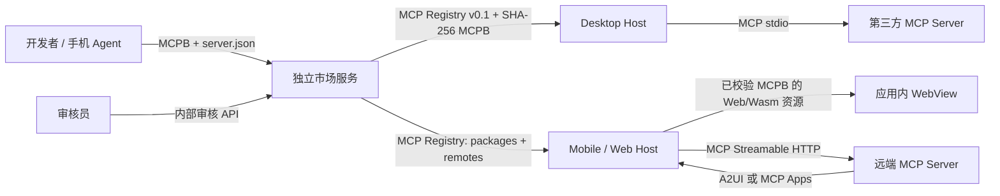

# 标准协议插件市场架构

## 不可跨越的边界

插件仓库不依赖客户端源码包、私有协议、内部 Manifest、内部字段或内部 Broker。市场服务不查询或修改已有账号、Workspace、DSH 或客户端数据库。客户端对外仅认 MCP、MCPB、MCP Registry、A2UI/MCP Apps 与标准 JSON Schema/OAuth 语义。客户端内部仍可用任意 Widget、QuickJS、进程管理或权限实现，但这些不是插件开发者的合同。

Desktop 客户端把用户选择的文件作为 `contentEncoding: base64` 参数交给 MCP tool。插件不会收到工作区路径或内部 Host 命令。MCPB 的通用 `compatibility.platforms/runtimes` 与 MCP 协商决定技术兼容；开发者选择的客户端版本只用于公开 TCK，不写入包。用户批准具体工具调用；把下载代码放在单独进程只是隔离的一层，生产仍须 OS 沙箱、文件/网络限制、资源预算和可终止性。

## 独立服务

本地实现：`server/market.py`，Python 标准库 + SQLite + 内容寻址文件。公开面支持 MCP Registry v0.1 的 `GET /v0.1/servers` 和 `POST /v0.1/publish` 所用结构；`server.json` 中 MCPB 包使用标准 `registryType: mcpb`、`identifier`、`fileSha256`、`transport.type: stdio`。上传通过 HTTP PUT `/packages/{sha256}.mcpb`；审核通过前 GET 404。内部审核端点 `/internal/reviews/{id}/approve|reject` 不供客户端使用。服务目前只实现 Registry 规范的必要子集，不宣称完整兼容。

持久化数据：`submission(id,name,version,document,digest,state,review)`；包文件按 SHA-256 命名。唯一键 `(name,version)` 防止覆盖已批准版本。批准后目录只输出 `active` 元数据；服务将包读为不可变文件。审核令牌与开发令牌隔离。状态迁移：上传包 → publish/pending → approve 或 reject → 目录可见（approve）。

生产拆分：无状态 Registry API + Postgres（事务/审计）+ 私有隔离桶（待审）+ 公共对象存储/CDN（批准）+ 异步扫描/TCK Worker + 审核控制台。开发者登录走标准 OIDC/OAuth；命名空间需要 DNS 或代码托管账户所有权校验，按 publisher 授权。`Content-Digest`/SHA-256、软件物料清单、签名和透明日志支撑供应链。公共目录支持游标分页、条件请求、撤回公告。每一步由不可变事件记录，操作员审核不能静默改包。审核者不能使用开发者令牌。

当前原型的静态 Bearer 令牌、SQLite、HTTP loopback 和人工批准接口只用于本地验证。没有自动恶意软件扫描、生产身份、签名、OS 沙箱、撤回推送、移动渠道审核或高可用；不能直接暴露公网。

## 平台边界

Desktop：MCPB Node/二进制/Python 是开放规范，本轮 Host 接受 Node MCPB；下载/解压设大小与路径上限，核验 `fileSha256`，安装到应用支持目录，MCP Dart SDK 协商 `2026-07-28`，重启从回执恢复。需要继续补原子版本切换、失败回滚、撤回、进程沙箱及工具级用户授权。

Mobile：A2UI v0.9.1 是消息格式而非权限系统，具体运输依[官方 A2UI over MCP 指南](https://a2ui.org/guides/a2ui_over_mcp/)；MCP Apps 适合隔离 HTML 界面。远端插件可用 MCP Streamable HTTP；Android 上的 AppFlowy Editor 也可从 Registry 的标准 MCPB `packages`/`fileSha256` 下载并校验包，将其中公开约定的 `web/` 站点装入应用私有目录，在应用内 WebView 离线启动。`web/` 是本生态公布的打包 profile，不是 MCPB 基础规范的移动执行定义，也不增添客户端私有 Registry 字段。当前仅校验 A2UI 消息，尚未实现完整 A2UI 绘制。下载 JS 到 QuickJS 后调用私有全局函数的方式不是开放插件合同，因此不作为本仓库发行类型。Flutter Web Wasm 需要浏览器图形与 DOM 环境，不能当成可直接装载的原生 Wasm 模块。Node GenOffice 核心不能直接在 QuickJS 中运行；手机 PPTX 完整编辑须单独移植解析/渲染核心或选远端 MCP 服务，并通过 Android/iOS 真机、政策、隐私与性能门禁。

Web：MCP Streamable HTTP + OAuth 和 MCP Apps iframe/A2UI。严格来源隔离、CSP、导航控制与逐工具授权。Web 在线安装尚未实现。

参考规范：[MCP](https://modelcontextprotocol.io/specification/2026-07-28)、[MCP Registry API](https://github.com/modelcontextprotocol/registry/blob/main/docs/reference/api/openapi.yaml)、[MCPB](https://github.com/modelcontextprotocol/mcpb/blob/main/MANIFEST.md)、[A2UI](https://a2ui.org/specification/v0.9.1-a2ui/)、[MCP Apps](https://apps.extensions.modelcontextprotocol.io/)。
