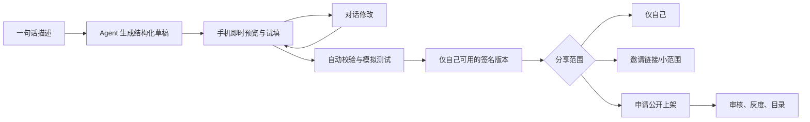

# 手机 Agent 插件工坊：普通用户创建与发布

状态：产品与技术草案（2026-10-15）。目标是让用户只用一台安装 OpenMuse 的手机，在对话中创建、试用和发布小型插件；当前代码尚无这条完整链路。

## 1. 首发产品范围

首发称为 **Mini Plugin**：表单助手、清单、知识卡、计算器、提醒和简单审批等，由 OpenMuse 已预置的组件与动作组合而成。用户描述需求，Agent 产出受版本控制的结构化 `MiniPluginSpec`；确定性编译器生成签名的声明式包，Host 渲染和执行。用户不接触源码、Git、CLI、SDK 或电脑。

Mini Plugin 与专业开发者编写的 worker/QuickJS 插件共享商店身份、版本、审核和安装体验，但运行能力有明确上限。若需求超出当前组件或动作集合，Agent 给出可完成的缩减方案或把任务转入“高级开发”云端工程，不偷偷生成可执行代码或要求用户安装开发工具。

## 2. 手机上的完整流程



用户示例：“做一个客户需求表单助手，记录客户名、需求、截止日期；提交后帮我整理待办。”Agent 用简短问题确认字段、谁能填写、保存位置和“整理待办”是否调用 AI。展示可编辑的字段清单、权限说明和真实手机预览。用户试填两条样例，看到保存与导出结果；点击“安装到我的 OpenMuse”后生成私有版本。以后说“加一个优先级字段”，Agent 生成新草稿与数据迁移预览，用户确认后发布新版本。

界面建议放在插件商店的“创建”页，也允许在普通 Agent 对话里通过“做成插件”进入。每一步保持同一个草稿，支持语音输入、图片/手绘表单作为需求参考、撤销和版本历史。Agent 展示字段/权限差异与最终效果，内部 Manifest、A2UI 消息和 artifact digest 只放在高级详情。

## 3. 数据与执行模型

`MiniPluginSpec` 只表达：表单字段/类型/校验、页面布局、允许的动作、数据存储位置、可见范围、权限用途和 UI Profile 版本。编译器只接受 schema 白名单，不执行 Agent 生成的脚本。第一批动作可以是 `record.create/read/update`、`export.csv`、`notification.schedule` 和经明确授权的 `agent.summarize`；每个动作由 Host/Cloud 已有能力实现，按用户、插件、Workspace、设备和时间范围授权。无法用现有动作表达的业务逻辑在首版拒绝发布。

示意规范（合同仍需 E0 冻结）：

```json
{
  "schema": "openmuse-mini-plugin/v1-draft",
  "pluginId": "user.example.customer-form",
  "profile": "forms@1",
  "title": "客户需求助手",
  "fields": [
    {"id": "customer", "type": "text", "label": "客户名称", "required": true},
    {"id": "request", "type": "multiline", "label": "需求", "required": true},
    {"id": "due", "type": "date", "label": "截止日期", "required": false}
  ],
  "onSubmit": {"action": "record.create", "scope": "account-private"},
  "requestedPermissions": ["records.write:self"]
}
```

Agent 可以提出“整理待办”作为下一步，但只有对应 `agent.summarize` 动作、费用/数据提示和用户授权都就绪时才加进规范。编译器输出的 artifact、Manifest 与授权说明由平台生成，不让自然语言直接变成任意命令。

当前 Mobile 工作台的 `MobileWidgetCatalog` 只支持 `Column/Row/Text/Divider/Card`，没有输入与提交组件。因此首个表单助手**必须先实现新 `forms@1` Profile**：TextField、NumberField、DatePicker、Select、Toggle、Button、错误提示、键盘/读屏语义、字段校验、action 回执。Profile 固定组件与最大节点、字节、更新频率；A2UI/GenUI 只是生成和渲染界面，真正的 `record.create` 仍经能力 Broker。Desktop 与 Web 若使用同一 Flutter 表单渲染器并通过各自端到端 TCK，可以复用同一声明式 artifact digest；未验收的端不显示支持徽标。

为了满足“只有手机”的条件，创作 Agent 必须可由 Mobile 直接使用的 Cloud Agent 服务承载；不能要求配对 Desktop 或运行本机 DSH sidecar。Agent 只持有短期、限定草稿 ID 的 `draft.read/write` 工具，不持有发布签名密钥，也不能替用户执行公开上架。结构化草稿由服务端 schema 校验并返回给手机本地预览；模型输出、表单内容和外部导入资料都作为不可信数据处理。

默认将表单记录保存在账号私有的 Cloud 数据域，支持导出和删除；若选择仅设备本地保存，界面要说明跨设备不可见。真实填写数据不能为了“预览”自动发送给 Agent；只有用户主动触发 AI 整理动作时才传入必要字段，并展示费用/隐私提示。离线提交使用幂等键排队，重连后不能重复建单。共享给别人填写时需要独立的访问策略、反滥用和字段级数据说明。

## 4. 版本、身份与发布

用户首次保存草稿时分配一个稳定 `pluginId`，例如 `user.<publisher-id>.customer-form`。同一产品在 Mobile、Desktop、Web 均使用此 ID；不同端的 artifact、权限与平台版本流单独记录。初版可只支持 Mobile；通过 Desktop/Web 的 Profile TCK 后逐端增加交付物。修改字段、动作或权限发布为新版本，旧版本与旧记录可回滚或导出，数据迁移须预演。

发布分三级：

| 级别 | 用户动作 | 门禁 |
| --- | --- | --- |
| 私有安装 | “安装到我的 OpenMuse” | 自动 schema/TCK/隐私检查，签名私有目录；仅本人设备可获取。 |
| 邀请分享 | “生成邀请链接” | 自动检查 + 受邀者授权 + 内容举报/限流；链接可撤回。 |
| 公开商店 | “申请上架” | 发布资料自动生成供用户确认，自动扫描 + 人工审核；通过后签名目录灰度发布。 |

私有安装也要有签名、版本、权限和回滚；它只是可见范围不同。私有目录按账户鉴权，禁止公共缓存和可枚举链接；邀请链接有到期和撤回机制。公开上架前用户最终确认名称、描述、图标、截图、收集的数据、权限用途、许可与联系方式。Agent 可代写文案、生成截图和解释审核错误，但发布动作由用户明确触发。平台政策与上架审核按目标渠道分别执行；Apple 对此类软件另有索引、内容处理和权限要求，[见 4.7 条款](https://developer.apple.com/app-store/review/guidelines/)。

## 5. 最小服务接口

`POST /v1/studio/drafts` 创建草稿；`POST /v1/studio/drafts/{id}/revise` 以自然语言生成下一修订；`GET /v1/studio/drafts/{id}` 取当前规范与版本；`POST /v1/studio/drafts/{id}/preview` 编译并运行无真实副作用的预览；`POST /v1/studio/drafts/{id}/publish` 指定 `private/invite/public`，用户会话与幂等键必填。公开发布返回 submission ID；私有发布返回签名目录中只对本人可见的版本引用。每个生成动作记录输入规范版本、模型/模板版本、生成结果和校验报告，便于修复与追责。

## 6. 纵向切片验收

1. 一名没有电脑和开发经验的用户仅用手机在 10 分钟内创建“客户需求表单助手”，修改字段、试填、私有安装，并在“我的插件”打开。
2. 关闭网络后仍能打开已缓存的表单；重连提交不重复，数据保存位置与同步范围清楚可见。
3. Agent 要求未知 A2UI 组件、任意网络请求、读取手机联系人或静默调用 AI 时，校验器拒绝并给出可用替代方案。
4. 新版本增加必填字段时展示旧记录迁移/兼容结果；失败保留旧版可用。
5. 只通过 Mobile TCK 的表单不显示 Desktop/Web 支持标识；通过三端测试后可以复用同一个 `pluginId`，分别下载安装。
