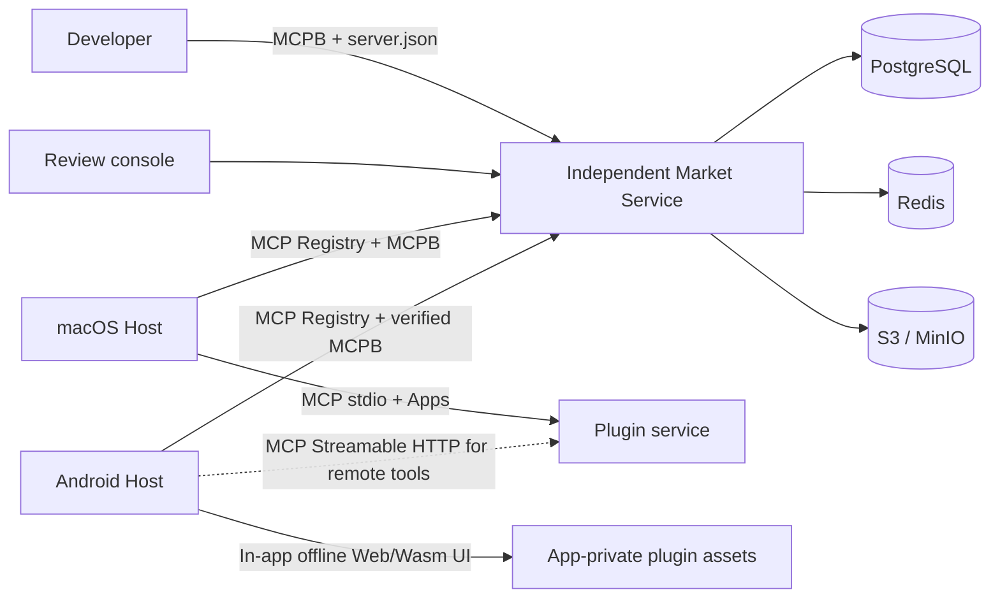

# Muse Plugin Market Service

A separate Rust service for third-party plugin review and distribution. It owns its own database, Redis keys, artifact bucket, HTTP API, and Askama admin console. It does not call or share tables with Muse-Server or AppFlowy-Cloud.

## Architecture

| Layer | Implementation | Relation to Muse-Server/AppFlowy-Cloud |
| --- | --- | --- |
| HTTP and admin UI | Axum 0.7, Askama 0.12, Tokio | Same Rust server conventions and template stack |
| Metadata, review state, audit | SQLx 0.8, PostgreSQL | Separate database and migrations |
| Artifact storage | S3 API, MinIO locally | Separate bucket; SHA-256 addressed MCPB packages |
| Rate limiting | Redis | Separate `market:` key prefix and deployment |
| Local development | SQLite and filesystem | No infrastructure prerequisite |

The client reads the **standard MCP Registry v0.1** `GET /v0.1/servers` catalog. Desktop downloads a standard MCP Bundle (`.mcpb`). Android can verify `packages[].fileSha256` and install static Web/Wasm resources carried by the reviewed bundle; plugins without such resources may use a standard MCP Streamable HTTP endpoint. MCP Apps use `ui://` resources, `text/html;profile=mcp-app`, `_meta.ui.resourceUri`, and `resource_link` results. No client-only Registry or manifest field is required in a third-party plugin. The static site's `web/` archive layout is a documented packaging profile, not part of the base MCPB execution specification.



## Local run

```sh
cargo run
```

Set `MARKET_DEVELOPER_TOKEN` and `MARKET_REVIEWER_TOKEN` to distinct values first. The defaults for database, storage and listen address are shown in `.env.example`; this binary reads environment variables, not `.env` automatically. Run `python3 tests/e2e_flow.py --origin http://127.0.0.1:8787 --developer-token ... --reviewer-token ...` after starting it. The reviewer UI is at `/admin`.

For a production-shaped local stack:

```sh
docker compose up -d postgres redis minio
cargo build --features s3
# Export PostgreSQL, Redis and S3 variables from .env.example, then run:
./target/debug/muse-plugin-market
```

The production compose file deploys this service as an independent stack with its own PostgreSQL, Redis, and MinIO volumes. Nginx exposes `https://plugins.openmuseai.com` for the public Registry, reviewed package downloads, and the MCP App. Upload, review, and admin endpoints remain on a loopback listener accessed through an SSH tunnel while token authentication is in use. Create the bucket once, then set `MARKET_S3_AUTO_CREATE_BUCKET=false` for steady state; rotate production credentials through the deployment secret store.

Build the production image on CI or a builder with enough memory, then push it to a registry or load it on the server and set `MARKET_IMAGE` to that image tag. `production.compose.yaml` deliberately has no `build:` entry: the 4 GiB production host must only run the release image. A deployment should run `docker compose -f production.compose.yaml config --quiet` before `docker compose -f production.compose.yaml up -d`. Do not run Cargo or Docker builds on that host.

## Review state machine

`uploaded → pending → approved → delisted → approved` or `pending → rejected`. Only approved versions appear in the public catalog and their package bytes are downloadable. Delisting prevents new installs; an already installed MCPB is not remotely erased. Every transition writes an audit event and requires a review note for rejection or delisting.

## HTTP API

| Endpoint | Role | Purpose |
| --- | --- | --- |
| `PUT /packages/{sha256}.mcpb` | developer | Upload and validate a deterministic MCP Bundle |
| `POST /v0.1/publish` | developer | Submit standard MCP Registry server.json metadata |
| `GET /v0.1/servers` | public | Paginated reviewed catalog |
| `GET /packages/{sha256}.mcpb` | public | Download an approved artifact |
| `GET /internal/submissions` | reviewer | Review queue |
| `POST /internal/submissions/{id}/{approve,reject,delist,relist}` | reviewer | State transition |
| `GET /internal/audit` | reviewer | Audit trail |

The local pilot accepts MCPB archives up to 80 MiB compressed, 160 MiB expanded, and 1,024 ZIP entries. Android applies the same compressed and expanded byte budgets to the static-site portion and verifies the complete Registry SHA-256 before extraction.

The current token authentication is a pilot implementation. The public deployment keeps all write and admin routes private to the loopback listener. Before opening third-party upload or the reviewer console directly to the internet, add independent OIDC authentication, per-developer namespace ownership, malware and license scanning, and explicit human review gates. The client-facing MCP Registry/MCPB/MCP Apps contract remains unchanged.

## US read-only mirror

`https://us.openmuseai.com/v0.1/servers` serves a snapshot of the approved catalog. `scripts/mirror_approved_registry.py` downloads each MCPB from the primary registry, verifies its SHA-256, rewrites public package and editor URLs to the US origin, and replaces the catalog atomically. The US mirror has no upload, review, or admin endpoint. The editor MCP service runs from `production.us-mirror.compose.yaml` on loopback port 18796, behind the US Nginx `/mcp` and `/editor/` routes. Its published package URLs use immutable digest filenames.

On the US VPS, the script is installed at `/opt/openmuse-us/mirror_approved_registry.py` and the approved files are under `/var/www/openmuse-us/market`. `openmuse-us-market-mirror.timer` refreshes the snapshot daily. Check `systemctl status openmuse-us-market-mirror.service` and `systemctl list-timers openmuse-us-market-mirror.timer` after changes. The client packages for the US region set `OPENMUSE_MCP_REGISTRY_URL=https://us.openmuseai.com`; the VPS desktop launcher exports the same value.

## Pinned overseas launch composition

The overseas first launch supplies only the reviewed Slides MCPB and native OpenMuse Notes (bundled with the client). Pass `--launch-manifest /opt/openmuse-us/official-launch-plugins.json` to the mirror to restrict the official distribution to exact `officialMcp` name/version/SHA-256 pins. Every pin must already be approved in the primary registry; a missing version or digest mismatch fails before replacing the previous catalog. The app's native Notes integration is not falsely represented as an MCPB. This changes official supply, while installed client packages remain local.
