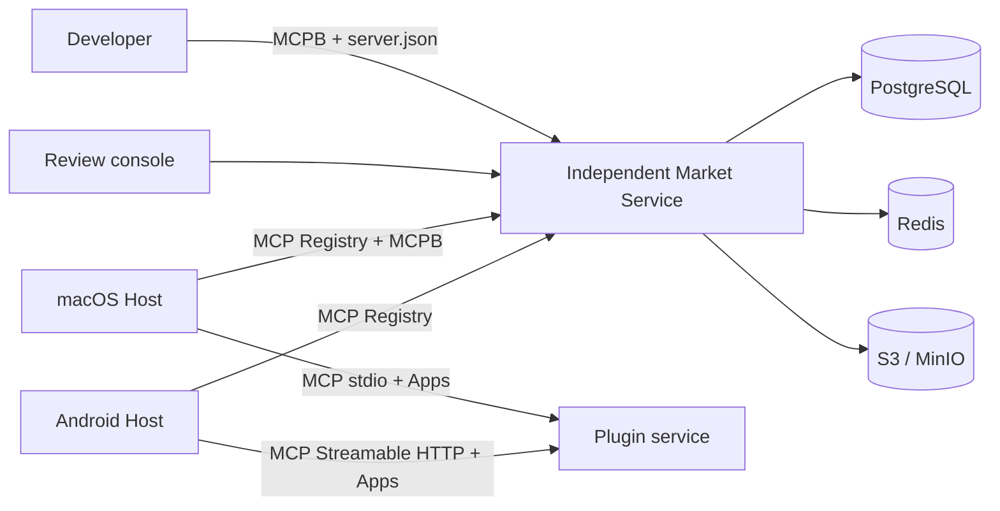

# Muse Plugin Market Service

A separate Rust service for third-party plugin review and distribution. It owns its own database, Redis keys, artifact bucket, HTTP API, and Askama admin console. It does not call or share tables with Muse-Server or AppFlowy-Cloud.

## Architecture

| Layer | Implementation | Relation to Muse-Server/AppFlowy-Cloud |
| --- | --- | --- |
| HTTP and admin UI | Axum 0.7, Askama 0.12, Tokio | Same Rust server conventions and template stack |
| Metadata, review state, audit | SQLx 0.8, PostgreSQL | Separate database and migrations |
| Artifact storage | S3 API, MinIO locally | Separate bucket; SHA-256 addressed MCPB packages |
| Rate limiting | Redis | Separate `market:` key prefix and deployment |
| Local development | SQLite and filesystem | No infrastructure prerequisite |

The client reads the **standard MCP Registry v0.1** `GET /v0.1/servers` catalog. Desktop downloads a standard MCP Bundle (`.mcpb`), while Mobile connects to the record's MCP Streamable HTTP endpoint. MCP Apps use `ui://` resources, `text/html;profile=mcp-app`, `_meta.ui.resourceUri`, and `resource_link` results. No client-only manifest field is required in a third-party plugin.



## Local run

```sh
cargo run
```

Set `MARKET_DEVELOPER_TOKEN` and `MARKET_REVIEWER_TOKEN` to distinct values first. The defaults for database, storage and listen address are shown in `.env.example`; this binary reads environment variables, not `.env` automatically. Run `python3 tests/e2e_flow.py --origin http://127.0.0.1:8787 --developer-token ... --reviewer-token ...` after starting it. The reviewer UI is at `/admin`.

For a production-shaped local stack:

```sh
docker compose up -d postgres redis minio
cargo build --features s3
# Export PostgreSQL, Redis and S3 variables from .env.example, then run:
./target/debug/muse-plugin-market
```

`MARKET_S3_AUTO_CREATE_BUCKET=true` is for local MinIO only. Public deployments must put this service behind TLS, set `MARKET_PUBLIC_ORIGIN`, create the bucket with infrastructure tooling, and use separate credentials.

## Review state machine

`uploaded → pending → approved → delisted → approved` or `pending → rejected`. Only approved versions appear in the public catalog and their package bytes are downloadable. Delisting prevents new installs; an already installed MCPB is not remotely erased. Every transition writes an audit event and requires a review note for rejection or delisting.

## HTTP API

| Endpoint | Role | Purpose |
| --- | --- | --- |
| `PUT /packages/{sha256}.mcpb` | developer | Upload and validate a deterministic MCP Bundle |
| `POST /v0.1/publish` | developer | Submit standard MCP Registry server.json metadata |
| `GET /v0.1/servers` | public | Paginated reviewed catalog |
| `GET /packages/{sha256}.mcpb` | public | Download an approved artifact |
| `GET /internal/submissions` | reviewer | Review queue |
| `POST /internal/submissions/{id}/{approve,reject,delist,relist}` | reviewer | State transition |
| `GET /internal/audit` | reviewer | Audit trail |

The current token authentication is a local pilot implementation. Before internet deployment, replace it with independent OIDC authentication and per-developer namespace ownership in this service, add malware and license scanning plus human review gates, and serve the console through an authenticated reverse proxy. The client-facing MCP Registry/MCPB/MCP Apps contract remains unchanged.
