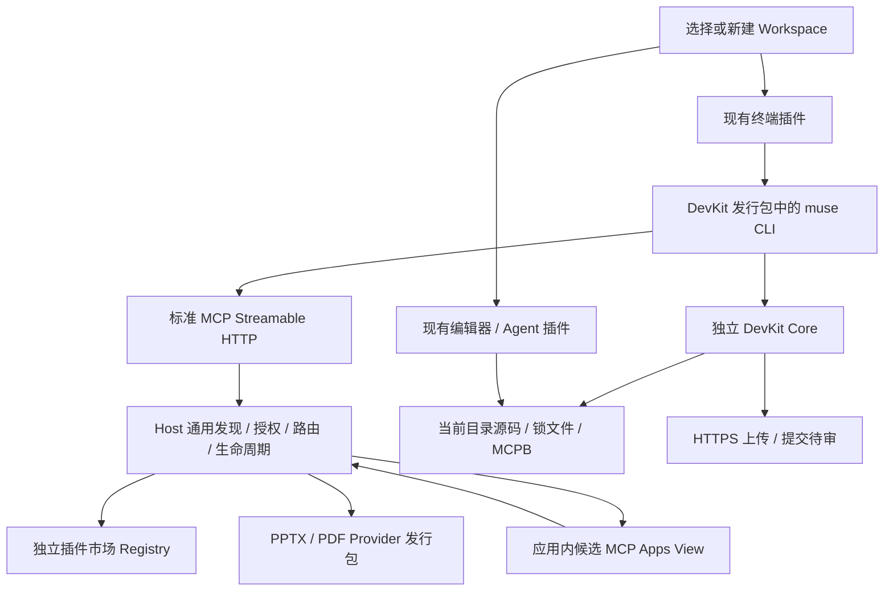

# DevKit 架构：Workspace 与公开 CLI

更新：2026-10-21。当前 Desktop 实现优先；后续设计不作为已交付能力。完整状态见[实现记录](08-DESKTOP-WORKSPACE-CLI.zh-CN.md)。

## 组件与边界

| 所有者 | 代码与责任 |
| --- | --- |
| Host | 现有 Workspace/终端承载、已审核包安装、通用命令启动、短期 MCP 会话、候选 View、逐调用者资源授权 |
| DevKit | `packages/devkit-cli`、`packages/devkit-core`、`plugins/developer-kit`；命令参数、能力选择、项目生成、固定构建器、报告校验、提交审核 |
| 公共 SDK | `packages/plugin-sdk`；官方 Apps 客户端封装，不导入 Client 私有类 |
| Provider | 自己的合同、Schema、解析/渲染、业务输出、许可和版本；Host 不写 PPTX/PDF 分支 |
| 独立市场 | Registry 目录、内容寻址 MCPB、开发者鉴权、pending/审核/上架状态 |

Host 无 DevKit ID 特权分支；任意已审核 MCPB 可使用相同公开能力与命令发行约定。消费者运行不依赖 DevKit 安装。

## 标准与公开生态语义

- 通信使用标准 MCP `initialize`、`tools/list`、`tools/call`、`resources/read`，View 使用 MCP Apps。
- Desktop 包为 MCPB 0.3；根 `package.json` 的 npm `bin` 映射用于声明命令。它是公开 npm 发行约定，**不是 MCPB 原生 CLI 标准字段**。
- `MCP_HOST_URL/TOKEN`、`workspace_describe`、`capabilities_bind` 等是独立版本的公开生态 Profile，**不是 MCP 保留字段/方法**。合同与 Schema 存在本仓库 `contracts/devkit-v1`，不依赖 Client 内部字段。
- 项目配置和模板报告属于 DevKit；PPTX/PDF 操作属于 Provider。Host 对业务字段透明转发。

## 命令发现与短期会话

1. Host 从已安装包根 `package.json` 发现 `bin`。命令名冲突不覆盖；保留 Host 命令名。
2. Host 生成自身目录中的命令 shim；每次启动校验安装回执内所有文件摘要、入口和元数据，拒绝被改动的包和符号链接。旧回执缺文件摘要时要求重新安装。
3. 终端在已授权 Workspace 根目录打开；Host 发放当前账号、根目录、终端生命周期内的随机 Bearer。
4. CLI 通过标准 MCP HTTP 连接随机 loopback 端口。服务拒绝浏览器 Origin、缺失/失效凭据、账号切换和撤销后的调用。
5. CLI 读取公开 Workspace roots，解析真实路径，确认 cwd 位于根目录内。终端关闭撤销会话及它持有的候选授权；其他终端/项目不共享。

HTTP loopback 是 Desktop 开发工具与本机 Host 的控制通道。已安装消费者通过应用内 Apps 通道工作；此设计不要求 Mobile 连接 Desktop 的 localhost。

终端具有本机用户 shell 权限；MCP roots 的授权不能把任意 shell 变成文件系统沙箱。短期凭据不传入消费者 View、Provider 或 Agent 的通用令牌。

## 项目与依赖

CLI/Core 不依赖 Host 或 Provider 源码。`muse init` 对一个或多个已安装合同进行匹配，要求具备 `readSnapshot`、精确 Provider 版本/包摘要；歧义、重复和版本冲突均阻止生成。

当前目录采用临时文件+独占链接提交，任何模板文件冲突则回滚本次创建文件。已有普通文件保留；受控源码、锁和状态文件拒绝符号链接。CLI 可在 Workspace 子目录创建多个独立项目。

锁文件携带确切 Host 构建摘要、合同内容和直接依赖身份。当前不做完整传递依赖/循环图解析、不自动升级 Provider。当前 `muse check` 是语法/入口检查，不是完整 TypeScript 类型检查。

固定构建器将浏览器模块、已捆绑的 Apps SDK 和通用 MCP runtime 组合成确定性 MCPB；ZIP 无多余目录条目，不执行项目任意 shell。包包含源码与锁的快照、依赖说明和第三方声明。

## 实际运行

CLI `muse dev` 调用通用 `development_open_bundle`；Host 验摘要、提示确认并启动候选独立 View/Node 服务，不替换生产安装。

候选 View 通过 `resources_choose` 分别选择文件，`capabilities_bind` 授权合同允许的工具。Host 绑定调用者、账号、Provider 包摘要和不透明资源引用；最后转发前检查身份、版本、工具 Schema 和预算，注入已授权内容。两个文件绑定不依赖当前标签焦点。

本期 Provider 给出已授权磁盘文件的只读快照；PPTX 使用 GenOffice 原管线，PDF 使用 Mozilla PDF.js。尚未对未保存编辑会话、预览/导航/写操作或 Agent 推理作组合承诺。

候选自己维护 `devkit://run/report`；Host 只按 URI 路由。`muse report` 校验代码和 Provider 摘要，`muse submit` 要求当前包摘要与报告一致。报告是开发客户端声明，不是服务端可信执行证明。

## 市场与发布

沿用独立 Rust 市场服务（Axum/Tokio/SQLx/PostgreSQL/Redis/S3），与 Muse-Server 平行。生产 HTTPS 增加带开发者鉴权的内容寻址上传及 Registry publish；内部审核入口不对外暴露。构建在开发机完成，不在 4 GiB 市场服务器编译。

DevKit 只持开发者凭据，上传后必须收到 pending 回执；待审不可公开新装。审核员独立审核。当前受控静态凭据/namespace 仍需迁移到独立 OIDC、命名空间授权和完整审计。

## 已知后续工作

独立 Dev Host 应用身份/数据目录、OS 沙箱、生成类型 SDK、Mock/契约认证、完整兼容发行目录、候选状态恢复、Android/Web 真机、手机创作与隔离远端 Runner 尚待实现。当前 Node 进程隔离不能替代 OS 沙箱，也不能以 headless 测试替代原生 UI 端到端验收。
