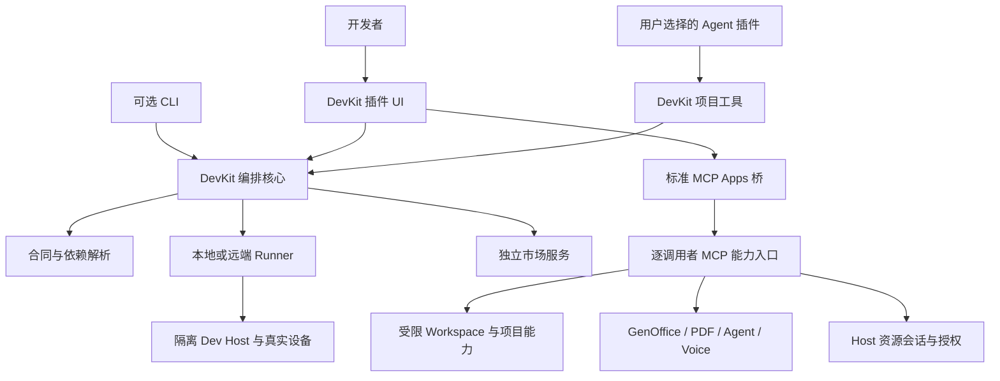
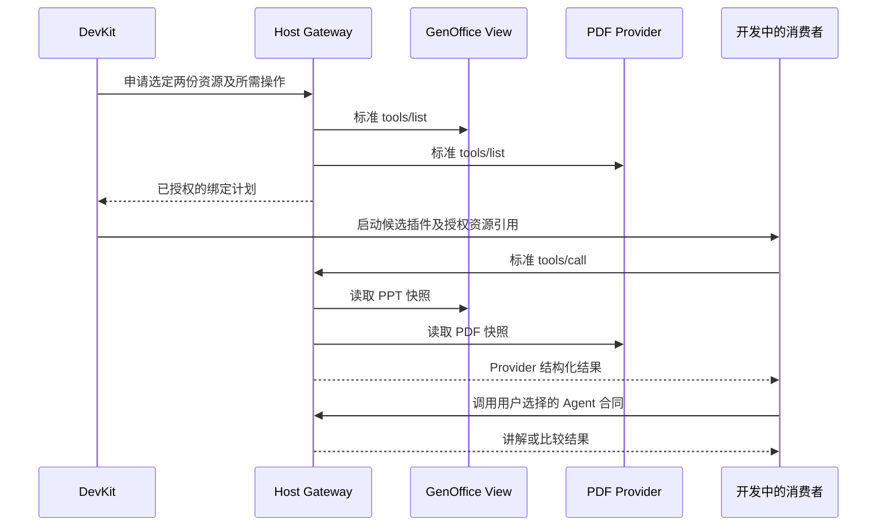

# DevKit 技术方案

## 设计基线与差距

设计基线检查日期为 2026-10-21。下表描述仓库当前实现；其余章节是待实现的目标架构。

| 现有位置 | 可复用内容 | 对 DevKit 的差距 |
| --- | --- | --- |
| `Muse-Client/packages/openmuse_plugin_sdk` | 内置 Flutter 插件与 MCP Apps 包装 | Flutter 内部 SDK 不能直接作为第三方动态插件 SDK |
| `Muse-Client/app/openmuse_host/lib/src/host/resource_agent_broker.dart` | 资源 View 工具发现与转发 | 当前活动 URI + 进程令牌，缺少逐插件身份、多资源授权与稳定绑定 |
| `Muse-Client/packages/openmuse_plugin_sdk/lib/src/mcp_app_document.dart` | 标准 UI 初始化和部分消息桥 | 尚未提供通用消费者 View 的 serverTools 路由 |
| `Muse-Client/app/openmuse_mobile/android/app/src/main/kotlin/io/openmuse/openmuse_mobile/OfflineWebPluginFactory.kt` | 本机审核包资源及保存桥 | 当前 native 消息处理集中于 download-file，不能宣告完整跨插件支持 |
| `plugins/genoffice-pptx/web/src/runtime.ts` | 六项实时文档工具 | 缺备注读取、公共预览、导航、完整输出 Schema 和业务合同发布 |
| `market-service` | Rust 独立 Registry/审核服务 | 缺合同目录、依赖组合认证、开发渠道与构建任务管理 |
| `compatibility/clients.json` | 客户端版本与协议的初始矩阵 | 缺精确构建摘要、Apps/Host Profile、真实能力及设备测试维度 |

PDF 公共 Provider 尚未在本轮基线中确认，需完成能力审计、许可评估和独立适配。不能将现有内置 PDF 画布直接视为公开可调用 API。Host Broker、Apps 和兼容矩阵还使用各自的版本信息，必须分别协商和验证，不能用一个客户端版本字符串代替所有协议版本。

## 组件与所有权

| 组件 | 所有者 | 责任 |
| --- | --- | --- |
| DevKit 插件 | 本仓库 `plugins/developer-kit` | UI、项目操作、依赖解析、诊断和发布编排 |
| SDK/核心/CLI | 本仓库独立 packages，后续建设 | 标准通信封装、公开配置、代码生成和共享执行核心 |
| Capability Gateway | Muse-Client Host 通用模块 | 调用者身份、发现、策略、资源绑定、透明转发 |
| Host 适配器 | 各端 Host | 文件授权、进程/任务边界、视图承载与设备生命周期 |
| Provider API | 各能力插件目录 | 业务 Schema、实现、客户端、Mock 和测试 |
| Runner | 本地受控组件或隔离工作服务 | 固定工具链、项目构建、测试、取消、资源预算 |
| Developer 服务模块 | 独立市场服务 | 合同、开发包、测试报告、提交和审核状态 |

DevKit 是普通可插拔插件。Host 不出现 `if pluginId == developer-kit` 的权限捷径；公开的项目、任务和资源服务对任何满足权限的插件都可用。DevKit 的停用不影响已发布消费者插件。

## 技术选型

| 部分 | 选择 | 适用边界 |
| --- | --- | --- |
| DevKit UI | TypeScript + React + MCP Apps | 自包含 UI，Desktop/Mobile/Web 复用；主题由 Host 上下文适配 |
| 代码编辑 | 首选 CodeMirror 6，TypeScript 诊断适配 | M0 验证维护源、许可及移动输入法后冻结；在插件页面内编辑 |
| 核心与 CLI | TypeScript 独立包，固定 Node LTS 工具链 | 核心不导入 Flutter、Host 或 Provider 实现源码；版本在 P0 锁定 |
| 合同 | JSON Schema 2020-12 + SemVer + 摘要 | 生成类型、运行校验、Mock 和文档 |
| 工具协议 | 官方 MCP/MCP Apps SDK | 原生 stdio、受控 HTTP、View postMessage；分别协商 |
| UI 构建 | 固定版本的 esbuild 等构建工具 | 使用审核依赖和锁文件；首次供应链/许可检查后冻结 |
| Desktop 执行 | 已发布 MCPB/受控 Runner | Node 服务与页面分离，DevKit 页面无任意 OS API |
| Mobile 执行 | 应用内 Web UI；构建委托已授权 Runner | 不把 QuickJS 当 Node，不要求 Wasm 才能开发 |
| 市场后端 | 沿用 Axum/Tokio/SQLx/PostgreSQL/Redis/S3 | 独立数据库、对象、凭据及部署，与 Muse-Server 平行 |
| 测试 | Schema/TCK、浏览器 harness、Dev Host、真机 | 每层独立记账，输出绑定产物摘要的报告 |

SDK 主版本、Host Profile、MCP、MCP Apps、A2UI Catalog 和操作系统支持分别锁定。具体语言库小版本与 Node LTS 补丁版由 P0 选型验证记录，不在设计文档伪造已发布工具链。

## 在现有工程运行与隔离开发

1. 平台工程师先在当前 Muse-Client 工程实现通用 Gateway、公开项目/Runner Profile 和开发通道。生产 Host 适配器可以调用内部 Dart/Swift/Kotlin 实现；这些内部对象不进入第三方合同。
2. CI 发布带这些能力的完整 Host 和隔离 Dev Host。DevKit 在正常 Host 中安装运行，缺少 Profile 时展示最低构建要求并引导更新。
3. 第三方开发者下载发行包即可。初始化、编辑和提交在 DevKit 内完成；未审核消费者代码在隔离 Dev Host/开发通道执行。
4. 自举的普通 DevKit 发行包由平台 CI 和审核流程产出。DevKit 更新自己也提交新版本，不把开发重载作为生产更新机制。

Dev Host 采用独立应用标识、数据目录和开发收据；默认使用夹具和独立登录环境。访问真实账号/资料需要明确选择，不能读取正式客户端的 token、浏览器 cookie 或数据库来省略登录。

## 跨插件能力入口

消费者 View 通过标准 Apps 消息调用其绑定的组合 MCP 入口。该入口按调用者聚合公开合同对应的 Host 和 Provider 工具，维护名称别名与路由，不让消费者直接连接其他 View、Electron IPC 或 DSH NativeGateway。

工具别名由 Gateway 确定性生成并受长度/字符约束；映射由版本化生态合同提供，SDK 隐藏具体别名。业务输入输出原样转发，由 Provider 校验；Host 仅验证调用者、工具存在性、授权资源、预算和生命周期。MCPB、Registry 的基础字段不被修改。

标准 MCP 协议没有定义整个组合依赖系统。合同索引、Provider 导出映射、依赖计划是公开生态 Profile，按独立版本发布并可由第三方实现。不能把未公开的 `_meta` 字段或客户端内部命令作为替代方案。

## 多资源会话与权限

Host 分离 UI 焦点、文档会话和能力授权。每个绑定关联调用者、Provider 实例、合同版本、资源会话及允许操作；调用者只取得不透明引用，不能以猜测 URI 获得权限。当前进程通用 Agent token 不发给 DevKit 或消费者 View。

两个文档分别授权，允许并存租约；启动比较或切换 UI 焦点不改变原绑定。会话关闭、账号切换、Provider 替换/卸载或撤权后立即失效，不将旧请求投递给同 URI 的新实例。Provider 若只支持单文档，应在解析/运行计划中明确，不能创建两个逻辑绑定却共用一个可变全局状态。

内容快照带 document revision；翻页/选区状态独立带 view revision。Provider 保证读取包含已提交但未保存的编辑；输入法尚未提交的组合文本可提示处理，不强制提交。写操作使用预期版本和幂等策略，由业务 Provider 决定。

Provider 内部事件可由适配器映射成通用资源变化。标准服务侧支持并协商资源订阅时使用订阅；Apps View 基础 Profile 不直接假定完整订阅可用，先通过合同的轻量状态工具轮询，前台 500–1000 ms、后台暂停。`ui/update-model-context` 不被当作任意插件消息总线。

网络权限按调用链检查，消费者委托给 Agent/Voice 不继承其全部能力。资源文件只在授权设备/Provider 范围内使用；云构建源码上传与云模型资料上传是独立授权。HTTP MCP 使用符合其授权规范的凭据，stdio/应用内通道采用对应的调用者隔离，不伪装成一套通用 OAuth 流程。

## 项目和任务操作

项目创建采用先规划后执行：校验命名空间、相对路径、目标目录、依赖与写权限，生成临时目录，再提交工程。已有文件使用预期摘要校验和批量事务；禁止符号链接越界、路径穿越、任意绝对路径写入和隐式覆盖。

Runner 与项目页面通过公开 MCP 任务工具/资源交互。拟定普通工具包括创建构建任务、读取状态和取消；名称与任务字段是公开业务合同，不是 MCP 保留方法。标准请求取消只取消请求本身，持久构建或播放任务需调用对应业务停止工具并等待回执。

本地 Runner 在受控环境挂载授权项目目录，工作目录映射属于 Runner 内部实现。云 Runner 使用独立容器和临时凭据，限制 CPU/RAM/PID/时间/磁盘/网络，产出有摘要的工件；不共享开发者宿主文件系统，不在 4 GiB 生产市场机器上构建。

## 多端与开发通道

| 模式 | 运行位置 | 限制 |
| --- | --- | --- |
| Desktop DevKit | 正常 Host 的插件 View + 受限 Runner | 未审核消费者在开发通道；Provider 使用发行包 |
| Android DevKit | App 内 UI、资源桥、可选远端构建 | 本机无 Node；绑定和权限原生桥须完成 TCK |
| Web DevKit | 隔离 iframe + 用户选定的构建服务 | 本地目录能力受浏览器限制，不能视为 Desktop 等价 |
| 手机离线 | 已有工程、缓存合同、预构建模板与 Mock | 不承诺离线 TypeScript/Flutter 完整编译或首次依赖下载 |

调试连接使用短期配对、设备确认及范围受限凭据；QR 中不包含账号 token。调试网络仅在开发通道启用，不扩大生产 CSP/Origin 限制。热更新构建结果仍验来源、摘要及开发会话授权；跨项目/用户不可复用凭据。

## 独立市场和开发服务

继续在 `market-service` 维护元数据、审核与 API 模块，构建 Worker 单独运行。建议新增合同工件、Provider 导出、兼容声明、开发渠道、构建/测试报告及发布证据记录；全部关联不可变包摘要与 actor。

客户端公开目录仍为 MCP Registry。开发者侧增加的合同查询、构建与提交状态 API 是服务自身公开版本化 API，不宣称是 Registry 标准端点。Provider 基本信息来自审核记录及经过验证的工具合同，不直接执行待审代码来生成公共目录。

正式开发者登录采用独立 OIDC 和命名空间授权；当前静态 token/SSH 管理入口不能作为开放开发者平台上线标准。审核仍由独立 reviewer 身份执行。控制台扩展沿用当前 taste-skill 约束及现有 Askama UI；不在本轮创建新的后台界面。

## 性能和诊断

正文按资源会话读取并缓存，预览按页、尺寸和 revision 缓存。讲解插件复用 GenOffice 的真实画布导出，PDF Provider 自己负责 PDF 页面；Host 不再解析同一文件。大对象通过标准资源引用和受控资源读取交付，超预算明确拒绝，不通过私有分块命令绕过标准预算。

每次操作使用诊断关联 ID，记录开始/结束、步骤、字节、耗时、调用者和 Provider 的公开身份，默认不记录原文、认证信息或用户路径。日志、构建、设备证据可以导出，但先执行敏感信息清理。

## 规范与实现参考

- [MCP 工具](https://modelcontextprotocol.io/specification/2025-11-25/server/tools)：公开工具及 JSON Schema。
- [MCP 资源](https://modelcontextprotocol.io/specification/2025-11-25/server/resources)：资源读取与可协商订阅。
- [MCP Apps](https://apps.extensions.modelcontextprotocol.io/api/documents/overview.html)：隔离 View 和 Host 通信。
- [MCPB Manifest](https://github.com/modelcontextprotocol/mcpb/blob/main/MANIFEST.md)：Desktop 包结构；多端静态站点属于另行公开的生态交付 Profile。
- [MCP 授权](https://modelcontextprotocol.io/specification/2025-11-25/basic/authorization)：HTTP 授权与其他通道的区别。
- [CodeMirror 上游入口](https://github.com/codemirror/dev)：编辑组件的上游及维护源迁移信息；具体发行包在 M0 冻结。
- [既有资源 Agent 设计](../../../../Muse-Client/docs/design/resource-agent/RESOURCE-AGENT.zh-CN.md) 位于平行客户端仓库。
