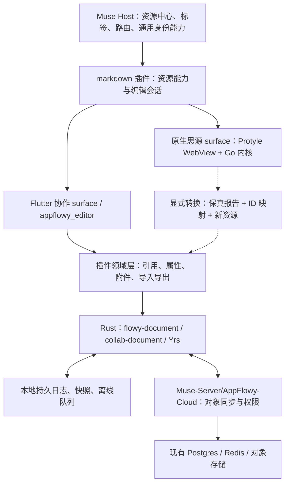

# 协作块编辑器架构与数据方案

> 范围更新：用户已将目标明确为面向 Agent、异构元素同屏、Office 扩展与 Mobile/Web/Desktop 的智能文档平台。最新决议见 [智能文档架构](../smart-document/README.zh-CN.md)。本文件保留前一轮受限编辑器融合评估；其中 AppFlowy Document 作为永久公共模型的建议与 12–18 周排期不适用于新目标，依赖/源码事实仍可参考。

日期：2026-11-04。本文均为拟实施设计；现有实现范围见[证据清单](EVIDENCE.zh-CN.md)。选型结论见[评估](README.zh-CN.md)。

## 1. 推荐架构和模块边界



同一资源由能力协商选择一个可写引擎。虚线是用户发起的转换，不是后台双写。Host 不解析 `.sy`、CRDT 或思源 API，不增加按插件 ID 判断的格式分支。文档编辑、引用、转换、协作状态展示归插件；路由、标签、资源身份及通用授权入口归 Host。

建议模块目录（拟新增，不代表已有包）：

```text
flutter_editor/          # appflowy_editor surface、块插件、工具栏、输入/选区
collab_core/             # 抽离的 Rust 文档和同步核心，固定版本
document_domain/         # 块引用、权限感知嵌入、附件和索引接口
format_bridge/          # .sy/.sydoc/Markdown 导入导出、未知节点与损失报告
contracts/              # 插件内编辑会话、能力声明、schema/version 合同
tests/collaboration/    # 跨语言 fixture、离线收敛、迁移与设备验收
```

现有 `flutter_runtime/`、`web/`、`native/` 与构建脚本保留为思源兼容实现。新代码在插件目录或公开共享包内；vendor 固定源码加可复现补丁，不在 vendor 上进行不可追踪的大范围手改。

## 2. 协作核心的抽离策略

第一步保留现有 Flutter `TransactionAdapter -> DocumentService -> dispatch/protobuf -> flowy-document` 纵向链路，只替换其外层依赖注入和资源入口，不同时重写全部 FFI。把 WorkspaceId、用户身份、device/session、文件服务、连接状态改为插件所需接口，避免引用整个 AppFlowy 应用容器。

第二步在集成稳定后再压缩 FFI 合同。拟提供如下插件内部接口，具体异步错误类型由 PoC 冻结：

```text
open(resourceIdentity, workspaceId, objectId, mode, capability)
apply(localTransactionId, expectedSchema, blockActions, textDeltas)
observeChanges(afterRevision) -> document / awareness / permission events
flushLocal() -> localDurableRevision
requestSync() -> pending / serverAccepted / durableCheckpoint
createCheckpoint() -> version, epoch, contentHash, attachmentManifest
close() -> retainedOfflineWork | closed
```

`capability` 的签发与校验复用已有会话体系，不假定 SDK 已提供名为这些方法的 API。若需要通用 SDK 扩展，应在正式实现阶段登记合同。现有 `TransactionAdapter` 对 text 和 block actions 分步调用，抽离时需验证中途失败、崩溃及批处理的一致性，不能声称其天然构成单个原子提交。

UI 事件进入本地 CRDT、持久化完成后显示“已保存到本机”；服务端接收与耐久化检查点分别记录。若所选 Cloud 协议只确认收到/广播，不能将其解释成已进入 Postgres/对象存储；需要检查点读取或服务端补充明确的 durable ACK。

## 3. 唯一真源和模型约束

推荐以 **AppFlowy Document CRDT** 为协作资源的权威内容。Flutter node 树、检索索引、Markdown 导出、思源 AST 结果均是投影。不要将 `.sy` JSON 或 BlockDOM 作为单个 LWW 字符串塞进块属性后称为“思源实时协作”。

本地 Web 类型可看到 Document 的 `blocks/page_id/meta`、`children_map` 与 `text_map: Y.Text`。Flutter 通过 Rust `collab-document` 而非 TypeScript 类型直接操作该模型；最终根键、字段类型、inline 属性编码由固定版本 Rust fixture 冻结。

| 领域对象 | 推荐表达 | 并发和兼容要求 |
| --- | --- | --- |
| 文档 | workspace + objectId + schemaVersion + epoch | UUID/ID 格式按 Cloud 固定合同；schema 与恢复 epoch 不混用 |
| 块 | 稳定 blockId、type、parent/children、data、external text | 移动不换 ID；禁止生成循环/重复归属 |
| 正文 | Collab 原生富文本，字符增删/属性增量 | 不按每次输入重建全文；冻结 UTF-16/码点等 offset 约定 |
| 块引用 | target resource/object + blockId + 显示模式 | 存结构化目标；反链为派生索引；权限决定可见文本 |
| 嵌入 | 引用目标 + 视图配置 | 首期只读、有限深度；拒绝递归循环；不复制目标内容作为真源 |
| 属性 | 受支持的有类型字段 + 命名空间化扩展 | 能否在现有 block data 中细粒度修改须 PoC；JSON 字符串整体更新会有覆盖风险 |
| 不支持节点 | opaque 原始载荷 + 来源/schema/校验值 + 只读占位 | 原文保留；对该节点不允许无损编辑声明 |
| 附件 | 内容标识/哈希、mime、大小、对象引用 | 不将大二进制内嵌 CRDT；对象授权独立校验 |

首期优先沿用原生 schema 的现有键与块类型，自定义类型集中在插件命名空间。不把未知数据强行塞进通用文本字段。服务端 `validate_require_data`、Document 解析、全文索引、快照、发布、导出都需验证扩展块处理；能存储二进制不等于整个 Cloud 生态理解此块。

若需要细粒度属性或新结构，先证明现有 schema 能无损承载，再选择兼容扩展或版本化 schema。不得未经评审新增随意的 CollabType 枚举值；自定义类型涉及服务端校验、客户端路由、索引与迁移，不是纯前端改动。

## 4. 协作算法以外的业务冲突

CRDT 保证其支持操作的合并，不自动保证块树、跨文档关系与数据库约束。实现必须复用既有核心规则并补齐以下合同：

* 同块双人输入用文本增量合并；禁止最后提交的整块字符串覆盖前一人的文本。
* 同块被移到两个父节点、节点同时被删与改、父子并发移动时，定义确定性胜者或修复器。修复结果不能依赖客户端遍历顺序；测试最终仅有一个有效父节点、无环、未删除可达内容不丢失。
* 拆块/合块必须包含身份、文本区间和引用重定向策略。首期限制跨文档并发移动；采用复制再确认删除的显式任务，记录幂等键与补偿状态，不宣称跨对象 CRDT 事务原子。
* 删除与修改冲突时，对用户有意义而未进入可见树的内容需提供恢复副本/历史入口，不能以所有客户端都收敛为空作为数据正确性的证据。
* 撤销只针对本地作者操作及指定 origin；协作远端更新不能进入本地普通撤销栈。删除/移动等语义操作需专项验证，不能只验证字符撤销。
* 评论锚点与远端光标使用 relative position 或对应 Yrs 能力；块被删后显示失效/折叠锚点。不能只存 DOM offset 或整段绝对字符偏移。

Yjs 官方分别说明了[更新合并和状态向量](https://docs.yjs.dev/api/document-updates)、[按 origin 范围撤销](https://docs.yjs.dev/api/undo-manager)和[相对位置](https://docs.yjs.dev/api/relative-positions)。这些说明支持机制选择；实际 Rust API、编码与跨版本行为仍须以固定依赖验证。

## 5. 连接、离线和版本恢复

1. 通过现有身份体系获取 Cloud 会话，解析 resource 与 workspace/object 的受权绑定。不能根据“用户知道 objectId”授予读取。
2. 从本地 durable snapshot + update log 打开文档，先恢复可编辑状态；每个设备/实例使用正确持久化的 CRDT 身份，避免复制 client ID/clock 产生冲突。
3. 使用与当前 Cloud 匹配的 Rust client-api 连接路由。Cloud 同时支持旧 v1 和 workspace v2；首期只冻结一条 Flutter 主链路。Web 互通作为独立门槛，不能混用 protobuf 与 bincode envelope。
4. 按协议交换状态向量/缺失更新，区分 CRDT update 编码版本、外层消息版本与业务 schemaVersion。对重复/乱序/丢包/重连反复施压，持久队列有幂等恢复和容量上限。
5. 每次本地修改先进入持久日志。进程退出、移动端后台挂起不依赖最后一次异步网络 flush；恢复时继续同步未确认修改。awareness 仅短期在线状态，不是正文备份。
6. 服务端权限变化立即禁用新的编辑与发送；再次授权才能重传。离线编辑本身不能保证上传时仍有权限，拒绝后保留用户可恢复的私有草稿，遵守产品的缓存访问政策，不自动写回受限对象。
7. 用户恢复历史版本时创建新 epoch/明确恢复操作，旧离线客户端不能把恢复前的队列静默合回。保留旧草稿并提示处理，不直接删除未同步内容。服务端若没有 epoch 防护，需要在现有 Cloud 中补充。

v1/v2 互通、Yrs 0.21.3/0.23.5 与 Yjs 14 的兼容均为待测事项。优先选择与 Cloud 固定 Collab rev 一致的 Rust 依赖；升级 Flutter 核心或降/升 Web 依赖须依据 fixture 决定，不以“都叫 lib0 v1”推断语义完全相同。

## 6. 资源 SDK 的保存与检查点

现有 `.sydoc` 的 CAS 包保存模式继续有效：隔离本地思源工作副本，flush、导出、SDK 提交。新的协作资源使用另一种能力合同，不能复用为“每端定时导出 ZIP 并覆盖同一资源版本”。

建议在已有资源中心合同上新增/适配通用 `live collaborative document` 能力（名称待冻结），关联 objectId、schema、epoch、检查点及附件 manifest。普通“保存”在协作模式表示确保本地落盘并请求同步；资源版本表示可恢复的耐久检查点。UI 明确“本机已保存 / 待同步 / 云端已确认 / 无编辑权限”，不把未上传的更改标成云端已保存。

正式 API 需要结合 Muse SDK 和 BFF 的已有会话合同设计。本次仅确认当前思源快照路径，未逐项审计 Host/SDK 全部 API；不能把上述拟议合同当成现成能力。

跨 CRDT 内容和附件没有天然原子事务。采用“附件先上传成功 -> 正文引用 -> durable checkpoint manifest”顺序，离线先使用插件私有暂存引用。断网显示待上传占位，失败可重试；GC 根据活跃文档、历史检查点和保留期做可达性判断。服务端不能仅按文件哈希推断用户访问权限。

## 7. 思源导入、导出与历史数据保护

采用分层转换，不以 Markdown 为中间真源：

```text
.sydoc/.sy.zip
  -> 既有包安全校验 + 原生格式读取
  -> 思源 AST / AV / 附件清单
  -> 格式无关转换 IR（仅转换使用，不是第三套在线真源）
  -> Collab Document + 附件对象 + source-ID 对照表
  -> 验证、损失报告、新资源发布
```

映射以 `(sourceCollectionId, sourceDocId, sourceBlockId)` 为源身份，目标为 `(workspaceId, objectId, blockId)`。同包内引用一次性重写；跨包/未导入目标保留 unresolved 引用并显示来源，不偷偷读取整个知识库。同一源再次导入依据 importJobId 决定续传还是新副本，避免重试生成重复附件与文档。

转换在新空间/暂存对象进行，验证通过才登记资源入口。保留原始归档、校验摘要、导入器版本、映射表和损失报告。失败清理暂存对象但保留源文件，严禁覆盖用户旧 userdata。

可逆性按能力分级：

* R0 原始保留：源包原样保留，供兼容入口继续使用。
* R1 语义往返：受支持的文字、层级、基础属性、附件、包内引用经过编辑、导出、重新导入仍满足明确等价规则。
* R2 部分理解：未知节点保留原始载荷，作为不可编辑占位，导出时尽量恢复原结构；周边节点编辑不能丢弃该载荷。
* R3 有损转换：如复杂 AV 公式/SQL 查询无法映射，必须逐项列出并显式同意转换，不能默认降为纯文本后声称无损。

现有思源导入器会重映射内核 ID 用于隔离，不应复用临时 remap ID 作为云协作稳定身份。导出回思源格式可产生新的原生归档；不保证原插件历史、加密、主题、查询语义和第三方扩展完整恢复。加密笔记本未解锁时不导入；协作共享涉及新的访问与密钥模型，不能默认为原端到端加密延续。

## 8. 搜索、引用和权限

引用本身不授予被引用文档的权限。受限目标的标题/摘要/反链数量、搜索片段、图谱节点、历史缩略图都需过滤；不能把客户端缓存中的明文作为授权依据。公开分享文档的嵌入只展示目标明确允许公开的内容。

索引使用 CRDT 检查点或已接受增量的投影，记录 source revision，接受短暂最终一致性。离线索引保留在用户私有空间；云搜索/反链服务端按 workspace/object ACL 筛选。大规模图谱和复杂查询在首期之外，但数据模型应保留构建这些投影的结构化引用。

## 9. 若改选 Protyle：完整成本在哪里

Protyle 路线也以 CRDT 为权威，不能维持独立 Go AST 写入与 CRDT 写入的双主结构。必须在两个实现方向中选一个：

| 方向 | 数据通路 | 适用性 |
| --- | --- | --- |
| B1 Rust 权威核心（优先试验） | Protyle 语义命令/文本 delta -> 插件桥 -> Rust CRDT -> Protyle 局部渲染；Go 为解析/查询等投影服务 | 可以与推荐路线共用文档核心；桥延迟、IME、渲染性能必须验证 |
| B2 JS Yjs 权威核心 | Protyle <-> 自建 Yjs binding -> Cloud v2；Go AST 作为受控投影 | JS 内部文本绑定更直接，但增加与 Rust 文档/版本兼容负担；不同时再开 Rust 权威副本 |

两者都不能直接套 `@slate-yjs/core`：Protyle 不是 Slate 的文档和事件模型。现有思源 `doUpdate` 接收 BlockDOM，经 Lute 解析后替换节点；只拦截此 HTTP 请求再发云端，会丢失字符级并发信息。原生 Go 更新接口、AI/SQL 写入、模板、AV、撤销等写入口必须全部经过协作命令层，或在协作模式明确禁用。

Protyle 双向绑定至少覆盖 `beforeinput/input`、composition、粘贴、拖放、块移动/拆合、富文本标记、远端局部渲染、DOM 规范化和选区映射。不能依赖 MutationObserver 全量序列化做权威操作。输入法合成期间保持本地 DOM，不粗暴重建当前块；远端 CRDT 更新仍接收，以稳定锚点在 compositionend 合并投影，不得盲用旧 DOM 覆盖新状态。

Go 内核若保留，应按 CRDT revision 重建/更新本地投影，确保崩溃可重放；投影写入标记 origin，禁止循环回传。原撤销日志要在协作模式替换或限制为协作语义，不能恢复整块旧快照覆盖其他用户修改。完整 AV、跨文档查询、全局修改功能的适配范围远大于 Protyle 本身。

因此，B 更适合原生格式保真优先、愿意长期维护 TS + Go + Rust 的团队；它不是把现有 WebView 多加一个 WS 就能得到的短期捷径。

## 10. 服务端改造范围

保留 Cloud 的身份、workspace、collab、WS、对象存储与 ACL。分三层投入：

1. 必做兼容验证：固定客户端协议与依赖、对象创建与 Document 校验、增量/全量编码、拒绝与重连、附件、离线恢复。已有合同满足时不新增服务。
2. 插件功能扩展：资源与 object 映射、检查点/epoch、附件 manifest、引用检索与 ACL 投影；优先在既有 Muse BFF/Cloud 内复用扩展点，具体路由待实现冻结。
3. 条件性 schema 改动：自定义块/属性需要索引器、发布器、导出器支持时，以兼容扩展实现。只有证明标准 Document 无法表达时才讨论新 CollabType。

本方案不依赖单独部署思源云服务，也不将 Go 内核变成第二个远端同步中心。开发和验证只使用隔离 Cloud 实例；实际现网部署状态、商业镜像替换与生产迁移需单独验收，不能由目录里的设计/测试文件推断已完成。
