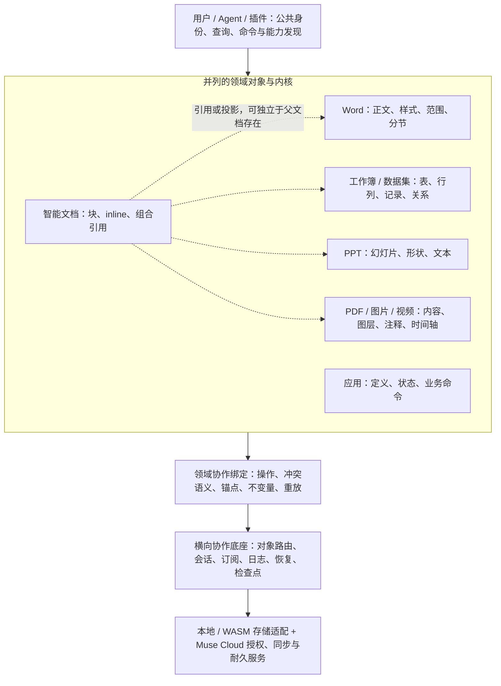

# 内容对象平台与统一协作底座：边界、粒度与领域扩展

2026-11-04，依据用户关于 Office 独立协作、非文档粒度的补充明确架构。状态：设计决议，未实现。本文对 [内容模型](CONTENT-MODEL.zh-CN.md) 的“顶层容器”表述作出澄清：平台根是内容对象图，智能文档是其中一种组合对象。不能把其他内容的存在与协作都依赖于一篇智能文档。

## 1. 结论

现有“块树 + 有类型对象 + 命令 + 按对象协作”的方向可以承载 Word、PDF、PPT、Excel、图片、视频和应用，但必须明确两项约束：

1. **统一内容平台高于智能文档。** 智能文档、Word、工作簿、数据集、媒体与应用都是可独立寻址、授权、存储和操作的领域对象。智能文档通过引用/视图组合它们。
2. **协作是所有领域共用的横向基础设施，在依赖方向上位于领域内核之下；合并规则与业务不变量由各领域纵向适配。** 不是正文编辑器的附属插件，也不是一种能自动适配任意内容的通用 CRDT 算法。

因此同时具有“水平共享”和“垂直依赖”两个维度：各领域共享协作基础设施，领域内核从设计之初提供协作操作。不要将“横向扩展”理解为每个 Office 组件以后各接一套独立同步系统，也不要将“底层统一”理解为所有领域必须换成同一种段落模型。

## 2. 平台根与智能文档的关系



协作底座也支持各领域直接进入独立编辑器：打开工作簿、打开一个数据集视图、Agent 修改记录，均不要求创建一篇智能文档。文档中的嵌入只是新增一条引用与展示配置；从嵌入进入编辑时连接原有对象的会话，不新建另一份数据。

例：一个项目数据集可以同时被智能文档中的看板、独立多维表格界面、手机表单及 Agent 引用。它们操作同一批 record IDs；删除其中一个展示块只删除引用，不默认删除数据集。对象的所有权、生命周期、历史保留和 GC 由对象策略决定，而非父 widget 的存在。

## 3. 五种边界必须分别设计

此前 `resourceId → objectId → nodeId → anchor` 是寻址说明，不能作为固定一对一的存储层级。需要区分：

| 边界 | 定义 | 例子 |
| --- | --- | --- |
| 产品资源 / 入口 | 用户看到和打开的资源、应用或视图 | 项目表、工作簿、报告；多个入口可以指向同一对象 |
| 领域实体 | 稳定业务身份，供引用/操作 | 段落、sheet、行、列、record、slide、shape、clip |
| 一致性 / 事务单元 | 保证哪些操作与不变量原子成立 | 文本和所属 marks、一个记录、工作表结构、受约束关系变更 |
| 同步 / 存储分片 | 增量传输、加载与持久化的单元 | 一份小文档、一个 story、一张工作表分区、记录分区 |
| 订阅 / 权限 / 展示范围 | 谁可读写什么、当前需要看什么 | 视口范围、字段权限、过滤视图、视频片段预览 |

这些边界可以重合，但不应被强制等同。一个工作簿可有多个同步分片；一个事务可涉及多个实体；一个订阅只读取某范围；同一实体可在多个文档中展示。对象级 ACL、字段/记录级 ACL 和视图筛选也是不同概念。

**逻辑寻址要细，物理切分要按规模与不变量决定。** 小数据集可先用一个协作对象，实体仍有稳定 ID；到规模门槛后按受验证策略拆分。不要一开始把每个字、每个单元格都变成一个网络房间，也不要一律把整个 workspace 放进一个 CRDT。

过滤视图不构成安全隔离。若同步分片包含用户无权看到的记录/字段，不能先将整片同步到客户端再隐藏；需要在授权边界拆分、通过服务端受权查询/提交或提供经过验证的局部同步协议。范围订阅不能默认由当前 Cloud 的对象订阅能力直接获得。

## 4. 各类内容如何进入平台

| 领域 | 权威语义内容 | 可操作/引用粒度 | 协作重点 |
| --- | --- | --- | --- |
| 智能文档 | 块、inline、引用、布局配置 | 块/文本范围/嵌入绑定 | 字符增量、块结构、引用和局部撤销 |
| Word | story/段落/文本、样式、分节、表格、浮动对象 | 稳定段落/文本锚点/表格单元/对象 | 富文本并发、结构与样式冲突、锚点变换；页是布局结果 |
| Excel | 工作簿、sheet、行列身份、输入/公式/格式 | sheet/逻辑单元格/区域/命名对象 | 行列结构、公式引用、批量操作、重算与冲突 |
| 多维表格 | 数据集、字段、记录、关系、视图定义 | collection/record/field/view | 记录/字段权限、并发修改、唯一性、关系与计算 |
| PPT | deck、slide、shape、层级、几何、shape 文本 | slide/shape/文本范围 | 形状增删/层序、移动缩放冲突、文字协作 |
| PDF | 版本化页面内容、页面结构及独立注释层 | 页面/注释/文本或页面对象 | 注释协作与正文编辑分合同；页面更换/增删后的锚点 |
| 图片 | 原始素材、版本化编辑参数/图层/矢量标记 | asset/layer/annotation/region | 标注、图层和非破坏编辑参数可协作；光栅笔刷需专用算法或受控写入 |
| 视频 | 媒体素材、轨道/clip、时间轴、字幕、标注、编辑参数 | track/clip/字幕段/时间范围 | 时间轴结构、裁剪、移动、参数与字幕冲突；转码/合成为任务 |
| 应用 | 版本化定义、业务数据、状态转换与绑定 | component/state entity/action | 状态转换约束、任务幂等、多人结果可观察 |

图片/视频原始二进制采用版本化对象存储、内容摘要与访问授权。多人通常同步的是编辑决策、标注、图层、字幕或时间轴；不能靠把 MP4/JPEG 放进 CRDT 字段获得有效的媒体编辑协作。需要直接修改像素/帧时，另定义分块、操作重放或专用算法，并处理冲突和最终产物版本。

视频时间范围应有明确 timebase/时间单位、clip stable ID、源素材版本与裁剪映射，避免拿屏幕像素或易变帧序当永久锚点。转码输出是来源与参数可追踪的派生产物，不是每个客户端必须共同合并的二进制流。

## 5. 横向协作底座统一哪些能力

建议公共底座统一合同与基础机制，而非强制单一合并算法：

* 对象/分片注册与定位：身份、领域类型、schema 版本、协作协议版本、恢复 epoch。
* 会话与主体：用户/Agent/插件身份、设备/实例、作用域、撤权、在线状态。
* 增量同步：订阅、状态追赶、缺失依赖、幂等与重试、背压、断网重连；具体 payload 使用协商的 engine。
* 持久化与恢复：本地 durable 日志、服务端接收与耐久语义、快照、重放与压缩。
* 版本与历史：操作来源、作者范围撤销合同、检查点、迁移与旧 epoch 拒绝。
* 可观察性：accepted/conflict/rejected/pending、关联 operationId、延迟与失败原因。
* 跨对象协调：任务状态、依赖版本与幂等恢复；要求原子性时提供额外事务/提交协议。

同时保留三类可组合策略：

| 策略 | 适合的状态 | 需要补充的领域规则 |
| --- | --- | --- |
| CRDT | 受支持的文本序列、部分 map/列表、独立标注等 | 合法树、字段值、删除与修改、结构引用等不变量 |
| 服务端序列化 / 事务提交 | 有强约束的结构操作、记录/关系变更、批量命令 | 版本/冲突处理、重放、离线草稿与重新提交；不是自动离线多写合并 |
| CAS / 租约 / 版本化替换 | 暂不支持细粒度合并的二进制、导出、早期 Office 编辑 | 冲突副本、单写者界面、权限与恢复；不能标记为完整多人编辑 |

可以先共享 Yrs/CRDT 引擎，也可以为不同领域选不同 engine；引入第二种 engine 应由明确需求推动，并承担同步、历史和恢复成本，不预先造一个过度通用的算法平台。

Yjs 的[更新机制](https://docs.yjs.dev/api/document-updates)定义的是其共享状态更新的合并与追赶；[子文档说明](https://docs.yjs.dev/api/subdocuments)明确同步仍由 provider 负责。这些机制不自动提供 Excel 公式重写、跨表事务、字段授权或 Office 布局语义。

## 6. 纵向领域绑定必须做什么

每个领域实现一个版本化协作绑定（拟议合同）：

```text
DomainCollaborationBinding
  describeSchemaAndCapabilities()
  validateCommand(actorScope, target, preconditions, command)
  lowerToCollaborativeOperations(command, authoritativeState)
  applyAcceptedOperations(operations) -> newState, invalidations
  validateInvariantsAndResolveConflicts(state, operations)
  mapAnchorsAndReferences(oldState, newState)
  createCheckpoint() / restoreCheckpoint() / migrate()
  describeUndoPolicy() / recoverDraft()
```

这不是可随意覆盖的业务钩子：算法、编码、schema 和恢复都需固定版本与跨端测试。客户端/Agent 不得绕开授权入口直接写底层 CRDT 以破坏领域约束；必须明确哪些原始更新可验证、哪些操作只能经服务端事务提交。

执行顺序上，合法命令产生权威协作操作，进入持久化/同步并驱动内核状态；内核布局、公式结果和 UI 随后失效重算。不能先在一个独立 Office 模型提交，再异步“尽量镜像”到另一个 CRDT 模型。允许有计算投影，但应能从权威操作/快照重建，不能双主写入。

### Word 的纵向适配

从稳定内容锚点进入编辑命令，经字符/格式/结构操作更新文档，再排版。不能同步第几页第几行的屏幕坐标。现有 `DocumentSession/SessionEdit` 是本地编辑基础，仍需补操作身份、持久日志、稳定锚点、协作撤销和远端重放等合同；已有绝对 CP 不能直接当并发地址。

### Excel 的纵向适配

至少覆盖 `setCellInput/insertRows/deleteColumns/moveRange/setStyle/renameSheet` 等有明确语义的命令（名称为示例）。逻辑行列应有稳定身份及次序映射；但仅有 rowId/columnId 仍不能代替相对/绝对公式引用、范围、跨表与删除规则。

例如 A 插入第 3 行，B 同时编辑原来的 A5：需要通过逻辑目标与领域规则确定 B 编辑的单元格，不可仅把坐标字符串 `A5` 作 LWW 更新；公式调整、命名范围、合并单元格、排序和填充都要一致处理。批量粘贴的原子性和并发冲突粒度也需明确。

权威状态保存输入/公式/格式与结构，计算图与值通常为可重建投影。若使用各端确定性重算，需要固定计算语义、浮点/时间/随机与外部数据规则；也可服务端权威计算结果。不能把不同客户端各算的结果互相覆盖形成循环。

### 多维表格的纵向适配

稳定 recordId 与 fieldId 是基本单位；看板/表格/日历是同一数据集的查询视图。记录筛选不是分片身份，也不授予权限。简单独立字段可按规则合并；唯一约束、关系完整性、状态机与权限变更需要事务/验证机制。

数据库记录与 Excel 单元格共享部分基础能力，但领域模型不同。前者侧重记录/字段/关系，后者还包含坐标结构与公式地址语义，不应为了“统一表格”而强行共用一种数据布局。

## 7. 对 Muse-Server/AppFlowy-Cloud 的具体定位

继续使用同一 Cloud 项目承载身份、会话、对象同步与耐久等基础能力；**不要求所有领域都伪装成 `CollabType::Document`**。首期正文可复用现有 Document/Collab，其他领域需按可用类型和合同实现 provider。

实施前应盘点：对象注册/类型校验、协议协商、服务端领域命令、授权边界、快照与索引、范围订阅、分片目录、批量事务、跨对象恢复。现有 Cloud 哪些满足就复用，哪些缺失就在同项目中扩展；不能把一个客户端自定义 type 字符串视为全链支持。

CRDT 类型若保存了强约束数据，服务端需有相应验证；需要数据库事务的命令可用受控事务路径，然后将已提交事件传播给各端。该路径必须确保状态与事件一致发布（如事务 outbox 或等价机制），避免数据库成功而同步事件丢失。事件历史不是完整数据库事务语义的替代。

高规模数据集的服务端过滤/范围订阅、细粒度 ACL 可能超出当前对象级 Cloud 合同，需要专项建设。不必为了这些能力先另起一套身份/云服务，也不能因共用 Cloud 而假定它们已经存在。

## 8. 第一阶段要冻结的公共边界

即使 Office 多人编辑后续实现，首期也应冻结：

1. 平台内容对象独立于 SmartDocument；资源入口与对象映射不是固定一对一。
2. 命令以稳定实体/锚点定位；不得把文件路径、屏幕坐标、易变数组索引写入长期 API。
3. 对象描述含领域 schema、能力、collaborationMode、分片/订阅信息和明确的授权边界。
4. 区分当前 `read-only/single-writer/multi-writer`；演进到多人协作保持身份与引用稳定，但允许受控 schema/存储迁移。
5. 同步分片、事务、权限、订阅各有合同，不用一个 objectId 偷换所有边界。
6. 父文档重开/删除/导出与子对象生命周期分离；检查点固定实际依赖版本，不默认跨对象原子快照。
7. 首期原型包含“独立工作簿/数据集入口 + 智能文档内视图 + Agent”共用同一对象，验证以后无需将所有内容迁到父文档才能协作。

以上提供未来扩展的架构空间，不能等同于已经具备完整 WPS/多维表格级协作。这里使用这些产品作为功能目标的参照，不推断它们的内部算法或数据分片实现。
