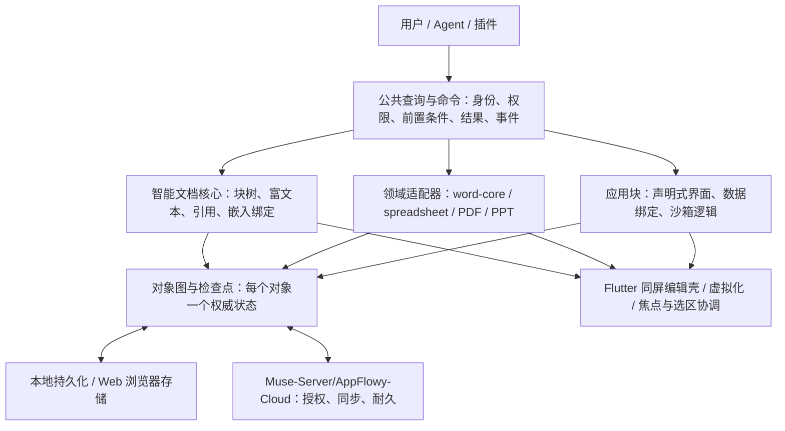

# 面向 Agent 的多端协作智能文档：架构决议

> 2026-11-05 已收敛为 [设计基线 v1：平台架构、智能文档方案、选型、产品稿、交互、开发计划与验收](v1/README.zh-CN.md)。本文件保留前期讨论；新产品范围、数据集实现选择、PDF 技术边界与任务以 v1 为准。

2026-11-04。状态：设计建议，尚未实施。本文按用户补充的产品目标更新前一轮“思源 + AppFlowy 编辑器融合”评估：首期不要求思源全功能保真，但必须为持续覆盖思源能力、异构元素同屏、Agent 操作、Mobile/Web/Desktop 和应用构建保留可实施的扩展路径。

配套：[统一内容与命令模型](CONTENT-MODEL.zh-CN.md) · [对象平台与协作底座](OBJECTS-AND-COLLABORATION.zh-CN.md) · [内核、编辑面、插件与多端运行](RUNTIME-EXTENSIONS.zh-CN.md) · [ioffice 核查、路线与验收](DELIVERY-EVIDENCE.zh-CN.md)。

## 1. 对统一内容模型的回答

**借鉴思源的块、稳定身份、引用、属性、查询投影及编辑器/内核分离；不直接将思源 `.sy` AST、Go Kernel 或 SQLite 表作为整个智能文档的永久模型。**

建议自有、版本化的 Muse 智能文档协议：

> 平台内容对象图 + 智能文档块容器 + 有类型的领域对象 + 统一命令/查询合同 + 共享协作底座与领域绑定 + 可组合编辑表面。

标题、段落、代码、公式属于原生块和 inline 内容；数据库以独立集合和视图存在；Word、Excel、PDF 等由对应 Office 内核维护内容，在父文档内以可寻址的嵌入视图呈现。它们共享身份、引用、权限、版本和命令入口，各自保留必须的领域语义。

平台顶层是独立内容对象图：SmartDocument、Word、工作簿、数据集、PPT、PDF、图片、视频和应用是并列领域。Office、媒体与数据集可独立创建/打开/协作，不依赖一篇父文档；嵌入只是对现有对象的引用或投影。协作底座横向共享，在依赖方向上位于各领域内核之下；合并与业务约束由领域绑定承担。实体、事务单元、同步分片和权限/订阅范围分别设计，不统一强制为文件或文档粒度。详见[对象平台与协作底座](OBJECTS-AND-COLLABORATION.zh-CN.md)。

“统一”应落实在跨元素可操作的公共语义上：Agent 可以定位一块、读结构、查询一个表格区域、插入一个 Office 页视图并应用结构化变更；用户在一个画面选择、浏览和激活不同元素。无需让 Excel 的公式依赖图、Word 的分节分页、PDF 的固定页面都使用段落 AST。

这样与 `ioffice/libs` 已有 Rust 文档/布局/渲染分层一致，也为思源功能逐步迁入提供稳定承载。前一轮建议中的 Flutter 与 Rust/Yrs 方向保留；**AppFlowy Document 从“永久内容模型”调整为首期可复用的存储/协作适配实现**。公开合同不暴露其私有键、protobuf、块路径或具体 Go/Rust 类型。

## 2. 五个关键问题的明确决议

| 问题 | 建议决议 | 具体边界 |
| --- | --- | --- |
| 标题/表格/公式/嵌入如何共存 | 块树组织阅读流，inline 描述段内语义，资源图组织异构对象及引用 | 块树不是 Office 内部模型；普通表格、数据库视图、电子表格区域分开定义 |
| 多种编辑能力如何协作 | Markdown、WYSIWYG、块操作都是同一内容的编辑投影；Office 与应用块委托领域 surface | 不让不同编辑器分别保存同一段正文；Markdown 源码编辑按支持范围与并发条件提交 |
| 前端与数据内核如何分离 | 前端管理输入/选区/视口；Rust 领域核心执行结构化命令、验证和本地持久；Cloud 处理共享授权、同步、耐久和服务端投影 | “数据内核”不等于只能远端运行；本地/WASM 保证离线和低延迟；服务端独立重验不信任客户端 |
| 第三方如何扩展 | 版本化 Element/Command/Surface 合同；声明式界面 + 沙箱应用 + 经版本审核的原生扩展 | 下载资源包不能任意注入 Flutter AOT widget；扩展界面不等于获得正文/文件写权 |
| 跨端如何复用 | Flutter 复用文档壳及可用编辑 surface；Rust native/WASM 复用核心；平台适配存储、输入与插件执行 | Web 是第一阶段验证平台；不能用 macOS/mobile 成功推导 Web 成功 |

## 3. 为何不直接继承思源模型

思源已经解决了许多知识管理问题，值得继承的是设计原则和能力语义。直接继承其全部内部模型，则会把几个当前局部实现变成未来平台约束：

* `.sy` AST 中的节点类型、Lute 转换和 Protyle BlockDOM 紧密关联。新元素不仅需要 renderer，还可能需要修改解析、规范化、导入导出、内核索引和事务。
* 思源 AV、`.sy`、附件、索引存在不同数据边界；单个文档 AST 并没有自动解决跨对象协作、共享权限和一致检查点。
* 现有 `update` 可把整块 BlockDOM 转树更新，不能直接当成支持离线并发的字符级操作。
* 文档内小应用需要可验证状态、计算/事件、外部动作和插件生命周期，超出 Markdown AST 的职责。
* `.sy` 内部 ID、SQLite schema 和本地路径不应成为所有端与第三方必须依赖的公开合同。

保留 `.sy` 导入导出适配器与原始载荷，使“覆盖思源能力”成为逐功能推进的兼容工程，而不是平台对思源内部结构的锁定。功能保真要分别测行为、语义和格式往返；仅保留未知 JSON 无法承诺将来一定完整编辑。

## 4. 与 Office 的组合方式

典型文档：标题 + 段落 + 普通表格 + 一个工作簿区域 + PDF 第 3 页 + Word 某语义范围的分页视图 + 一个审批应用。父文档保存这些块的布局、引用、绑定配置；子对象负责自己的内容。公共检查点记录所引用的具体子版本，保证历史重开不被最新子对象内容污染。

Word 的“一页”是布局结果，正文编辑后可能重排，应区分固定版本第 N 页与跟随语义范围的 live 视图；Excel 应优先引用稳定工作表/区域而不是“第 N 打印页”；PDF 用版本 + 稳定页面标识/页序与坐标变换。详见内容模型文档。

## 5. 技术选型

| 层 | 建议 | 原因 / 限制 |
| --- | --- | --- |
| 公共语义 | 自有 Smart Document Model 与命令协议 | 保持元素、Agent 与 Office 的长期稳定边界；版本与迁移可控 |
| 原生正文编辑 | Flutter，先评估/复用 appflowy_editor | 快速起步与多端 UI 复用；只作为编辑面，不掌握永久格式 |
| 智能文档内核 | Rust；优先复用 AppFlowy Collab/Yrs 的成熟文本/块能力 | 与 ioffice 技术方向一致；native/WASM；自有领域层在适配器之上 |
| 云基础 | 现有 Muse-Server/AppFlowy-Cloud | 继续复用对象协作、身份、存储及 ACL；新元素的 schema/索引/权限需扩展验证 |
| Office | word-core、ss-core/现有 spreadsheet 适配合同、后续 PDF/PPT provider | 尊重当前能力与各自模型；先只读嵌入再逐类增加编辑/协作 |
| 思源 | 语义/交互参考 + 兼容适配器 + 回归语料 | 不把 Go Kernel 变成全平台总内核；有需求时继续作为原生格式兼容入口 |
| 插件应用 | 受支持的声明式组件为主，沙箱 JS/WASM 扩展为辅 | 不把任意可执行插件塞进每次按键/布局路径 |

Flutter Web 与 Rust WASM 必须分别构建、绑定与缓存。Flutter 官方说明 Web 依赖有平台差异，`dart:io` 不可用，并要求 Wasm 兼容的依赖/interop；这支持“统一源码、分平台运输”的设计，不证明现有 Office 原生绑定可直接复用。[Web FAQ](https://docs.flutter.dev/platform-integration/web/faq)、[Wasm 文档](https://docs.flutter.dev/platform-integration/web/wasm)。

若 Flutter Web 关键输入、无障碍、嵌入组合或浏览器性能无法达标，保留相同语义/内核/协议，Web 替换为 DOM 编辑 surface。这个选择是 G0 结果触发的工程备选，不是预设再建一套 Web 数据内核；不建议一开始同时维护两套通用编辑 UI。

## 6. 可持续实现思源功能保真的机制

持续兼容必须从第一天留下接口和语料，而不是只写“后续补齐”：

1. 建立能力台账：稳定块 ID、动态引用、嵌入、IAL、标题折叠、AV、查询、附件、历史等分别记录语义、思源样本、命令/事件和三端测试。
2. 每类元素都有 payload schema、操作 schema、迁移、引用枚举、可访问文本提取、导入导出及未知版本策略；这些是元素合同的一部分。
3. 引入思源语义命名空间及 source ID 映射；受支持内容映射到原生模型，暂不理解的内容保留来源和只读原始载荷。
4. 不能因最初只有基础块而把未来属性都序列化成不可合并的大字符串。每个字段须明确协作策略，新 schema 在 old client 中必须可拒写或占位读取。
5. 用受支持范围内“导入 → 编辑 → 多人合并 → 导出 → 重导入”的语义差分验证逐步提升兼容等级；复杂 AV 和插件 API 各有专项。
6. 思源扩展生态的运行时/API 兼容是独立产品目标，不能从核心功能逐步补齐推导出来。

## 7. 对前一轮方案和排期的修订

前一轮的 12–18 周估算只涵盖受限 Flutter 协作编辑器与知识能力，并将浏览器完整交付及 Office 协作置于范围外；**不能用于当前完整智能文档目标**。现在 Web、Agent 命令层、可扩展模型和异构嵌入属于首期架构验证的一部分。

建议先用 3–4 周验证“正文编辑 + 一个真实 Office 嵌入 + Agent 结构化变更 + 三端协作”；之后 6–8 人团队规划 18–28 周交付明确边界的首版平台。Office 首期按能力只读嵌入，不能把 Word/Excel 多人编辑默认为 Cloud 接上后自然拥有。完整 Office 领域协作与任意应用生态是后续专项，不包含在此估算。

以上为工程估算，未经原型实测；具体门槛及代码事实见配套交付文档。本文解决架构方向，不宣称功能或兼容已经实现。
