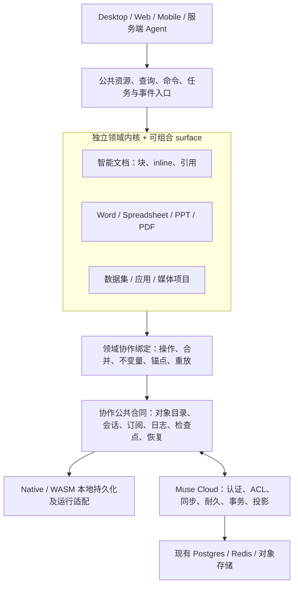
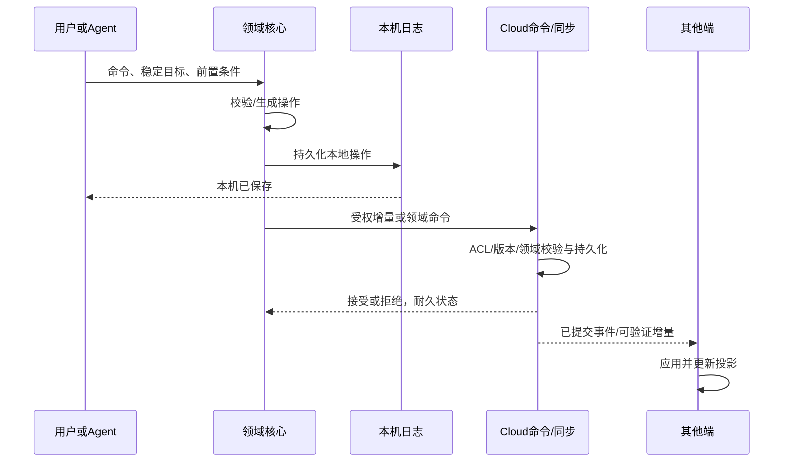

# 可扩展协作内容平台架构

2026-11-05，设计基线 v1。范围为整个内容平台；智能文档实现见 [02](02-SMART-DOCUMENT-DESIGN.zh-CN.md)。

## 1. 架构目标与约束

支持独立或组合的领域对象、用户/Agent/插件共同操作、跨端一致语义、离线与故障恢复、增量协作和可演进 schema。服务端继续基于 Muse Cloud；专业内核复用 ioffice；Host 只承担通用资源/视图/权限能力，不增加按思源或具体插件 ID 分支的业务代码。

平台合同不依赖 Flutter widget、DOM、文件路径、私有 protobuf、SQLite 表或某种 CRDT 内部键。每个领域只有一个权威写入模型；界面、索引、布局、公式结果和格式导出是版本化投影。

## 2. 分层与部署

共享底座通过接口提供能力，不要求一个庞大可执行内核包含所有领域。新智能文档核心建议 Rust；PDF 继续 C++/PDFium；领域 wrapper 统一合同及错误/生命周期。Native FFI、浏览器 WASM/Worker、Cloud 服务是不同运输实现。

v1.1 进一步按 [package/plugin 合同](09-COLLABORATION-PACKAGES.zh-CN.md)拆分：内容模型/领域核心、无 UI 的协作协议 package、共享 runtime、可装配 Cloud provider/plugin、内容领域 binding 与可选协作 UI。内容插件不绑定某个网络 provider；状态算法可作为本地核心依赖保留，在线同步停用不自动卸载算法或清理日志。

## 3. 对象模型和身份

| 概念 | 最小字段（拟议） | 约束 |
| --- | --- | --- |
| ResourceEntry | resourceRef、displayName、objectBindings | 用户入口与领域对象可多对多；关闭窗口不删除对象 |
| ContentObject | objectRef、domainType、schemaVersion、epoch、capabilities | 不强制对应单个文件或单份 CRDT |
| Entity | entityId、entityType、所属 object | 段落、record、sheet、row、shape、clip 等稳定业务身份 |
| Relation | source、target、kind、selector、binding | 引用/依赖/包含分开；关系不授予目标访问权 |
| SyncPartition | partitionRef、encoding、schema/epoch、routingVersion | 同步/持久分片；可与对象一对多，不等于权限范围 |
| CheckpointManifest | parent/依赖版本集合、schema、附件、完整性状态 | 默认是指定版本集合；需额外协议才能宣称全局因果一致快照 |

目录映射对象到其分片和领域 provider。首版小对象可用一分片，保留稳定实体 ID；拆分时通过目录版本和迁移屏障重定向客户端。不可原地修改路由后继续接收旧 epoch 的离线写入。

引用对象可同时有独立编辑器、多个嵌入、一个表单和 Agent。删除一处引用与删除对象是两个命令；对象回收检查引用、历史保留、所有权和权限。附件哈希只用于完整性和去重，不能作为访问授权。

## 4. 粒度决议

| 边界 | 设计依据 | 示例 |
| --- | --- | --- |
| 实体 | 业务定位与引用稳定性 | 单元格、记录、shape |
| 事务 | 原子业务约束 | 批量更新、关系完整性、结构变更 |
| 同步分片 | 加载、网络、存储、并发热点 | 一个小文档、sheet 分区、记录分区 |
| 订阅 | 当前需要的受权数据 | 视口、record 查询、对象事件 |
| 权限 | 服务端可验证的可见/可写边界 | 对象、未来记录/字段权限 |

细粒度寻址不要求每实体一个 WS 房间。过滤视图不构成权限隔离；若一个 CRDT 分片包含无权数据，禁止整片下发再前端隐藏。首版采用对象级 ACL，后续记录/字段权限必须配合受控查询/提交或授权分片设计，不能只扩充 UI 配置。

## 5. 协作公共合同

拟议 `muse.collaboration/1` 能力包括：对象/分片描述、会话与撤权、订阅和追赶、幂等重试、持久状态、检查点、迁移/恢复、事件与统计。该名称尚未公开发布，不能伪称现有 SDK 方法。

领域绑定负责 `validateCommand → lowerOperations → apply → validateInvariants → invalidations`，并定义 anchor、undo、迁移及冲突。共同底座负责可靠交付和恢复，领域操作决定实际数据语义。

| 策略 | 用途 | 限制 |
| --- | --- | --- |
| CRDT | 正文字符/marks、经验证的结构与独立标注 | 不自动保证合法树、公式引用、唯一性和跨分片原子性 |
| 服务端事务/序列化命令 | 强约束数据集操作、关系、未来 Office 结构批量操作 | 离线只能排队/草稿，提交需重验；不能承诺离线多写自然合并 |
| CAS/版本化替换/租约 | 二进制与尚未适配多人操作的专业内核 | 必须显示只读/单写者，不标记为完整多人编辑 |

首版正文优先复用 Yrs/Collab；首版小数据集采用服务端命令事务与事件投影，以简化校验和未来约束演进，不并行再维护 AppFlowy database 第二份权威记录。新建数据库适配器是实现可替换点，公共 collection 合同保持稳定。

## 6. 提交、耐久与收敛

CRDT 更新的服务端入口与业务命令入口不能成为绕过校验的两条写入路径。若复用的 Cloud 入口不能验证新增不变量，必须补校验或限制该类操作进入受控命令路径。对于受限数据集，SQL 状态与事件 outbox 在同一事务提交，随后异步发布；重复发布按 operationId 去重。

服务端“收到”“接受”“广播”“耐久检查点”要分别定义。只有协议能证明耐久时才能显示云端已保存；未提供 durable ACK 的既有通道需通过检查点确认或补合同。重放、重试不重复业务副作用。

## 7. 各领域纵向扩展

| 领域 | 首期边界 | 完整协作前置工作 |
| --- | --- | --- |
| 智能文档 | 字符/基础块多人写入 | 稳定锚点、树冲突、局部撤销、迁移 |
| Word | 独立对象 + 固定版本页/范围视图 | 将 CP 操作映射稳定锚点，正文/样式/结构操作与重放，保存与历史 |
| Excel | 独立工作簿 + 可用区域预览 | 行列稳定 ID、公式相对/绝对引用、范围变化、批量事务、计算语义 |
| 数据集 | 基础记录/字段、表格与看板、服务端事务 | 大规模分片、关系/公式、记录字段权限、离线变更冲突 |
| PPT | 类型与 selector 预留 | slide/shape 身份、几何/层序/文本操作与冲突 |
| PDF | 固定版本页面；产品会话按实际能力提供文本/渲染 | 注释独立协作；正文编辑、改页与签名等领域规则另行验证 |
| 图片/视频 | 素材与展示；共享块配置 | 图层/标注/clip/字幕/时间轴；像素/帧操作与派生产物专项 |

Word 页不是稳定内容实体；Excel A1 字符串不是完整并发身份；视频时长/时间范围带 timebase 与素材版本。Office 底层二进制不进入正文 CRDT。媒体渲染/转码结果带来源和参数版本，避免重复执行与过期结果覆盖。

## 8. Cloud 模块与存储设计

继续使用当前项目，不假定所有能力已存在：

| 模块 | 复用/新增判断 | 拟议持久实体 |
| --- | --- | --- |
| 身份/workspace/对象 ACL | 复用并验证；新增命令 scope | 现有账号与授权绑定 |
| 对象目录/provider | 在现有资源对象映射上扩展 | object_descriptor、partition_map、relation（逻辑名） |
| 正文同步 | 复用 Cloud Collab/WS；固定协议与版本 | 现有 collab 存储，扩展 schema/epoch 合同 |
| 数据集命令 | 新建受控服务模块 | collection、field、record、revision、outbox |
| Agent 作业 | 复用可用作业基础并补文档语义 | operation_receipt、job、provenance、event_cursor |
| 检查点/附件 | 复用对象存储并加引用 manifest | checkpoint_manifest、asset_ref、import_job |
| 搜索/反链 | 复用现有可用索引路径并加领域投影 | revision 标记、受权查询；索引可重建 |

以上是逻辑表/模块设计，不是可直接在现网执行的 migration。实现需检查命名冲突、租户隔离、锁/唯一键、回填、回滚和保留策略。日志/Redis 不单独承担长期唯一耐久来源。

## 9. 离线、恢复与升级

正文先本地持久再同步；队列记录对象、schema/epoch、操作 ID 与必要依赖。token 刷新不改变操作身份。撤权后停止上传并保留受政策约束的私有草稿；不能向旧对象静默重放。在线权限提示不替代服务端每次提交校验。

首版数据集与业务动作在线提交；离线可读已缓存受权快照，待提交表单保持私有草稿。应用界面明确数据来源时间与未提交状态。其他领域以后可增加各自离线策略。

恢复历史正文产生新 epoch 或具有等效旧队列隔离的恢复协议；恢复任务保存旧未同步草稿。跨对象检查点通过 manifest 指定版本，强一致快照另建设依赖屏障。插件/schema 升级在兼容性检查与可恢复检查点后进行，旧客户端拒写未知版本。

## 10. 宿主与现有 SDK 的衔接

复用 Host 的 resource handler/creator/context、窗口路由与能力协商。`ResourceEditorSession` 现有字节 CAS 继续服务归档/文件；live 文档通过新增 profile 关联其对象会话和检查点，禁止定时 ZIP 覆盖协作内容。

`muse_resource_contract` 已有 resource descriptor、engine adapter manifest、presentation/anchor 等合同，新增模型先与其映射；严格解析的旧协议不直接塞未知字段或扩大 placement 枚举。新能力采用版本化 profile 或明确新版本。其声明类型存在不等于具备 native/WASM 多端实现。

## 11. 隔离与运维

对象引用、全文片段、反链数量、Office 预览、检查点及附件都经过同一访问裁决；失权目标只显示受限占位。Agent 身份从认证会话绑定，不能由 payload 自报。

记录 operationId/jobId/objectRef/partitionRef、来源版本、提交结果和耐久阶段，不记录全文、token 或模型内部推理。监控同步延迟、队列积压、重复事件、恢复失败、schema 拒写和索引滞后。Cloud fork 维护人负责版本锁、安全升级和故障恢复；生产变更与迁移另经上线流程。
