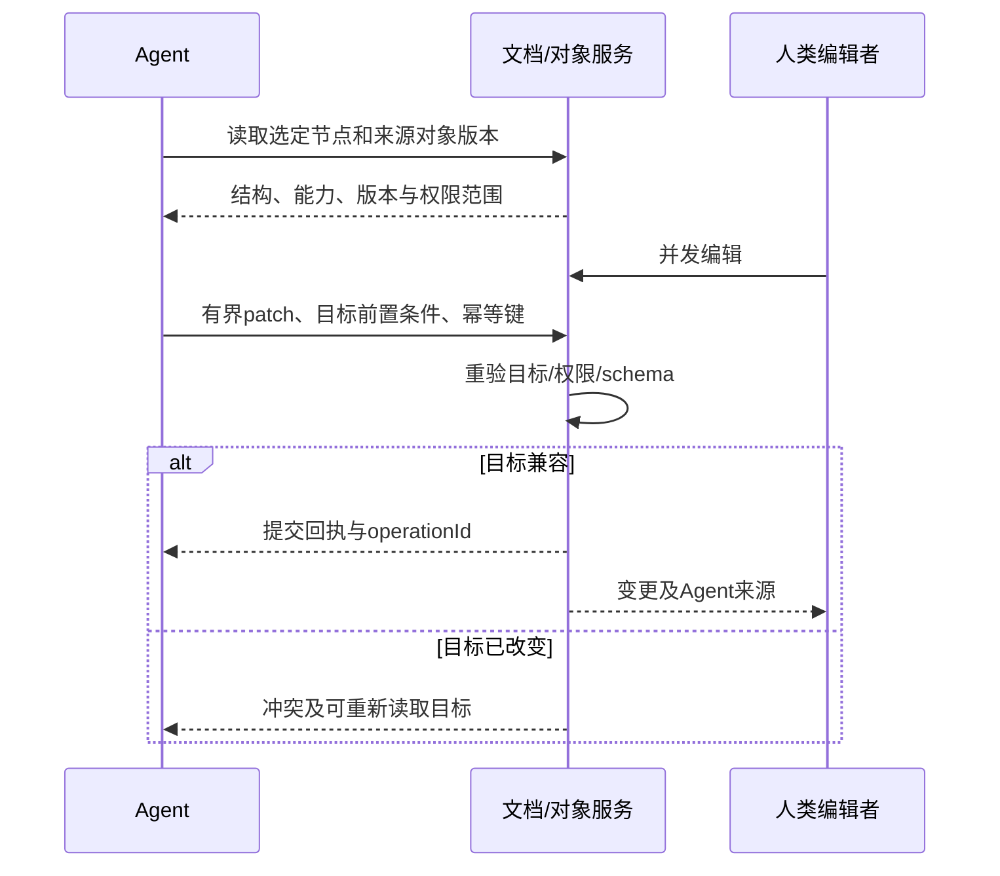

# 智能文档详细架构与方案

> 产品输入已冻结为 [SD-BL-1.2-20261105](13-FROZEN-BASELINE.zh-CN.md)。详细工程设计以 [14](14-ENGINEERING-DESIGN.zh-CN.md) 为最新补充；本文保留总体方案。

2026-11-05，设计基线 v1。本文描述新产品，现有 Protyle/Go 思源插件仍保持原生格式兼容路径。类型、目录和接口为拟议设计，尚未实现。

## 1. 系统上下文与模块

智能文档是平台原生组合对象。它管理块、inline、原生表格、引用、评论锚点、外部对象视图和应用实例绑定；工作簿、PDF、数据集等独立对象通过 provider 接入。

| 模块 | 职责 | 不承担 |
| --- | --- | --- |
| smart-document-contract | schema、命令/查询/事件、错误、能力、版本 | FFI/DOM/数据库私有结构 |
| smart-document-core | 语义校验、块/inline、锚点、引用、事务与失效 | 主题、窗口、平台文件路径 |
| smart-document-collab | 核心到 AppFlowy Collab/Yrs 的绑定、undo、重放 | 第二份独立正文模型 |
| smart-document-surface | Flutter 输入、选区、格式工具、虚拟化、可访问语义 | 直接修改持久存储 |
| surface-coordinator | 子编辑面生命周期、焦点/滚动/坐标/快捷键仲裁 | 复制 Office 文档状态 |
| object-provider adapters | Office/数据集/媒体的能力、selector、投影与命令 | 将缺失能力伪装可用 |
| document-agent-service | 有范围的结构读取、命令、作业、来源、事件 | 逐键 UI 模拟或无限对象权限 |
| format-bridge | Markdown/思源转换、损失报告、原始载荷保留 | 后台双向同步两个权威格式 |
| document-runtime | 本地/浏览器持久、网络、附件、受控任务 | 业务命令的第二实现 |

初期沿用 AppFlowy `TransactionAdapter/DocumentService/flowy-document` 纵向切片减少重写；对外以本产品合同包装。是否压缩 dispatch/protobuf/FFI 在 G0 后决定，不能同阶段重写所有边界。

## 2. 内容 schema

```text
SmartDocumentHeader
  objectRef, schemaVersion, epoch, title, rootId, capabilityRequirements
Block
  id, type, payloadVersion, structure, typedPayload
InlineContent
  collaborative text + marks + typed atoms + anchors
NativeTable
  stable rowId/cellId, bounded cell content, merge metadata
EmbedBinding
  targetRef, selector, live|pinned, presentation, requestedInteraction
AppInstance
  definitionRef@version, stateRef, bindings, policyRef
CommentThread
  threadId, anchor, author, messages, resolvedState
```

公共 `structure` 描述逻辑父子与顺序，具体 children_map 等由适配器实现；不能让插件自由创建第二个 parent。根内容与标题独立字段；个人展开/滚动/选择状态不写入共享正文。文档标题、共享应用配置与个人偏好分别存储。

首期原生块：paragraph、heading 1–3、list/task、quote、divider、code、math、基础 table、image、video、reference、resource-embed、collection-view、app。inline 支持加粗/斜体/下划线/删除线/高亮/代码/链接和块引用；复杂 marks/表格合并依据能力开放，不为菜单完整性伪造实现。

每类元素注册 type/version、payload/child 约束、支持命令、冲突规则、引用枚举、可访问文本、迁移、导入导出、fallback 和资源预算。未知元素保留原载荷及来源，显示只读占位；周边编辑不得删除未知字段。未知载荷包含的主动内容不自动执行。

首版复用适配器能完整表达的字段；AppFlowy 中若某属性仅以 JSON 字符串存储，就按一个受控 CAS 字段处理，不能宣称其子属性自动协作。需并发细粒度编辑的属性，先选择有明确操作的映射/版本化扩展并验证服务端链路。

## 3. 公开操作合同

拟议 profile `muse.smart-document/1` 发布查询、命令和事件能力；运输使用受支持的本地调用与 Cloud API/MCP 工具，不公开原生指针、源路径或私有 Collab 数据键。

```json
{
  "requestId": "req-01",
  "idempotencyKey": "job-42:patch-1",
  "target": {"objectRef": "doc-01", "entityId": "block-12"},
  "preconditions": {"epoch": "e3", "targetVersion": "n8"},
  "command": "document.insertBlocks",
  "arguments": {"afterId": "block-12", "blocks": [{"type": "muse/paragraph", "text": "分析结果"}]},
  "provenance": {"jobId": "job-42", "sourceVersions": ["dataset-01:v19"]}
}
```

真实 actor 来自认证会话，不能由 JSON 中自报身份获权。result 为 `committed/pending/conflict/rejected`，包含 operationId、更新版本、warning、冲突目标和可恢复草稿引用。相同幂等键+不同参数必须拒绝；相同键+相同请求返回原结果。去重至少作用于 `(授权主体, objectRef, epoch, key)`，保留期和过期语义在合同冻结时明确。

| 能力 | 首期主要操作 | 合同重点 |
| --- | --- | --- |
| inspect | describeCapabilities、getOutline、readBlocks、readRange | 分页、预算、稳定目标与版本；不默认返回全文 |
| edit | insertBlocks、editText、setMarks、deleteBlocks、moveBlocks、setProperties | 锚点与字段前置条件；结构命令原子边界明确 |
| compose | bindEmbed、updateBinding、createCollectionView、instantiateApp | 目标权限、固定/实时绑定与能力求交 |
| collaborate | subscribeChanges、getStatus、comment、resolveThread | cursor 可恢复；事件重复/乱序语义明确 |
| lifecycle | flushLocal、requestSync、checkpoint、export、close | 本地耐久与云端状态分开；文件 CAS 不替代实时同步 |
| job | submitOperation、getOperationStatus、cancelOperation | 取消未提交部分，已提交结果保留且可查询 |

统一错误类：`FORBIDDEN/READ_ONLY/UNSUPPORTED/SCHEMA_MISMATCH/EPOCH_MISMATCH/PRECONDITION_FAILED/QUOTA_EXCEEDED/DEPENDENCY_MISSING/RETRYABLE/VALIDATION_FAILED`。错误必须指出可恢复方式，不携带受限内容。

## 4. 编辑命令与并发规则

| 操作 | 目标与策略 | 明确的边界 |
| --- | --- | --- |
| 字符/marks | CRDT 文本和相对锚点 | 字体布局不影响位置；Dart UTF-16 与 Rust/Office offset 显式转换 |
| 插块/删除 | 稳定 ID 与原生 Collab 结构操作 | 同 ID 不重复创建；引用与评论转为失效或恢复状态 |
| 移动/缩进/拆合 | 原生绑定中可证明正确的结构事务 | 无环、单父、内容可达；跨对象移动首期不开放原子拖放 |
| 简单属性 | 字段策略或版本 CAS | 不静默覆盖并发修改的整体 JSON |
| Agent 替换 | 节点/范围版本或摘要前置条件 | 无关节点更新不必拒绝；目标已改不得盲重试 |
| 评论/锚点 | 稳定块 ID + 文本相对位置 | 删除后显示锚点失效，不跳到相邻错误文本 |

结构复用是 G0 的硬门槛：测试同块双移、父删子改、拆合、撤销和乱序重放。首版不自行引入未经验证的新树 CRDT；若某复杂命令在现有实现中不能维护不变量，禁用该命令或改受控在线操作，并更新功能表与排期，不以最终所有端同样损坏作为通过。

Undo 仅记录本地主体/origin 的可撤销操作；远端更新不进入普通本地撤销栈。Agent 批量变更形成有界操作组；冲突后补偿要验证现状，不能整篇恢复旧快照覆盖他人内容。大批量改写先形成 patch/proposal，可自动提交或由用户审阅，取决于已有会话授权策略。

## 5. 编辑面与多模式

Flutter appflowy_editor 是首选正文 surface；公共 schema 与 editor node 之间保持可逆且保 ID 的投影。输入法 composition 期间不粗暴重建活动输入区域，远端更新按稳定锚点合并；光标、临时标记、菜单和视口是本地状态。

Markdown 首版为输入快捷规则及导入导出；完整 Markdown 源编辑后置。若后续提供源码模式，只针对明确支持区域，带来源版本解析为结构化 diff；Office/未知元素采用保留引用语法，禁止全文重建丢 ID。

同屏采用父块虚拟化 + 子 provider 页/区域虚拟化。父 surface 管块级选择、阅读流和块移动；子 surface 激活后接管其内部选择、IME 和局部工具栏。选择从一个领域跨到另一个领域时，首版支持块级复制/链接，不承诺任意跨编辑器连续字符选区。

Coordinator 合同：`mount/updateViewport/measure/activate/suspend/resume/dispose/getSelection/semanticHitTest/contextCommands/flushLocal`。明确几何单位、缩放/裁剪、焦点归属、滚动边界、快捷键和剪贴板格式。关闭或虚拟化卸载不能以异步 dispose 代替保存屏障。

## 6. Office 与媒体 provider

| Provider | 接入基础 | 首版模式与后续 |
| --- | --- | --- |
| Word | ioffice word-core + Flutter word_render/editor | 固定版本 page 或可验证范围预览；真实 WASM 未通过时 Web 可用服务端固定快照，显式标识 |
| Spreadsheet | 现有 SpreadsheetEngine 与 GridCraft/ss-core 受控适配 | 可用固定区域预览；编辑/导出/协作按实际内核能力协商，不强制换内核 |
| PDF | 现有 C++/PDFium ProductEditBridge + Flutter surface，Web Emscripten WASM | 固定版本页/区域，提取文本及来源跳转；不另开第二个 PDF 文档作为写入真源 |
| PPT | provider 及稳定 slide/shape selector 预留 | 首版不承诺完整 PPT 编辑与协作 |
| 图片/视频 | 版本化素材对象与媒体展示 | 图片与视频播放、标题/替代文本/尺寸；不自动播放带声音，不自动执行代码 |

`ObjectView` 返回目标版本、selector 解析结果、可访问文本、intrinsicSize、坐标空间、实际能力、渲染来源和加载状态。Word 页依赖字体/纸张/内核；PDF 使用 page space；视频带 timebase。缓存键包含内容、selector、内核/字体和必要权限上下文，撤权时使未受权投影失效。

live 引用可展示受权最新版本，pinned 绑定用于可复现报告/历史。首版 Office 编辑能力为只读视图，激活可跳转到独立专业编辑器；只有该 provider 的对象会话真正支持多人写入时才显示协作编辑。删除嵌入不删除来源；“复制为独立对象”是独立命令并重新确定访问权限。

至少一个真实 Office provider 在三端通过才满足首版嵌入验收；追加类型按适配器能力逐项开放。优先 PDF 页（已有 byte/page ABI），再 Word 页和 Spreadsheet 区域。服务端渲染只用于经授权内容且标明模式，端到端加密内容不可默认送云转换。

## 7. 基础数据集与文档应用

首版 collection：稳定 collectionId/recordId/fieldId；字段限定文本、数值、日期、单选、布尔；表格/看板共享记录，表单为写入入口。无公式、跨集合关系、唯一约束 UI 或字段级权限承诺。对象级 ACL；排序筛选是视图状态，不能作为授权过滤。

数据集在 Cloud 事务中验证并写记录/revision/outbox；客户端持有只读受权快照与待提交私有草稿。提交带字段/记录前置版本，互不冲突字段可按合同重验，不能默认任意 JSON 整体覆盖。离线表单不标记已共享提交。

应用实例由 definitionRef@version + stateRef + bindings + policy 组成。首版应用样板为“项目任务表 + 看板 + 新建任务表单 + 状态统计”，使用内置声明式组件，不开放任意第三方业务代码。Agent 可读取同一数据集并执行受支持命令。

应用运行时区分持久业务状态、个人 UI 状态和外部任务结果；页面重建/历史重放不重复执行外部动作。后续沙箱 JS/WASM 通过受权代理查询/提交，不能拿 Host token、原生指针或任意文件权限。

## 8. Agent 接口与执行流程



服务端 Agent 可在用户未打开编辑器时操作明确委托的对象，不依赖当前只路由活动资源的本机 broker。读取采用分页、选择范围、结构摘要及目标 provider 的可访问文本；不能为了方便把所有嵌入全文一次性暴露。

生成流先显示私有草稿/建议，不将每个 token 变成不可管理的共享操作。每一有界提交记录作业、来源对象版本及作者；中止后已提交部分保留，未提交草稿可丢弃或保存。后台执行超时、授权到期、目标撤权和 schema 更新都能终止后续写入。

## 9. 持久化、同步和资源保存

Native：正文快照与 update log 通过固定 Collab storage 适配写入私有目录；队列/元数据/本地搜索可用 SQLite。Web：核心 WASM 独立构建，日志/快照通过浏览器存储适配，首版优先 IndexedDB；OPFS/SQLite WASM 不是开工前提。磁盘与配额失败必须显式进入保存错误状态。

正文 localSaved 在 durable append 完成后触发，服务端接受/耐久状态另行确认。附件先暂存/上传，再发布引用与 checkpoint manifest；中断时显示待上传占位，重试不重复创建目标。历史与活跃对象的可达引用决定 GC，单纯删除当前块不立即物理删媒体。

资源中心保存：live resource 指向对象描述与检查点；导出/备份为包，包包含 schema、对象版本、附件清单与完整性标记。`.sydoc` 继续使用原有思源归档会话；新格式扩展名在 G0 冻结，不能复用名称冒充原生包。退出时 flushLocal，未云确认也能在本机恢复；关闭不等于丢弃离线修改。

同步状态采用多维组合：`persistence=dirty/localDurable/error`、`sync=offline/pending/accepted/checkpointed/rejected`、`access=edit/comment/view/revoked`、`job=idle/running/conflict/failed`；UI 根据组合给出短文案，不用一个“保存成功”掩盖其他状态。

## 10. 搜索、引用与历史

正文/引用投影带 source revision，云搜索始终按 ACL 过滤；反链数量、标题与摘要也可能泄露信息，失权时只显示允许的信息。客户端离线搜索仅基于用户已缓存且政策允许访问的数据。索引落后可显示索引时间，不阻塞正文提交。

评论与引用使用相对锚点/稳定 ID；外部目标缺失、失权、删除、迁移失败分别有状态。恢复正文检查点采用新 epoch 或等效防旧队列协议，保留旧未同步草稿。跨对象历史按 manifest 重开，不能拿最新子对象覆盖旧检查点。

Commenter 不能因可发表评论而获得正文 CRDT 任意写入权。首版评论通过受控命令写独立注释对象/分片，保留目标锚点；comment/view/edit 路由分别授权。可编辑正文的原始更新入口也需执行相应身份、schema 与领域验证，不能靠前端工具栏区分权限。撤权能阻止新的读取/提交，但不能保证收回用户此前已经合法获得的离线副本；缓存处理按平台数据策略执行。

## 11. 思源兼容与持续演进

`.sy/.sydoc` 只通过显式导入创建新对象，原包与 source-ID 映射保留。受支持节点语义转换，未知 AV/查询等保留只读载荷与损失报告；不自动拆分整个知识库。导出 Markdown 明确丢失应用/Office/复杂属性；完整包保留可携带的对象快照，外部受限依赖仅标记引用。

建立能力台账：核心写作 → 引用/嵌入/IAL → AV/查询/图谱/历史 → 特殊交互/插件 API；每项绑定样本与操作序列。保留未知数据只证明可取回，不证明已达到功能保真。新元素包含 migration 与文本投影后才能进入正式格式能力表。

## 12. 当前代码与实施差距

现有资源 CAS、Word 会话、Spreadsheet 适配器、PDF ABI 和 Cloud 双 WS 路由均可作为基础，但本方案中的公共 object/profile、服务端 Agent、数据集事务模块、live 保存与检查点、统一 surface coordinator 仍需实现。工程归属和任务见 [开发计划](06-IMPLEMENTATION-PLAN.zh-CN.md)，验收见 [07](07-ACCEPTANCE.zh-CN.md)。
