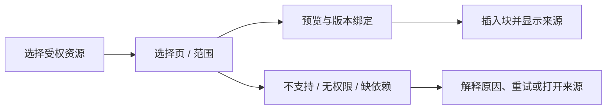

# 智能文档交互稿与页面规格

> 产品/交互冻结基线：**SD-BL-1.2-20261105**。以 [冻结记录与快照](13-FROZEN-BASELINE.zh-CN.md) 为准；技术实施见 [14](14-ENGINEERING-DESIGN.zh-CN.md)/[15](15-EXECUTION-PLAN.zh-CN.md)。

2026-11-05，v1.2。Desktop/Web 以 WPS 智能文档的功能组织和协作方式为参考，本文件是当前交互基线；指定企业页的精确几何仍待核对。来源及证据等级见 [11](11-WPS-DESKTOP-REFERENCE.zh-CN.md)，本轮可点击视觉稿及功能覆盖见 [12](12-FUNCTIONAL-ALIGNMENT.zh-CN.md)。v1.1 自定义工作区布局仅保留为历史行为试验。

本文描述最终产品行为；原型覆盖子集有明确标注，不能把模拟协作和 HTML 编辑当作生产客户端。需求沿用 SD-01–SD-17。

## 1. 信息架构

资源中心 → 智能文档；文档内部包含内容流、可选大纲、Agent/评论/历史上下文面板；外部对象可在块内预览，也可在既有工作区标签/资源页独立打开。数据集独立表格和文档内视图复用同一对象。

文档内不再启动 AppFlowy 或思源的完整工作区、账号壳和第二套文件树。文档工具栏只包含当前内容需要的操作，Host 保留导航和资源位置。

基于现有 Host 结构，Agent 使用已有工作区容器，资源 plugin 贡献当前上下文与工具；评论/历史与当前资源共享上下文区，不再额外叠一套全局 Agent 栏。Mobile 从 Home 资源中心进入资源页，编辑器不重复根层导航/新建悬浮按钮。专注与协作布局切换不改变对象身份、内核或保存路径。

## 2. Desktop / Web 主编辑页：功能区、编辑区、协作区

```text
┌────────────────────────────────────────────────────────────────────────┐
│ Host 资源标签 / Web 资源路由（平台外框）                                  │
├────────────────────────────────────────────────────────────────────────┤
│ 文档名 / 位置                                 在线成员   评论   分享    │
│ 文件   编辑   插入   格式   查看                               Agent      │
│ 撤销/重做 │ 段落样式 │ 字形/颜色 │ 列表/缩进/对齐 │ 插入 │ 评论           │
├───────────┬────────────────────────────────────┬───────────────────────┤
│ 目录      │ 文档标题                            │ 评论 / 历史 / Agent   │
│ 自动生成  │ 编辑者 · 更新时间                   │ 同时只开一个上下文区   │
│ 章节定位  │                                    │                       │
│           │ 段落、任务、代码、公式               │ 选区原文 / 讨论线程    │
│           │ 基础表格                            │ 回复 · 解决 · 重开     │
│           │ 独立数据视图、Office/媒体引用        │                       │
│           │ 段落柄    连续内容流      段落评论   │                       │
├───────────┴────────────────────────────────────┴───────────────────────┤
│ 目录开关  字数/选区统计                      保存与同步状态  缩放        │
└────────────────────────────────────────────────────────────────────────┘
```

功能区是单行菜单加紧凑常用工具；本次菜单分类/排序是 Muse 提案，不假称为指定页的实测。顶部工具、划词工具、段落柄调用同一命令；不维护三套格式逻辑。选择表格/代码/媒体/嵌入对象后，显示该领域支持的上下文操作；无能力的操作隐藏或禁用并说明原因。

连续正文为默认编辑模型，无强制 Word 分页。正式视觉实现可调整页宽、封面与布局，不改变对象或块身份。目录从正文标题投影，目录跳转不提交正文修改；表格内的标题是否进入目录由产品规则固定。正文标题可重命名；资源标题及文内标题是否绑定为同一字段必须明确，不能双写漂移。

侧栏关闭后回到原选区；从评论跳到正文保留讨论上下文。Agent 默认按需打开。Host 已有上下文容器时复用该容器，不同时叠两根 Agent 栏。窄窗口先收起目录，再将侧栏转抽屉；大表格仅局部横向滚动，不使整个页面横向滚动。

本轮视觉稿以 138px 目录、266px 侧栏、正文最大 840px 为可调基线；实际窗口可自适应。原型窄屏以面板下置降级，仅供功能评审；最终 Mobile 使用下节的专用交互。

## 3. Mobile 主编辑页

```text
┌─────────────────────────────┐
│ ‹ 项目周报       协作者  ··· │
│ 已保存到本机 · 待同步        │
├─────────────────────────────┤
│ 第18周项目周报               │
│ 本周完成……                  │
│                             │
│ 项目任务  表格 ▾             │
│ 任务A     进行中             │
│ 任务B     已完成             │
│                             │
│ PDF 第3页 · 固定版本         │
│ [页面预览 / 打开来源]        │
├─────────────────────────────┤
│ 插入   格式   评论   Agent   │
└─────────────────────────────┘
```

键盘出现时工具栏贴合键盘且正文滚动到选区；Agent/评论使用可收起面板或资源内子页，返回后恢复滚动和选区。大表格可局部横向滚动或打开独立对象；外层页面纵向滚动与子表格手势不能互相锁死。手机保留完整阅读/短编辑/评论/表单主流程，无需复制桌面 Ribbon。

## 4. 插入菜单与内容选择

插入菜单分写作、数据、材料、应用：写作提供段落/标题/列表/任务/代码/公式/表格；数据提供新数据集或引用已有数据视图；材料提供图片/视频/受支持 Office；应用提供已安装模板和声明式元素。

选择器只列有权限且 provider 可用的对象，显示来源、可用预览/编辑能力。未实现但后续可扩展的种类不占据大量无效主入口；发现文件不支持时提供具体原因及可用替代动作。

Office 选择流程：



默认固定版本引用，用户有能力时可选择实时引用；首期只读预览。插入后块头显示材料名、页/范围、绑定模式与“打开来源”。实际使用云端固定快照时在详情中明确，不能标成“本地可编辑”。

## 5. Agent 面板

面板组成：目标范围（选区/选定块/文档）、可读来源、输入区、当前作业与历史。首次进入默认当前选区，若无选区则提示范围为文档并显示摘要，不悄悄扩大到全部关联知识库。

```text
Agent
作用范围：选定的 3 个块       [调整]
参考资料：项目任务表 v19     [+]
指令：归纳本周风险并给出待办

运行中：读取材料 → 生成建议 → 校验目标
建议：新增“风险与行动”小节
来源：项目任务表 / 2026-11-05 版本
[查看改动]  [应用]  [丢弃]   或按已授权策略自动提交
```

用户既有授权允许自动提交时不强制每步审批；面板仍显示修改范围、来源及结果。生成中保留停止入口；停止后清楚说明哪些已提交。目标冲突显示受影响块和重新读取动作，禁止只给“失败重试”后盲目覆盖。

Agent 已提交内容进入普通文档流，来源可在历史查看；不以永久彩色背景干扰正文。引用内容缺失或不可读时说明影响，不虚构已读取材料。

## 6. 数据集与应用配置稿

```text
插入应用 → 项目任务
数据： (●) 新建任务表  ( ) 使用已有数据集
字段： 任务[文本]  状态[单选]  截止日期[日期]
视图： [✓]表格  [✓]看板  [✓]新建表单  [✓]状态统计
范围：沿用目标对象权限
[预览] [插入]
```

插入后页内显示应用与视图切换，数据定义/记录由独立对象持有。用户在独立表格改状态，文档看板刷新；“移除本块”只移除展示。表单提交成功后显示记录定位；离线显示“草稿未提交”，不进入共享统计。

个人筛选/排序与共享视图配置分开标记；P0 暂无字段级权限与复杂关系，编辑器不能把不支持选项渲染成可用控件。

## 7. 多人协作、评论与历史

### 7.1 在线成员与共同编辑

页头显示当前可见成员和在线数量；成员面板区分在线、离线、阅读中、正在编辑。点击位置仅滚动定位，不抢本地焦点；持续跟随必须显式开启，用户开始输入/主动滚动即退出跟随。当前原型仅模拟一次位置定位。

远端光标与选区包含名称且不只靠颜色；同一用户多个会话按会话管理并按产品规则合并头像。退出或 TTL 到期后消失，网络中断不永远显示“正在编辑”。位置来自领域锚点，不能把桌面像素坐标发给其他端。作者归属/贡献统计是持久数据投影，不以在线头像推断；复杂贡献统计列为后续增强。

### 7.2 分享与权限

入口是页头“分享”：显示工作区范围、成员及当前能力；所有者/有授权管理员才能更改成员。实际操作提交后等待服务端回执，失败保留原权限并说明原因。首版只支持已认证工作区用户，不默认创建公共匿名链接。

Editor 可修改受支持正文；Commenter 可读并讨论；Viewer 可读。客户端工具可用性、原始更新提交和服务端领域命令都遵守同一授权。评论权限不允许用 CRDT 字节通道绕过正文权限。引用不增权，来源无权不泄露标题/摘录。原型的“交互评审设置”只能用于预览身份，不作为生产权限切换。

### 7.3 评论完整流程

选区 → 浮动工具“评论”，或段落右侧评论入口 → 保留目标与摘录 → 输入/提及 → 发送 → 等待提交回执。划词评论与整块评论分别显示范围；回复沿用 threadId。打开评论输入时不要因失焦丢掉原选区。提交失败保留草稿；当前原型离线禁用发送，生产中允许私有草稿但不能标为已发布。

讨论可回复、解决并隐藏、在历史评论重开。只允许按权限修改自己的评论；所有者可执行获准的管理动作。提及候选只展示有权可发现的人，提及不会自动给其正文/材料访问权；通知按事件 ID 去重，不能在编辑评论时反复推送。

正文更新后由领域 adapter 映射锚点；找不到目标时显示“原位置已不存在”，保留摘录和讨论，允许查看或重新绑定到明确选择的新位置。锚点失效与已解决分别保存；不能把目标删除等同讨论问题已解决。原型移除块时把讨论移入已解决列表，仅为演示历史查找，生产必须保留独立的 orphaned 状态和筛选。

### 7.4 三类历史

“文件 → 历史记录”下分别进入历史版本、协作记录、历史评论；更新时间可快捷进入协作记录。三者是不同的数据源和权限能力。

* 历史版本：命名/筛选快照、只读预览、退出/比较、恢复或另存副本。原型仅含命名、原位预览和恢复；版本筛选/比较/另存是后续交互细化。
* 协作记录：按操作展示人/Agent、时间、动作和目标，点击定位仍存在的实体；目标不存在时保持记录可读。不是每次按键都作为一行审计。
* 历史评论：包含已解决及锚点失效的线程，可按权重开，不把聊天线程还原到错误位置。

恢复预览只读；恢复操作明确对象范围，创建新的恢复版本，保留恢复前正文及待处理离线草稿。实时数据集/工作簿默认不回滚；固定版本引用按依赖清单读取。跨资源恢复须单独设计事务/补偿，不能由一次“恢复文档”暗中触发。

## 8. 状态与异常规格

| 状态 | 用户文案/表现 | 可执行动作 |
| --- | --- | --- |
| 本机耐久，离线 | 已保存到本机·离线 | 继续受支持正文编辑、查看缓存 |
| 网络可用，待同步 | 已保存到本机·待同步 | 查看详情/重试，不阻断输入 |
| 云耐久已确认 | 云端已确认 | 普通编辑 |
| 本机持久化失败 | 保存失败，修改尚未安全保存 | 重试、导出可恢复草稿；不伪报成功 |
| 无编辑权 | 只读 / 可评论 | 合法阅读/评论，不显示假编辑工具 |
| 授权被撤销 | 访问已撤销 | 停止新增受限读取与提交，按政策处理私有草稿 |
| 嵌入加载失败 | 材料暂时不可用 | 重试、打开来源；其他块照常可用 |
| 目标不存在/版本不可取 | 来源已删除 / 指定版本不可用 | 查看允许的信息、更换绑定；不静默转最新版本 |
| 未识别元素/新版 schema | 此元素需要更新版本 | 保留只读内容、升级或导出原载荷 |
| Agent 前置条件冲突 | 目标内容已变化 | 查看冲突、重新读取、保留草稿 |
| 插件错误 | 此应用暂时不可用 | 重试/查看静态摘要，不卸载用户数据 |

正文已保存状态与表单/附件/Agent 任务分别显示，避免一条全局状态掩盖某类未提交操作。

## 9. 可访问性与输入验收

工具栏有语义名称/禁用原因；键盘可遍历插入、评论和 Agent；焦点顺序与阅读顺序一致。Canvas/Office 提供可用文本与导航语义，图片有替代文本，视频有可用字幕时暴露字幕，不以颜色作为唯一状态信息。

桌面验证中文/日文 IME、emoji/组合字符、跨块粘贴、快捷键与远端更新；Mobile 真机验证软键盘、触控选择、返回/后台恢复；Web 验证目标浏览器剪贴板、语义导航与存储异常。具体证据进入验收矩阵。

## 10. 功能区详细规格

| 入口 | 命令 / 行为 | 选区及状态要求 |
| --- | --- | --- |
| 文件 | 历史三入口、文档信息；备份/导出沿用 SD-16 | 资源级动作；服务端按能力重验 |
| 编辑 | 撤销/重做、查找；剪贴板按平台能力 | 撤销仅当前本地操作者、当前活动 surface，不能回滚他人的提交 |
| 格式工具 | 正文/H1–H3（H4–H6 后续）、字形、前景/高亮、列表/任务、缩进、对齐 | 选文字作用于 range，无选区作用于当前段/后续输入；按钮显示 mixed 状态 |
| 选区工具 | 常用格式、链接、评论、Agent | 只处理合法领域选区；保持 range，跟随 viewport 避免遮盖文本 |
| 插入 | 写作、表格、数据、资源/媒体、应用分类 | 顶部、`/`、段落下方插入同一目录；先检查权限/安装/平台 |
| 段落柄 | 变类型、上/下方插入、复制/移动、链接、移除 | 复制原生块产生新块 ID；引用复制仍指向同一来源，需显式“复制来源”才创建新资源 |
| 查看 | 目录、布局、主题/内容宽、上下文开关 | 个人偏好不写入共享正文；共享样式需显式设置 |
| 表格上下文 | 单元格/行/列选择、插入/删除行列、基础样式 | 表格选择模型独立于普通文本；复杂合并不在首版默认承诺 |
| 嵌入上下文 | 来源、页/范围、版本、实际编辑/只读能力 | 进入子编辑器时移交焦点/撤销所有权；Esc 先退出子层再关外层 |

上表定义生产要求；可点击稿未覆盖项以 [12 功能矩阵](12-FUNCTIONAL-ALIGNMENT.zh-CN.md) 为准。字体/字号/颜色的具体清单按三端字体可用性冻结，不允许 Web 可见而 native 静默丢失。

### 10.1 文本与块编辑状态机

```text
阅读 → 获取编辑权限 → 光标/输入中 → 本机耐久 → 同步待确认 → 云耐久确认
光标 → 文字选择 → 浮动工具 / 评论 / Agent → 领域命令 → 映射并恢复选区
光标 → / 插入候选 → 搜索/键盘选择 → 创建元素 → 定位新元素
块选择 → 段落菜单 / 拖拽 → 校验父子关系与权限 → 提交一次结构事务
```

Markdown 是输入快捷规则，WYSIWYG 是展示/交互方式，块是结构单位；三者共用同一内容真源。`#`+空格、列表/任务、引用、代码围栏等在非 IME composing 状态识别；撤销应能撤回转换，代码区不误触规则。完整 Markdown 源编辑继续按 P1 计划，不做两个编辑器分别保存不同副本。

Enter 在普通段落末尾建下段，在列表按语义续项，空列表项可退出列表；Shift+Enter 软换行；代码/公式等子编辑器按自身规则处理。跨块删除、拖拽与远端移动必须保持单父/无环与合法焦点；多列/布局容器后续扩展也遵守同一规则。

### 10.2 `/` 插入与插件能力

候选可用上下键/Enter/Esc，支持中文/别名搜索和最近常用项；不劫持 IME 候选。空段和明确允许的插入点才替换命令文本；取消不留半个元素。多阶段资源选择器保留插入锚点和草稿；异步期间原目标被删除时要求重新选择位置，不插到错误段落。

元素 descriptor 同时贡献标签、图标、分类、别名、schema、创建命令、renderer、无障碍摘要和平台能力。模板/菜单来自 registry，插件停用后已有未知载荷保留。下载中的媒体显示草稿/进度；上传失败不污染正文耐久状态。

### 10.3 焦点与多编辑器协调

surface coordinator 持有 activeSurface、selection snapshot、undo owner 和键盘作用域。父文档、表格单元格、代码编辑器、工作簿、PDF 标注分别有领域 selection adapter；不能强行转成 UTF-16 字符偏移。菜单仅暂存指向该领域位置的快照，提交时重验有效性。

子 surface 进入/退出有可见边界；Esc 先撤销当前弹层/选择/子编辑状态，之后才返回文档层。容器滚动、子内容滚动和本地选区不受远端 presence 控制；嵌入加载/卸载保留草稿和来源身份。

## 11. 评审与交付边界

本文件与 [12 的 WF-01–WF-12](12-FUNCTIONAL-ALIGNMENT.zh-CN.md) 共同构成当前交互稿；[04 PRD](04-PRODUCT-PRD.zh-CN.md) 和 [07 验收](07-ACCEPTANCE.zh-CN.md) 保持发布口径。新版源码、截图和运行检查位于 `wps-functional-review/`，旧 `visual-review/` 保留历史。

本地原型通过不等于 Flutter/native/Web 产品实现通过。真实账号、协作收敛、文件持久、真实 Office、通知、IME、剪贴板及三端设备仍需 G0 与发布验收。指定参考页的实测截图与菜单排序尚未获得，不宣告像素一致。


Mobile 最新实施输入：[产品与完整交互](21-MOBILE-PRODUCT-UX.zh-CN.md) → [视觉稿、基线与开发映射](22-MOBILE-DESIGN-REVIEW.zh-CN.md)。SD-MOB-1.3-20261105 追加归档，不改写 SD-BL-1.2 历史冻结内容。
