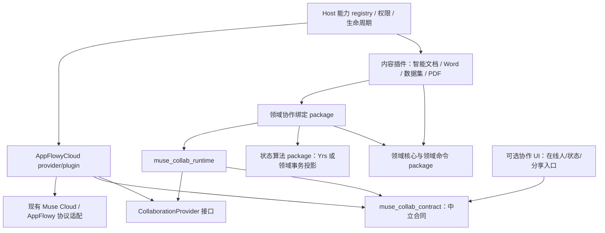

# 协作协议、运行时与内容插件解耦设计

2026-11-05，产品与交互反推的架构补充，优先于此前“共享协作底座”的粗粒度描述。本文件为设计，不表示下列包已经存在。

## 1. 决议：协议做 package，服务实现做可装配 provider/plugin

资源内容模型和协作基础能力可以分开演进。建议拆成：**资源合同、内容领域、协作协议、协作运行时、服务 provider、领域协作绑定、可选协作 UI**。

协议是无 UI、无账号、无具体内容类型的稳定 package。协作运行时是共享 package。Cloud 等连接服务通过 Host 的能力 registry 以 provider/plugin 装配。领域绑定随内容模型维护，处理结构、锚点、合并和业务约束。这样的 Everything is Plugin 同时支持“能力可发现/替换”和“不同平台按发行方式部署”。

不能把“协作 plugin”解释为一个下载 HTML 包能够热替换全部 CRDT/原生内核；也不能把协作解耦理解成任意内容只要发字节就自然具有正确多人编辑。

## 2. 从产品行为反推边界

| 产品行为 | 必须成立的架构约束 |
| --- | --- |
| 停用共享连接后仍能写已支持的本机正文 | 内容内核/本地持久不依赖在线 provider；网络断开不销毁权威状态 |
| 在文档和独立资源中看到同一任务状态 | 内容对象与数据集身份独立，surface 只订阅/操作同一对象 |
| Agent、用户、插件修改同一资源 | 共享领域命令与真实授权；协作 runtime 不另写一份业务模型 |
| PDF/工作簿可以单独打开 | 内容 plugin 不依赖 SmartDocument；嵌入只是引用和有限会话 |
| 新内容类型接入同一协作服务 | 公共协议不枚举全部正文块/Office 私有结构；领域绑定声明 engine/schema |
| 换服务或升级后旧离线修改不误写 | 对象固定 engine/encoding/schema/epoch/provider 路由；迁移有屏障 |
| Mobile/Web 没有下载任意原生插件 | 同一插件身份可由随包 native/WASM 或受控远程 provider 实现 |

## 3. 建议包图与依赖方向



图中依赖表示编译/接口方向，运行时 provider 由 registry 注入。`muse_collab_contract` 不反向 import 智能文档/Word/Flutter；运行时不 import 内容 plugin。插件与其 Rust/Dart package 是部署层与复用层的关系，不要求每个 package 都变成一个市场商品。

| 单元（建议名称） | 责任 | 禁止依赖/行为 |
| --- | --- | --- |
| 既有 muse_resource_contract/center | 身份、资源描述、引用、版本、展示和访问范围 | 不持有某个编辑器 AST |
| muse_collab_contract | 描述/能力/会话/增量/回执/追赶/错误与版本协商 | 不 import Flutter/SQL/思源 AST/Office 类型；不定义 paragraph/cell 等业务操作 |
| muse_collab_runtime | 会话状态、可靠传递、去重、背压、订阅、追赶与生命周期 | 不自行合并 Word/Excel；不保存第二份独立正文 |
| muse_collab_appflowy | 合同到当前 Cloud HTTP/WS 的映射、连接/鉴权适配 | 不把 Cloud token 给任意内容 plugin；不私建一套用户/工作区身份 |
| content_collab_binding | 领域命令到 engine 操作、合法状态、锚点、恢复/undo | 不绕过服务端真实授权；不依赖某个窗口才可运行 |
| state-engine package | 本地状态演算、编码、增量/快照与必要持久化 hook | 不把逻辑时钟等同全局业务 revision |
| muse_collab_ui | 状态/在线人/分享入口等可选贡献 | 不拥有 ACL、正文模型、同步队列真源 |

Rust 是新核心包优先语言；公共 wire/schema 可生成或手工实现 Rust/Dart/必要 TS 类型并用同一 fixture 验证。现有 C++ PDF adapter 使用相同边界，不必改为 Rust。包名、具体仓库与正式 profile ID 在 G0 冻结，避免为目录整齐先做不必要的全仓迁移。

## 4. 状态算法与协作服务必须进一步分开

内容内核需要稳定的权威状态存储；Yrs 等 CRDT 可能同时是本地数据结构。它不等于在线 Cloud 连接。建议：本地 state-engine/binding 随相应内容 plugin 的发行依赖安装，即使没有在线 provider 仍可单机运行；在线 provider 仅将受权更新可靠同步。

因此需要区分两种“停用”：

* **停用连接服务**：关闭在线同步/awareness，保留本机 durable 状态和待同步操作，支持的本机编辑继续；恢复后按固定合同追赶。
* **缺失或卸载所需状态引擎/内容内核**：不能承诺继续可编辑。Host 应保护依赖、降级只读/可恢复导出，不允许用任意另一引擎接管再覆盖。

数据集首版依赖服务端事务时，网络不可用只能读缓存/保留私有草稿。它与正文的离线能力不同，公共 runtime 用 capability 明确表达，不用一个全局“离线可编辑”布尔值误导产品。

## 5. 中立接口与最小信封

以下均为拟议接口，避免直接复制当前 Cloud API 名称作为平台公共合同：

```text
CollaborationProvider
  describeProvider() -> protocols, engines, limits, durabilityCapabilities
  openSession(objectBinding, accessContext) -> boundedSession
  subscribe(session, partitions, cursor) -> events
  exchange(session, engineProfile, causalState) -> missingUpdates
  submit(session, updateOrCommandRef, idempotencyKey) -> receipt
  requestCheckpoint(session, dependencyRefs) -> checkpointRef
  suspend(session) / close(session)

DomainBinding
  describeSchemaAndEngine() / validateAndEncode(command)
  applyAuthorizedUpdate(update) / validateInvariants()
  snapshot() / restore() / mapAnchor() / describeUndo()
```

信封建议字段：`contractVersion/objectRef/partitionRef/bindingVersion/engineProfile/encodingVersion/schemaVersion/epoch/operationId/dependencyToken/payloadDigest/payload`。内容操作留在由 profile 指定的 payload，provider 可转发不理解的业务语义，但服务端对应领域入口必须验证合法写入。合同 opaque 不等于服务端盲信字节。

`dependencyToken/causalState/cursor` 对公共层是不透明值。CRDT state vector、服务端事件 cursor、对象业务 revision 和检查点 ID 分开，不强制转成统一递增整数；跨分片没有天然全局顺序。

结果区分 `queued/received/accepted/durable/rejected/conflict`，每一项有精确定义。provider 不具备 durable ACK 时不能自行映射为 durable；产品显示本机已保存/待云确认。重试与 receipt 查询按同一 operationId/幂等域工作。

这首先是 **Host 内部跨 provider 合同**。当前 AppFlowy 旧/新 WS 封装继续由 adapter 映射，不要求先改造所有服务端网络协议或另起一套 WS。确需公开新的 wire/profile 时才版本化发布、与 Cloud 冻结双端 fixture。

## 6. 注册、发现与会话绑定

内容 plugin 声明领域 schema、支持的 engineProfile、必须/可选协作能力；provider 声明支持的 profile、平台、限制与耐久能力。Host 在安装/打开时求交并获得受限会话，不给内容 plugin blanket token。

一个对象的绑定记录至少含：providerRef、engineProfile、编码/schema/epoch、路由版本、权限主体范围。新对象可使用 workspace 默认 provider；已存在对象不会因用户切换默认设置而改 engine 或迁移服务器。

在线换 provider/engine 属于显式迁移：暂停新写或使用迁移屏障 → 收集未同步状态 → 校验检查点与目标 → 迁移/重编码 → 更新绑定/epoch → 原端只读/重定向 → 处理旧离线草稿。不同存储协议之间不能仅更改 URL 宣称完成迁移。

## 7. 权限与信任边界

Host/平台身份体系负责认证和 audience/scope；Cloud 负责对象/命令实际裁决；领域绑定负责结构和业务不变量；服务端不能把客户端验证当作授权证明。

同一 provider 中，不同 plugin/session 的对象集合、权限与队列隔离。原始 CRDT 更新入口和业务命令入口都必须纳入权限设计，Commenter 不能凭注释权写正文。新增领域 binding 的服务端实现是可信模块或经过约束验证的扩展，不从任意客户端上传的算法直接授予服务器执行权。

停用 plugin 撤销对应新调用者，不删除资源与操作日志。资源、快照、队列和恢复数据保存在账号/对象数据域，不能放在可卸载的插件安装目录。取消网络会话不等于清空未同步修改。

## 8. Everything is Plugin 的部署矩阵

| 单元 | Desktop | Mobile | Web / 服务端 |
| --- | --- | --- | --- |
| 合同 package | 共享编译依赖 | 同一语义 | 无 UI 类型/fixture 共用 |
| runtime/state engine | native library/编入宿主的能力 | 随应用发行 | WASM/Worker 或受权远程模式 |
| Cloud provider | 注册为能力 plugin，可有受控外部实现 | 内置能力 plugin + 可更新配置 | 浏览器 adapter / Cloud 服务模块 |
| 协作 UI | 插件贡献状态/菜单/面板 | 响应式贡献 | 同源消费合同 |
| 新领域绑定 | 发布源码/ABI/服务器验证后启用 | 与能力版本同发 | 独立 provider profile 验证 |

Flutter 的 package、plugin、federated 平台实现是复用/平台适配机制；这不意味着任意代码能在已编译 AOT 进程里热安装。[官方 package/plugin 文档](https://docs.flutter.dev/packages-and-plugins/developing-packages)。Yjs 的[共享更新](https://docs.yjs.dev/api/document-updates)和[子文档 provider](https://docs.yjs.dev/api/subdocuments)说明可复用同步机制，但不替代领域验证和授权。

## 9. 接入新内容模型的标准步骤

1. 内容团队定义实体/命令/事务/锚点/schema；独立资源入口与本机持久化先可运行。
2. 选择可用 state-engine 和冲突策略，实现领域 binding；声明精确能力，不能默认所有对象离线多写。
3. 使用公共 contract/runtime/provider 开会话，补服务端授权/验证/投影；不重建账号或另一套插件通信总线。
4. 运行同一协作兼容套件与领域专属并发用例，测试停用连接、未同步恢复、schema升级和provider失效。
5. 提供可组合 surface 与可访问文本/查询命令；独立编辑器与嵌入订阅同一对象。

## 10. 开工验证与架构门槛

package 依赖检查要求协议无 domain/Flutter import，runtime 无内容 plugin import；把 fake provider 换成 Cloud adapter 时内容 schema 不变。至少用智能文档与独立小数据集验证同一 contract/runtime 表达 CRDT 与事务结果，使用真实 PDF provider 验证独立对象的只读组合。

故障验收包括：服务 plugin 不可用时已支持正文继续本机持久；算法缺失时安全只读；插件停用不清日志；旧 provider 迟到事件不污染新绑定；撤权拒绝原始更新；迁移失败不丢旧草稿；事件重试不重复外部副作用。

本轮只完善产品与原型，尚不创建上述真实 package 或改动 Cloud。实施阶段先抽“合同 + Cloud adapter + 一个领域绑定”的最小闭环，再按真实复用需求拆其余包，避免提前建设空洞的通用引擎平台。

## v1.2 从编辑与协作交互进一步分层

新版 [12 功能/视觉稿](12-FUNCTIONAL-ALIGNMENT.zh-CN.md) 要求三个数据通道分别管理：

| 通道 | 数据与生命周期 | 协作 package / plugin 责任 |
| --- | --- | --- |
| 内容状态 | 正文/表格/工作簿等领域更新；本机耐久、追赶与快照 | contract/runtime 传递和回执；domain binding 校验、合并、undo 与恢复 |
| 在线感知 | 成员会话、光标、选区、正在编辑位置；临时状态、TTL | 中立 awareness 合同与 provider 通道；位置解释留在领域 adapter，不写入正文日志 |
| 讨论及记录 | 持久评论线程、回复、解决状态、提及事件；语义操作与快照索引分别投影 | annotation/activity 服务可做公共 package + provider；领域定义锚点，不将所有领域操作压成文档文本 |

`AnnotationThread` 是独立持久实体，不强制“一线程一个资源/同步文档”。可按目标对象归组、按访问与订阅边界分片；线程身份、锚点有效性、解决状态和权限分别保存。评论者能写 annotation 不代表能提交正文；服务端禁止从通用更新入口绕过该边界。评论历史不随正文快照直接回滚。

拟议锚点为 `objectRef + domainProfile + entityRef + opaquePosition + revisionContext`。SmartDocument 用块 ID/相对文本位置；Workbook 用稳定 sheet/row/column/cell 身份；PDF 用版本/页与页内选择器；Slides 用 slide/shape ID。公共包不强制把这些转为字符索引或屏幕坐标。锚点 adapter 输出 resolved/degraded/orphaned/forbidden，失效时保留线程但不错误定位。

编辑 UI 另有 `EditorCommandRegistry/SelectionSnapshot/SurfaceFocus/UndoOwner` 合同，属于内容 surface/Host 适配，不塞入网络协议。工具栏、段落柄、slash 和快捷键共用命令；公开插件贡献通过版本化 profile，仍不向现有 strict manifest 私塞未知字段。

因此“协作能力是独立插件/package”仍成立：公共身份、传输、回执、感知、讨论服务可复用；可编辑内容、合并规则、选区与历史恢复的语义由领域持有。Word/Excel 独立对象可以接入同一底座，不要求作为 SmartDocument 子块才得到协作。
