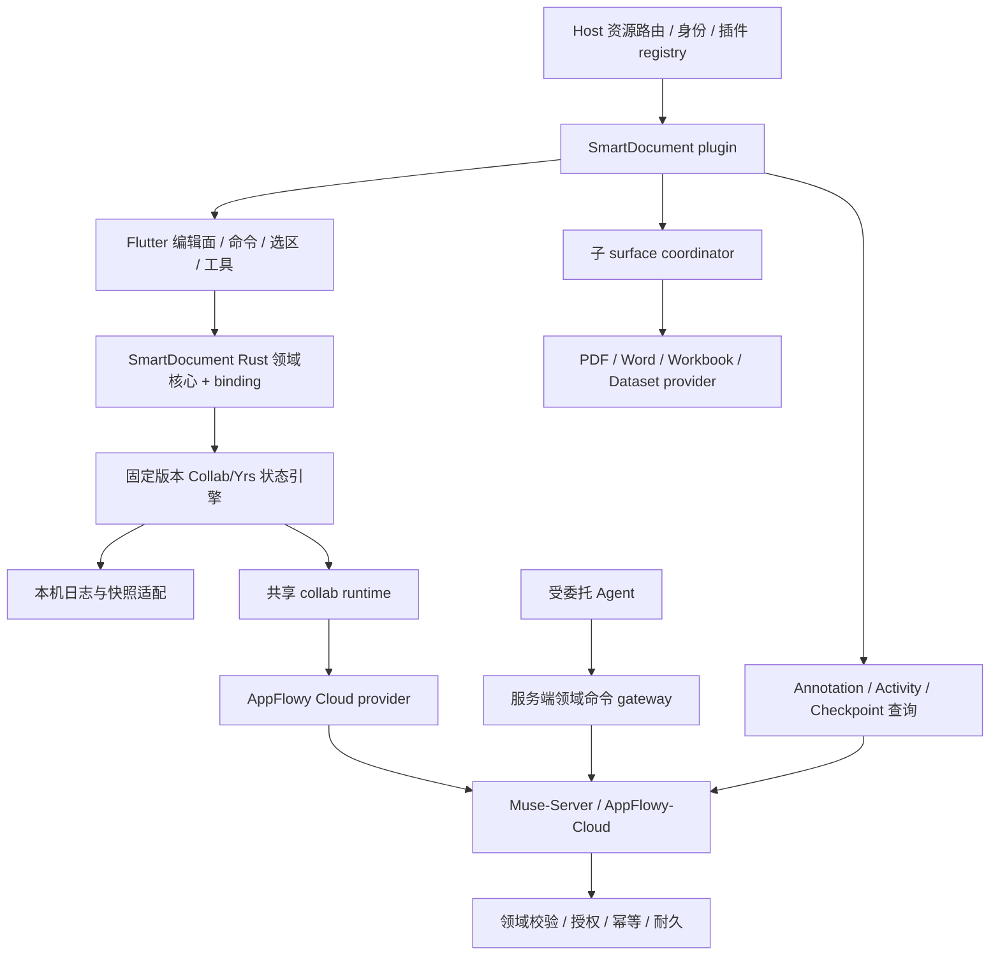

# 智能文档详细技术方案：从冻结设计到工程闭环

2026-11-05。输入基线：[SD-BL-1.2-20261105](13-FROZEN-BASELINE.zh-CN.md)。状态：**作为 SD-F1-20261105 工程输入冻结归档；本文包含完整目标设计，阶段实现以 [16](16-PHASE1-IMPLEMENTATION.zh-CN.md) / [17](17-PHASE1-ACCEPTANCE.zh-CN.md) 为准**。公开合同与全量多端版本仍待 T02/T03 后续工程门；冻结输入不等于这些门已通过。产品范围已经冻结；本文不重新定义 P0，不把拟议目录/API 当作已有实现。

## 1. 方案目标与边界

以现有资源/插件体系装配一个新的智能文档内容 plugin，复用 AppFlowy 的正文编辑与 Collab 链路，补足 Muse 领域合同、共享服务、Agent 命令和多编辑面协调。原思源 `.sy/.sydoc` 路径继续独立工作，通过显式导入/导出接入新对象。首期不将 Go Kernel 升级为平台总内核，也不把完整 AppFlowy 工作区嵌进 Host。

唯一权威原则：正文由领域状态引擎持有；Flutter editor 是可重建投影，不能再独立写一份 JSON 正文；Cloud 的日志/快照是同一对象状态的持久化，不另立“UI AST 数据库”。数据集记录以服务端事务为权威，Office 内容由原领域内核持有。



## 2. 现有代码接入点与差距

本轮只读核查以下文件；仓库 HEAD/文件摘要在冻结清单中另行记录。它们是设计依据，不证明干净构建或运行通过。

| 已有位置（相对工作区根） | 可复用能力 | 需新增/验证 |
| --- | --- | --- |
| `Muse-Client/packages/muse_resource_contract/lib/src/{resource,engine_session,presentation,wire}.dart` | 资源身份、materialization、引擎/展示合同、严格字段验证 | live object/session 独立 profile；不能直接复用文件 commit 为实时协作 |
| `Muse-Client/contracts/muse/contract-*/` | 现有 messages/schema digest fixture 组织 | 新合同采用同一固定输入/拒绝样本机制，旧 digest 不变 |
| `Muse-Client/packages/muse_engine_adapter/lib/src/adapter.dart` | probe/open/focus/close、受限 resource gateway | 新领域 adapter 和 live 会话能力，不向原接口偷偷加字段 |
| `Muse-Client/packages/muse_surface_orchestrator/lib/src/host_service.dart` | presentation 请求/状态/取消和资源路由 | 复用外层路由；文档内部子 surface 不再复制整套 Host orchestrator |
| `Muse-Client/packages/openmuse_plugin_sdk`、`Muse-Client/plugins/siyuan-client` | 公开 plugin/editor/context/flush 贡献及现有装配方式 | 新 smart-document plugin；保留旧思源 handler，不能在 Host 写内容类型分支 |
| `Muse-Plugin-Ecosystem/plugins/markdown/flutter_runtime` | 当前思源 Go + WebView 原生兼容运行时 | 不误当成 Flutter 正文编辑器；新内容代码放独立目录 |
| `.../vendors/appflowy/client/frontend/appflowy_flutter/lib/plugins/document/application/{editor_transaction_adapter,document_service}.dart` | editor transaction 到后端 actions 的现有链路 | 逐项保 ID/原子性/错误回传检查；抽为薄适配，不盲目照搬整应用依赖 |
| `.../vendors/appflowy/client/frontend/rust-lib/{flowy-document,collab-integrate}` | 原生正文与协作基础 | 可复现依赖、native/WASM、领域操作和存储 hook |
| `Muse-Server/AppFlowy-Cloud/src/api/{workspace,ws}.rs` | 对象路由、现有 `/ws/v1`、`/ws/v2/{workspace_id}` | 新对象路由/权限/验证/回执/命令；旧对象不自动换协议 |
| `ioffice/libs/{word-core,ss-core}`、`ioffice/koffice/pdf/rebuild/pdf-rebuild/src/ksp/product/ProductEditBridge.{h,cpp}` | 各领域专业模型、PDF 产品桥 | 受限 object-view/provider，先真 PDF 固定页，不重写 PDF 内核 |

当前客户端 Cargo 声明 `yrs = 0.21.0` 并引用相对 `vendors/AppFlowy-Collab`；Cloud 声明 Yrs 0.23.5，并固定 Collab git rev `e59260e...`；Flutter editor ref 为 `470c4e7`。这些是已读 manifest 的事实，不是本次选定的互通版本。T01 必须解析实际锁文件/路径并获取完整源码；T03 必须以双方真实编码 fixture 验证，不能只将版本号改成相同就宣告兼容。

## 3. 包和仓库落点

以下为**拟新增位置**。先按闭环抽取最少模块；不为每个逻辑名创建空包。合同只有一个权威 schema 来源，跨仓发布按固定版本/digest，不复制编辑维护。

| 落点 | 内容 / 依赖约束 |
| --- | --- |
| `Muse-Client/contracts/muse/contract-collaboration/v1` | 中立会话/能力/回执/awareness/error schema + fixture；不包含段落/单元格结构 |
| `Muse-Client/contracts/muse/contract-smart-document/v1` | 正文查询/命令/元素/锚点语义 fixture；领域合同与通用协作合同分开 |
| `Muse-Client/packages/muse_collab_contract` | 无 Flutter 的 Dart 合同与检查；由固定 schema 产生或依 fixture 手工维护 |
| `Muse-Client/packages/muse_collab_runtime` | Dart 会话 façade、生命周期与平台端口；不复制 Rust 合并算法 |
| `Muse-Plugin-Ecosystem/packages/muse-collab-rs` | Rust workspace：contract/runtime/provider adapter；与内容 plugin 无反向依赖 |
| `Muse-Plugin-Ecosystem/plugins/markdown/smart_document/rust` | 正文领域 core/binding/格式适配及 native/WASM 导出；受控依赖 Collab |
| `Muse-Plugin-Ecosystem/plugins/markdown/smart_document/flutter` | 复用 editor 的 surface、命令/选区、元素和 provider 协调 |
| `Muse-Client/plugins/smart-document` | 公开 SDK 的资源创建/打开/context/flush 等贡献；既有 distribution 装配 |
| Cloud 既有 `src/api`、`src/biz`、`libs` 和 migrations 中的领域模块 | object gateway、annotation、dataset、operation、checkpoint；不新建账号系统 |
| 既有 `muse_ioffice_adapter` / `openmuse_pdf_product` / Office provider | 新 selector/只读 view 接入；各领域状态引擎不迁入文档 core |

Rust 公共 crate 与领域 crate需要供 Cloud 使用：开发期可用明确的多仓 path，发布必须固定源码/版本并带构建材料。Cloud 不能从市场下载任意客户端代码作为可信 binding。跨仓 CI 同时锁 Host、plugin、Cloud、领域 provider、schema 与工具链。

## 4. 内存、持久化与对象结构

### 4.1 原生正文结构

`DocumentHeader(objectRef, schemaVersion, epoch, rootId, title)`；块采用稳定 ID、type/payloadVersion、单父结构和有序子节点；富文本采用共享 text + marks + inline atoms。基础表格有稳定 table/row/column/cell 身份，单元格内容有明确限制。图片/视频/PDF/Workbook 通过目标引用与 selector 组合。

表格/数据集/工作簿分域：原生表格属于文档结构；数据集视图保存 datasetRef/viewRef；工作簿区域保存 workbookRef/sheetRef/range selector。每类写命令都路由所属对象；没有父文档就不能编辑的隐藏工作簿模型不符合冻结目标。

对于 editor node、领域语义与 Collab 私有键，建立逐项映射表：字段、位置单位、创建/更新/删除/迁移、并发策略、往返样本。若 Collab 仅支持某属性整体 JSON，领域必须采用显式 CAS 或改有界字段映射，不能将嵌套属性当作天然细粒度协作。

### 4.2 数据类别

| 数据 | 权威和持久位置 | 版本/恢复语义 |
| --- | --- | --- |
| 正文状态 | 本机/Cloud 的同一 Collab 更新日志及快照 | schema/engine/epoch 固定；checkpoint + 后续 updates 可重放 |
| 个人界面 | 用户偏好/本机状态 | 目录展开、缩放、滚动、选择不进入共享正文 |
| AnnotationThread/Message | 服务端受权持久实体，可按 target 分组 | threadId、独立 revision、resolved 状态；anchorStatus 独立 |
| Awareness | 临时会话通道 | sessionId、位置、TTL；不进历史/备份，断开即过期 |
| Activity | 权威提交派生的语义事件索引 | operationId 去重、游标分页；可重建，不推断逐字符贡献 |
| Checkpoint | 正文状态和依赖 manifest | 记录来源版本及 fixed/live；恢复创建新版本，不全图回滚 |
| Dataset | Cloud 事务记录 + revision + outbox | 读投影可重建，离线只保留私有草稿 |
| Assets | 授权对象存储 + 引用 manifest | 上传/历史/可达性和 GC；移除引用不即时删文件 |

物理 SQL 表名与 migration 为 T02/T03 设计输出；本文件不直接创建重复的 collab storage 表。Native 选现有持久层；Web 首选 IndexedDB 快照/日志适配，两端必须证明 append/flush 的真实完成边界。

## 5. 命令、选区与子 surface

```text
EditorCommandContext
  objectRef, surfaceId, selectionSnapshot, localOrigin, capabilityRevision
SelectionSnapshot
  domainProfile, entityRef, opaqueAnchor, focusToken, sourceVersion
CommandDescriptor
  id, supportedSelectionKinds, enabledReason, undoPolicy, invoke
SurfaceSession
  mount / activate / suspend / resume / flushLocal / dispose
  selection / focusOwner / undoOwner / contextCommands / accessibleText
```

顶部、划词、段落、slash 和快捷键只负责构造 context 并投递命令。菜单失焦后仍使用领域锚点，不依赖 DOM Range/Flutter TextSelection 永久有效；提交前重验。代码/公式/工作簿激活后持有自己的 undoOwner，Esc 逐层退出。跨领域首版只做块级复制/链接，不能拼接为伪连续字符选区。

IME 期间保持活动输入区域，composition 不触发 slash/Markdown 结构规则；远端变更映射锚点并在安全边界更新投影。某 editor action 若分多次后端调用，T03 验证部分失败能否恢复；不能把视觉上一次操作默认为原子事务。高频按键路径不经过 Agent、MCP 或服务端问答。

## 6. 四条关键数据链路

### 6.1 人类编辑与保存

输入事务 → projection adapter → 领域校验及 engine transaction → 本机 update append → localDurable → 网络队列 → Cloud 授权/领域验证 → durable receipt → 远端投影。UI 可先呈现乐观输入，但必须保持 pending/dirty 状态；本机持久失败时保留可导出的内存草稿并明确报错。只收到 WebSocket ACK 不等于 durable。

同一操作包含 operationId/origin，不因重试重复产生语义事件。Cloud 若不能提供可验证耐久回执，UI 维持“已保存本机/待云确认”，T03 输出缺口；不得在 adapter 里伪造 durable。

### 6.2 评论与在线感知

选区锚点 → annotation command → comment capability → 线程/消息事务与通知 outbox → 回执 → 各端讨论视图。新线程、回复、解决、重开是独立命令；提及必须可发现且不增加内容权限。通知 consumer 按 eventId/recipient 去重。

位置更新 → domain anchor encoder → awareness provider → 受权订阅 → 本端 domain mapper → 装饰层。先明确 TTL/节流和失联策略；语义 orphaned 与 forbidden 分开，受限位置不泄露文本。正文删除只改变锚点有效性，不隐式解决讨论。

### 6.3 Agent 原子提交与幂等

读取有界结构/来源版本 → 生成私有 patch → 服务端 command gateway 校验委托、schema、读集及目标 → 提交 → 可查询 operation receipt。Actor 来自认证/委托，不能来自 body 自报。幂等键绑定 principal/object/epoch/requestDigest；同键异请求拒绝。

目标前置条件校验与状态更新必须在同一串行化边界完成。优先复用 Cloud 的对象执行上下文；若现有架构不能保证跨实例互斥，需带 fencing 的对象写入所有权或等效存储 CAS。不能只在 API 层先读 revision，再把更新异步发给另一个 actor。

幂等记录和耐久更新之间的崩溃窗口必须可恢复：要么复用同一事务日志，要么记录可重放的 operation/update + outbox，再可靠投影到 Collab 存储。日志是同一正文的恢复链，不是第二份可编辑 AST。无法证明时 G0-E 不通过；不先承诺跨对象 exactly-once 或原子事务。

### 6.4 历史与恢复

读取 checkpoint 与依赖 manifest → 只读 surface → 明确当前对象恢复范围 → 保存恢复前/未同步状态 → 新 epoch 或等效旧队列屏障 → 恢复快照 → 新检查点 → 各端重新绑定。旧 epoch 更新不得写入新会话；离线端重新上线要保留可审查草稿，而不是静默丢弃或覆盖。

评论历史不随正文回滚；实时数据集/Workbook 不自动回滚。固定引用按 manifest 读取；依赖版本不可用时明确占位，不替换成最新。跨对象一致检查点是后续专项，首版不暗中承诺全图原子快照。

## 7. API 与合同草案

首期以进程内/FFI/现有 Cloud adapter 实现同一语义；下表为**拟议的新 versioned profile 方法**，不是已存在 URL。REST/MCP 只暴露所需命令，协作增量继续由既有 Cloud 通道适配。

| 领域 | 方法组 | 关键输入/结果 |
| --- | --- | --- |
| 对象会话 | describeCapabilities/open/subscribe/close | objectRef、绑定/授权；返回能力、会话、限制和回执口径 |
| 正文 | readOutline/readBlocks/readRange/applyPatch | stable IDs、分页/预算、读集前置条件；有界命令结果 |
| 注释 | createThread/reply/resolve/reopen/listThreads | 目标锚点、thread revision；返回原文摘录允许范围及通知状态 |
| 记录/版本 | listActivity/listCheckpoints/preview/restore | cursor、依赖 manifest、restore 范围与 epoch barrier |
| 数据集 | queryRecords/mutateRecords/submitForm | record/field revisions、幂等键；事务结果/outbox cursor |
| 材料 | describeView/openView/readAccessibleText | object selector、版本、坐标/大小、实际渲染能力 |
| 作业 | submit/getStatus/cancel | 委托、jobId、operationId；已提交/未提交结果分别返回 |

```json
{
  "profile": "muse.smart-document/1",
  "requestId": "req-001",
  "target": {"objectRef": "doc-001", "entityId": "block-008"},
  "expected": {"epoch": "e3", "targetToken": "opaque-domain-token"},
  "idempotencyKey": "job-003:patch-1",
  "command": "document.setMarks",
  "arguments": {"anchorRef": "anchor-01", "marks": {"bold": true}},
  "provenance": {"jobId": "job-003", "sourceRefs": ["dataset-01@v19"]}
}
```

这是语义示例；targetToken 不是一个全局 revision，anchorRef 需由绑定解析，provenance 不授予权限。成功区分 localDurable/accepted/durable；失败包含 forbidden、readOnly、schema/epochMismatch、preconditionFailed、unsupported、quota、dependencyMissing、retryable 等稳定类别。分页/预算/大小限制必须在合同 fixture 固定。

## 8. 权限与所有写入口

建立路由清单：新建、REST patch、WS update、full-sync/import、Agent、历史恢复、附件、数据集和 annotation；每条按 object/scope/action 重验。通用 runtime 透传 bytes 不等于服务器盲信 bytes。

Commenter 不开放正文更新，只允许 annotation 命令。Editor 的候选更新在受控状态中解码并校验结构、配额与 epoch；当前协议无法可靠校验的命令先禁用或走受控命令。新对象只有所有入口通过矩阵后才开灰度；不为接入新领域破坏旧 Cloud 对象路由。

撤权停止新的受限读取/提交、关闭对应订阅并按缓存策略处理本机副本。引用、反链、提及候选和错误文本同样可能泄露信息。外部 provider 仅拿受限会话，不获得 Host blanket token。

## 9. 扩展与跨端技术决议

ElementDescriptor 聚合 payload schema、命令、平台/权限依赖、slash 别名、菜单、渲染器、无障碍文本、导入导出、迁移和 fallback。声明式元素/模板优先；native Flutter renderer 随发行版编译。停用在线 provider 不卸载 state engine；缺领域引擎则只读/导出。

Native 使用固定 FFI/现有 dispatch 包装先完成闭环，之后再压缩中间层；Web 需要真实 WASM + 浏览器持久 + 输入/语义验证。失败按预留 DOM surface ADR 切换 UI，继续共用领域合同，不重建第二套 Web 数据内核。该触发必须记录证据和工作量影响。

PDF 首选现有 C++/PDFium 页/文本 ABI，经 Flutter/Web provider 组合；Word 页依赖字体/布局版本，Spreadsheet 用稳定 sheet/range，不抽象成相同的“第 N 页”。首期以只读 view 满足引用，进入专业编辑器后能力由其自身协作 binding 决定。

## 10. 工程冻结输出与验收

T02 输出：schema/messages 正反 fixture、字段/锚点映射、错误/幂等、能力/预算、引用/依赖 manifest。T03 输出：native/Web 构建锁、真实双端/Cloud收敛、本机耐久故障、IME、PDF、Agent 原子冲突和数据集共用证据。

必须冻结 engine/encoding/schema/epoch 语义、Cloud adapter profile、持久回执定义及升级路线之后才承诺大规模实现。性能目标和用例沿用 [07](07-ACCEPTANCE.zh-CN.md)；排期与责任见 [15](15-EXECUTION-PLAN.zh-CN.md)。所有当前真实产品验收仍为 unrun，原型 19 项检查不计入。
