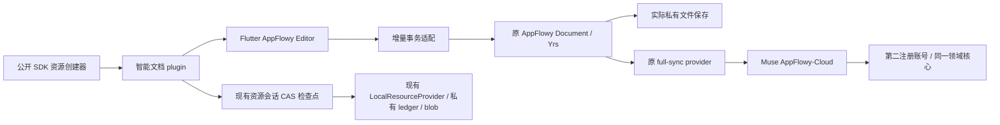

# 智能文档第一阶段实施与端到端验收

2026-11-05。阶段 **SD-F1-20261105**；结果：**本阶段 macOS 原生 + 原 AppFlowy Cloud 的纵向链路通过**。完整 G0、三端首版和 WPS 功能/视觉对齐尚未全部通过。

产品/交互沿用不可变 [SD-BL-1.2-20261105](baselines/sd-v1.2-20261105/BASELINE.zh-CN.md)，24 个归档文件校验通过；技术方案、总计划和阶段实施范围冻结为 [SD-F1 工程输入](baselines/sd-f1-20261105/BASELINE.zh-CN.md)，5 个归档文件校验通过。当前 [16 阶段计划](16-PHASE1-IMPLEMENTATION.zh-CN.md) 的 F1-01–06 已完成；T03/T05/T06 等完整任务仍只完成相应切片。没有缩减冻结 PRD，也没有将原型的 19 项演示检查当作本轮产品测试。

## 1. 已落地的实际链路



新增实现位于 [smart_document](../../../smart_document/README.zh-CN.md)；公开 SDK 插件位于 [Muse-Client/plugins/smart-document](../../../../../../Muse-Client/plugins/smart-document/README.zh-CN.md)。原生验证宿主实际复用现有 `ResourceCenterHub`、`LocalResourceProvider`、`ResourceEditorSession`，没有为内容类型新增 Host 私有分支。当前未加入正式 Host 发行组合；原思源插件与旧数据保持独立。

* Rust 复用当前 Cloud 相同 revision 的 AppFlowy-Collab / `collab_document::Document`，作为唯一可写正文。支持稳定块 ID、文本/marks、UTF-16 校验、批次候选验证、重开和原 origin undo/redo。
* Flutter 使用固定上游 editor，事务转换为增量；远端通过投影事务更新当前 EditorState。键盘/IME 的 undo 入口接领域栈，避免旧整段快照抹掉协作者文本。
* 支持段落、H1–H3、列表/待办、引用、分隔线及基础格式。当前工具栏提供加粗/斜体/下划线、undo/redo 和已接通的插入；slash 过滤未接通元素。完整格式、表格、代码/公式专业编辑等继续按产品稿实施。
* 本机文件真实写入/flush 后才显示保存成功。保存错误保留修改，失败关闭后仍可恢复编辑；拒绝的内容操作需显式放弃才能关闭。资源 CAS 仅为检查点，不承担在线合并。
* 同步为既有认证 HTTP/protobuf full-sync，默认 1 秒轮询，未新增服务器或 CRDT 算法。UI 显示“协作服务已接收”；没有将 exchange 当作 durable ACK，也没有伪造在线成员或光标。

## 2. 固定来源与实际构建

| 项目 | 本轮使用 |
| --- | --- |
| AppFlowy-Collab | `e59260e524f33104b0ddcd6bb8f6218cad0f7e18`；Yrs 实际 0.23.5 |
| AppFlowy Editor | `470c4e77c71b63f693ce0923a927afcd667d6f3b` / 5.2.0 运行时子集 |
| Editor 适配 | 仅三个文件：Flutter 输入回调、可注入领域 UndoManager、intl SDK 兼容；原始文件清单/补丁/许可保留，未修改全局包缓存 |
| 工具链 | macOS ARM64；Flutter 3.44.2 / Dart 3.12.2；Rust 1.96.0；Xcode / Docker |
| Native library | Dart build hook 自动构建并随 macOS app 捆绑 Rust code asset，不靠临时动态库环境变量 |
| 协作服务 | 当前 Muse AppFlowy-Cloud 工作树编译，独立 Postgres/Redis/GoTrue/Minio；镜像按 digest 固定 |

[源码/工具链/锁文件摘要](execution/phase1-20261105/source-lock.json)记录三仓 HEAD、相关工作树文件 SHA-256、Cloud binary 摘要与实际版本。本轮为工作树交付，没有创建跨仓发布 commit；HEAD 本身不能代替这些未提交改动。原 editor 的来源/补丁校验单独通过。完整客户端旧 vendor path、Web 和 Mobile 仍待后续验证，不能据此宣称整个旧 AppFlowy 客户端已修复。

## 3. 本轮实测结果

最终完整运行 ID：**20261105T114713Z**。所有 **16 个流水线步骤 exitCode=0**，详见 [summary](execution/phase1-20261105/summary.json)、[逐步耗时/日志摘要](execution/phase1-20261105/steps.json)。耗时是本机已有构建缓存下的记录，不作为性能或冷构建指标。

| 证据 | 实际结果与覆盖 |
| --- | --- |
| Rust | **4 个测试通过**：并发中文/emoji/marks 与来源 undo/redo；失败批次原子性；稳定块增删/重复更新/重开；越界和截断代理对拒绝 |
| Flutter 控制器 | **4 个测试通过**：真实 FFI/实际文件重开；只读拒写；磁盘写入故障与重试；拒绝操作阻止 flush/close，显式恢复后仍可编辑 |
| 分析与依赖 | runtime、SDK plugin、原生 example 均分析通过；新模块/插件/宿主显式按 lock 解析依赖 |
| 旧资源合同 | **4 个 golden 测试通过**：三个权威 wire fixture 的正反例及冻结 schema digest；未改变旧合同，测试引起的既有包 lock 重写被恢复 |
| 真实 Cloud | **1 个集成用例覆盖 8 组检查通过**，两个真实注册工作区成员 + 一个非成员；不是同一 token 的假双会话 |
| 原生 macOS | **1 个实际 app 集成用例覆盖 7 组检查通过**，真实 SDK/编辑器/native library/文件/Cloud；没有用 HTML 视觉稿替代 |
| 普通应用构建 | 独立于测试入口的 `flutter build macos --debug --dart-define-from-file=../../.build/native-defines.json` 成功，产物见下文 |

Cloud 的 8 组检查：[原始报告](execution/phase1-20261105/cloud-e2e.json)。包括认证创建、双成员文本/格式交换、离线并发 Unicode 收敛、本地 undo/redo 保留对方修改、块增删与稳定 ID、非成员读及原始 full-sync 写拒绝、文件重开后合并新云状态、**真实 Cloud 进程重启后新客户端读回内容**。权限用例也检查：带本机种子打开但服务端明确拒绝时，编辑器立即进入只读。重启测试保留同一隔离 DB/Redis，不代表已认证断电、Redis 丢失或多区域故障。

macOS 的 7 组检查：[原始报告](execution/phase1-20261105/native-e2e.json)。覆盖真实资源创建器/Hub/plugin 打开；原生剪贴板快捷键输入→AppFlowy 事务→Rust；只对选区加粗；第二认证账号更新呈现在当前原生编辑器；连续段落间距；受限资源会话 CAS 与有序上下文提取；经真实私有 ledger/blob 重开。同屏编辑窗口为一个，第二账号是独立实际 controller/provider 会话。该用例在实际 macOS 产物内由 Flutter integration_test 注入 tap/key 事件并读取系统剪贴板；选区由测试设定。它不替代外部 OS 键鼠自动化、人工选区拖动或中文 IME 认证。

实际编辑器截图如下；这是最小实现的运行证据，不宣称已达到冻结完整视觉稿：


## 4. 实测暴露并已修复的 Cloud 问题

1. **full-sync 入口授权反馈**：原处理链的异步下游拒绝不能保证 HTTP 调用方得知拒写。现在在入队前执行现有 collab Write/guest 检查，并校验 payload objectId 与 route 一致；非成员原始请求得到拒绝。没有替换原授权系统。
2. **相同 state vector 的删除集合**：原差量计算在 server state vector 不大于 client 时提前返回空数据。删除/undo 可不增加该向量，造成一端撤销后另一端不收敛。现在始终由 Yrs 编码差量及 DeleteSet；实际双账号 undo/块删除用例回归通过。

两处补丁及涉及文件见 [Cloud patch](execution/phase1-20261105/cloud-permission-and-delete-set.patch)。本轮没有改动用户已有 `deploy.env`，未部署生产。其余写入口、Commenter、撤权及未知 schema 校验继续属于全量权限工程门。

## 5. 复跑与本机审阅

从 `plugins/markdown/smart_document` 运行：

```sh
python3 scripts/verify_phase1.py --native
```

需要三仓及锁定来源、上述工具链、Docker、可访问的依赖源。命令按 lock 解析依赖并启动独立环境；服务缺失、失败或超时会退出失败，不 skip 后记为成功。`--offline` 仅适合已备好 Dart 缓存的环境。凭据只写入忽略目录的本地合成 fixture，不进入报告/资源文件。服务仅监听回环，Compose project 为 `muse-smart-document-stage1`；不操作原 `muse-*` 容器或现有账号，邀请明确不发邮件。

普通交互运行：

```sh
cd flutter/example
flutter run -d macos --dart-define-from-file=../../.build/native-defines.json
```

普通 macOS debug app 已生成于 `smart_document/flutter/example/build/macos/Build/Products/Debug/muse_smart_document_stage1.app`，仅供本机验证，不是正式发行包。普通入口的人工点开检查因本机锁屏未执行；上述原生自动化结果单独成立。它使用本地合成账号；重新生成 fixture 后需按上面命令重建。无 defines 时为本机模式。停止本轮服务可运行 `python3 scripts/dev_stack.py stop`，保留独立测试卷。

冻结校验（从 v1）：

```sh
python3 scripts/verify_baseline.py
python3 scripts/verify_engineering_baseline.py
```

本轮归档证据的大小/SHA-256 见 [manifest](execution/phase1-20261105/manifest.json)。原生普通构建结果另记 [native-app-build](execution/phase1-20261105/native-app-build.json)。

## 6. 未完成门槛与下一开发顺序

| 总门槛 | 当前状态 | 仍需交付 |
| --- | --- | --- |
| G0-A | partial | 新 native 核心来源/构建已验证；完整旧客户端、WASM 与跨平台精确版本未全部完成 |
| G0-B | partial | 双账号/离线/undo/基本块已验证；三端、乱序故障矩阵、移动/拆合/父删子改仍待完成 |
| G0-C | unrun | 真 WASM、浏览器持久化、中文 IME/长文/语义与能力决策 |
| G0-D | unrun | 至少一类真实 Office provider 同屏及三端生命周期/来源验证 |
| G0-E | unrun | Agent 结构化读取、带前置条件/幂等的命令 gateway 与恢复 |
| G0-F | unrun | 独立 Dataset 与嵌入视图、Agent 共用身份和服务端事务 |
| G0-G | partial | 非成员入口/本机错误/CAS 已覆盖；全部角色/撤权、未知块保留、迁移/epoch、durable ACK 尚未完成 |

下一开发顺序仍受 [15 总计划](15-EXECUTION-PLAN.zh-CN.md) 控制，完整 0.1 的 18–28 周容量区间未因本轮小闭环缩短：

1. **T02/T03.d–j**：将阶段私有 port 收敛为中立协作合同/runtime/provider/binding；补 Web WASM、Mobile native 与存储/输入原型，形成跨端能力表。未实现平台明确不可用，不使用 FFI 或 `dart:io` 冒充 Web 实现。
2. **T05–09 / M1**：补完整基础块/格式/选区/输入、稳定结构并发、WS provider、重连/awareness 和可信保存回执；在实际 Host 以明确支持平台的实验装配接入共享身份，不复制账号体系。
3. **T10–13 / M2**：分享角色、相对评论锚点、历史/恢复、Agent 原子命令及全入口拒写。
4. **T14–19 / M3**：真实 Office/媒体 provider、独立 Dataset/表单、元素 registry、Markdown/思源格式桥；内容语义与协作 transport 保持分离。
5. **T20–24 / M4**：人工多端 IME、可访问/性能、故障/升级/权限与恢复矩阵，完成全量 P0 后发布。

本阶段结束结论是“已建立并验证原 AppFlowy 协作版本上的真实原生智能文档增量”；完整 AC-01–17 和跨端产品不能在当前阶段标为全部通过。
