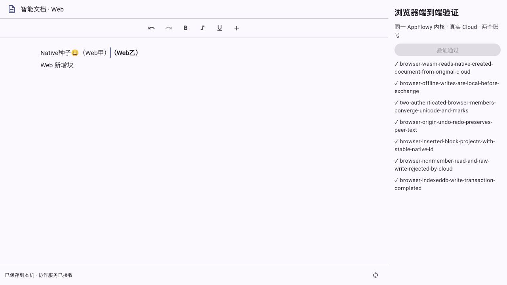
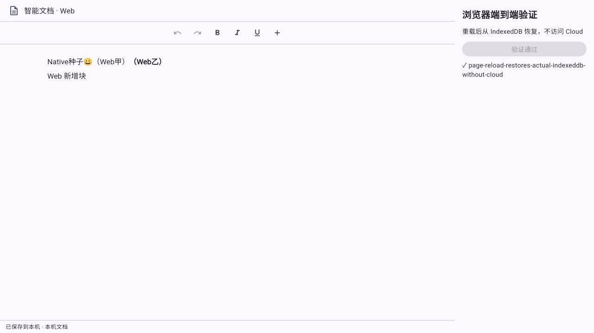

# 第二阶段验收：Web 真 WASM、独立合同与 native 互通

2026-11-05。阶段 **SD-F2-20261105**，运行 ID **20261105T132439Z**。结果：**本阶段 F2-01–06 通过**；[实施范围/技术方案](18-WEB-COLLAB-IMPLEMENTATION.zh-CN.md)。原产品/设计与阶段工程归档均保持不变。

## 1. 实际完成了什么

Web 与 native 使用同一个 Rust `collab_document::Document` 和相同 AppFlowy-Collab/Yrs 编码。浏览器运行实际 WASM，Flutter 控制器/编辑面继续复用，Web 状态实际保存到 IndexedDB。读取 native 创建的同一对象，经原 Muse AppFlowy-Cloud 完成浏览器双账号并发，再由新的 native 会话读回；不是两份示例 JSON 的视觉演示。

协作端口实际移到纯 Dart [muse_collab_contract](../../../../../../Muse-Client/packages/muse_collab_contract/README.zh-CN.md)，不依赖 Flutter/文档 AST。正文声明自己的 binding；引擎、编码、schema、协议或 epoch 不兼容时，在读本机/访问网络之前拒绝并关闭 provider。这个包是内部合同预览，不是完整 runtime 或公开迁移协议。Word/Workbook 的真实协作仍需各领域 binding/服务，测试中的 workbook 仅证明合同类型不限制为文档。

## 2. 本轮证据

顶层 **12 个步骤全部 exitCode=0**：[summary](execution/phase2-20261105/summary.json)、[steps](execution/phase2-20261105/steps.json)。其中 native-regression 又执行了原 **16 步流水线**，详见 [回归摘要](execution/phase2-20261105/regression-summary.json)。两层步骤有包含关系，不把它们混算为互相独立的 28 组产品功能。

| 验证层 | 实际结果 |
| --- | --- |
| 纯 Dart 协作合同 | 3 个测试通过；文档/独立工作簿描述、严格解析、engine/encoding/schema/protocol/epoch 不可隐式切换 |
| Rust native | 原 4 个测试通过；同一核心换用有输出/窗口上限的纯 Rust zstd 解码后仍通过实际 Cloud 流程 |
| Flutter controller | 5 个测试通过，新增不兼容绑定必须早于存储/网络且关闭 provider；原文件/只读/故障恢复/拒绝操作保护继续通过 |
| 旧资源合同 | 原 4 个 golden 测试通过，旧 strict schema digest 未变；既有包的非任务 lock 重写恢复 |
| 原生真实 Cloud | 原 8 组双账号/离线/undo/块/权限/重开/Cloud 进程重启检查继续通过 |
| 原生 macOS SDK | 原 7 组资源创建/编辑/选区格式/Cloud/布局/CAS/重开检查继续通过 |
| Chrome Web 核心 | 1 个真实浏览器测试通过，运行 WASM、真实 IndexedDB、关闭重开与另账号命名空间空读；不 mock engine/store |
| Web 实际构建 | `flutter build web --no-web-resources-cdn` 成功；Flutter surface 为 JS，**领域核心为实际 Rust WASM**，不等于 Dart2Wasm 构建认证 |
| 运行中的 Web 页面 | 7 组检查通过，见下文；通过实际浏览器按钮发起，不绕过 Cloud 认证或 CORS |
| 整页重载 | 1 组检查通过，重新加载页面/核心，在未创建 Cloud provider 的条件下从 IndexedDB 恢复 |
| native 读回 | 3 组检查通过：同一块 ID、Web Unicode/marks、Web 新增块，见 [readback](execution/phase2-20261105/native-web-readback.json) |

47 个归档文件及 SHA-256 见 [manifest](execution/phase2-20261105/manifest.json)。包括原始日志、两层源码锁、WASM 产物摘要、原生回归截图与本轮浏览器截图；不包含合成账号凭据或编译定义文件。当前为跨仓工作树交付，未创建发布 commit，也未部署生产。

## 3. 实际浏览器流程

打开构建后的 `http://127.0.0.1:18080/`，页面实际读到了 native 创建的 `Native种子😀`。通过页面“开始验证”按钮运行并确认“验证通过”，[原始回执](execution/phase2-20261105/web-e2e-result.json)记录：

1. 浏览器 WASM 从原 Cloud 读取 native 创建的同一文档。
2. 两个注册成员各自离线写入；交换前互相看不到对方修改。
3. 恢复交换后，中文/emoji、双方文本与 marks 收敛。
4. 本地 origin undo/redo 保留协作者文本，远端删除集合正确传递。
5. 浏览器新增块远端投影，原 native 块 ID 保持。
6. 非成员 GET 和原始 full-sync 写入均由 Cloud 拒绝。
7. IndexedDB readwrite transaction 已完成，实际快照与内核一致。

然后导航至 `?reopen=1`，这会重新加载应用和 WASM 会话。恢复模式不创建 Cloud provider；实际本机内容仍完整，点击验证后返回通过，[重载回执](execution/phase2-20261105/web-reload-result.json)与截图如下。

最后运行新的 native 会话，通过 Cloud 读取 Web 已提交内容，验证稳定 ID、两个 Web 文本、Bob 加粗和新增块；证明 native/Web 用同一对象/编码互通。

浏览器按钮由代理通过浏览器 UI 操作；其中编辑/undo 校验由应用内 Dart 控制器驱动。它不是人工中文 IME、OS 键鼠或复杂跨块选区认证。测试页面为内容层 workbench，正式 Web Host 的共享资源入口尚未装配；原生 SDK workbench 则由回归单独验证。

## 4. 来源、兼容修复与限制

* 保持 AppFlowy-Collab `e59260e524f33104b0ddcd6bb8f6218cad0f7e18` / Yrs 0.23.5。固定上游的 collab 运行时子集 25 文件校验通过；两个明确改动文件用于 workspace members 与浏览器 clock，原始许可/来源/补丁保留，未修改全局缓存。native 默认 clock 不变，未升级 Cloud wire。
* Editor 仍是固定 `470c4e77c71b63f693ce0923a927afcd667d6f3b` 运行时子集，477 文件/3 个既有补丁校验通过。
* WASM 与 glue 按 `wasm-bindgen 0.2.128` 构建。实际 WASM **1,306,288 bytes**，摘要 `ad33e31ebc8b562d319661dd68da5ab62bbb07e3c716dbd2c47b872c8d8155f3`，详见 [产物记录](execution/phase2-20261105/wasm-artifacts.json)。生成产物在忽略的构建目录，可由固定来源重建。
* `Device-Id` 使用当前 Cloud 允许且原 API 支持的头名，使浏览器 CORS 预检正常通过；没有增加通配 Cloud origin、关闭浏览器安全或另建协作代理。
* 浏览器本机保存以 IndexedDB transaction complete 为准，不保证不会被驱逐或断电；网络 exchange 仍只表示“协作服务已接收”，不是 durable ACK。
* 内核当前在浏览器主线程同步调用；长文性能、Worker、存储配额/驱逐、完整故障/权限、三端可访问仍未认证。

本次使 G0-A/B/C/G 的部分证据前进；**G0-C 完整门槛仍为 partial**，其 IME、长文、语义/目标浏览器矩阵等未完成。G0-D/E/F、Mobile、WS/presence、评论/历史/Agent/Office/Dataset 与完整 P0 继续按总计划实施。不得将本轮结果回写成 AC-01–17 全部通过或 WPS 全功能/精确视觉对齐完成。

## 5. 复跑与后续

命令、前提和浏览器步骤见 [18](18-WEB-COLLAB-IMPLEMENTATION.zh-CN.md)。`verify_phase2.py` 缺少浏览器通过回执时会等待并失败，不能“服务起来了”就宣告成功。原合成测试环境保留供本机审阅，普通本机 Web 模式不包含测试账号；验收构建仅在回环审阅，不可直接公开部署。

下一顺序：Mobile 原生产物与相同核心闭环 → Web/原生真实输入及长文/存储故障矩阵 → 受限协作会话、WS/presence 与 durable 回执 → 正式 Host 按能力装配 → 既定 M1–M4 的正文/团队/Agent/Office/数据集。整个产品目标和原 18–28 周容量区间保持，继续按门槛重估。

停止本轮浏览器审阅服务：从 `smart_document` 运行 `python3 scripts/stop_web_fixture.py`。脚本核对登记 PID 的实际命令，仅停止本任务服务器，保留 IndexedDB 与独立 Cloud；可加 `--dry-run` 先做只读检查。
