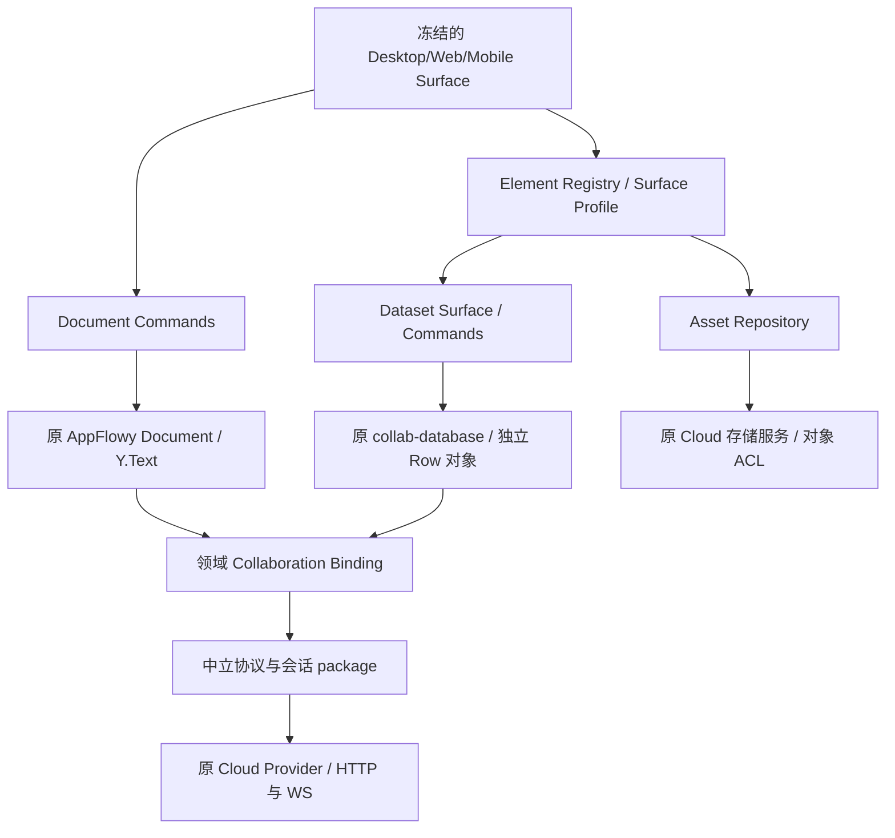

# 思源功能复用、领域适配与完整交付计划

2026-11-06。变更号 **CR-SD-REUSE-20261106**。用户明确要求参考思源实现，覆盖数据库、图片、超链接，保持冻结设计、领域分离，并持续实施至端到端 UI 验收。本变更扩大既有 [50 项台账](siyuan-collaboration-parity.json) 的细项与复用约束，不把 P4/P5 的切片当作完成目标。

## 1. 固定来源和复用约束

思源固定参考 `d3af9d5782082b379d45a69eedf4ebcfe8ba6889` / 3.8.9，读取时 master、工作树干净；按固定版本研究，不推进其分支，也不修改其源码。新智能文档仍使用固定 AppFlowy Editor 5.2.0 / `470c4e77c71b63f693ce0923a927afcd667d6f3b`，AppFlowy-Collab `e59260e524f33104b0ddcd6bb8f6218cad0f7e18` / Yrs 0.23.5，服务端保持 Muse-Server/AppFlowy-Cloud。

`vendors/appflowy` 完整源码目录不能仅凭 `git -C ... rev-parse HEAD` 当作独立上游版本；本地命令可能找到父级插件仓库。正式复用以现有编辑器 lock/manifest、Cargo 固定 revision 和对应源码 hash 为准，新增复制文件要补来源/许可/补丁清单。现有运行依赖与新 Rust crate 沿用已有 AGPL 许可归属，不抹掉上游声明。

优先顺序：**复用已接入的运行代码 → 增加领域适配 → 提取有来源的纯算法/测试语料 → 最后才新增实现**。每项新增实现须说明上游现有能力为何不足。禁止为已存在的渲染、CRDT、筛选/排序/字段转换或上传存储重新造一个近似版本。

不能直接调用思源 Go 文件写入逻辑作为新 CRDT 文档的第二真源，也不能把 Protyle DOM 变更直接套进 Flutter。原 `.sy/.sydoc` 插件保持独立；其功能不重复记为 `.musedoc` 已完成。

## 2. 用户点名能力的来源与适配

| 能力 | 思源实现/行为来源（相对 markdown 根） | 优先复用的运行组件 | Muse 必要适配 |
| --- | --- | --- | --- |
| 超链接 | `vendors/siyuan/app/src/menus/protyle.ts`、`menus/linkMenu.test.ts`、`protyle/render/av/richTextValue.ts` | AppFlowy `href` marks、原 rich text、Markdown 链接快捷输入、原 link toolbar/menu | 文档相对选区、可撤销链接命令、URI 与资源解析边界；三端入口按冻结设计呈现 |
| 图片 | `vendors/siyuan/app/src/protyle/render/imageResize.ts`、`imageTitleEditor.ts`、`imageActions.ts`、`util/imageURL.ts` | 原 ImageBlockComponentBuilder/ResizableImage、系统 file picker；Cloud bucket/文件流和鉴权服务 | 私有对象附件、草稿上传/重试、跨端可解析资源引用、离线缓存、标题/alt/尺寸和只读语义 |
| 数据库字段 | `vendors/siyuan/kernel/av/av.go`、`capabilities.go`、`value.go`、`app/src/types/av/index.d.ts` | 固定 `collab-database` 的 Field/TypeOption/Cell/DatabaseRow | 18 类思源字段的逐项语义映射、差异与迁移；不能用普通表格代替 AV |
| 数据库视图 | `vendors/siyuan/app/src/protyle/render/av/`，Go `kernel/av/layout_*.go` | 原 AppFlowy Database/DatabaseView、filter/sort/group/row order | Grid/看板/列表/卡片/日历的三端 surface；视图与数据分离，保留来源 ID |
| 关联/汇总/模板 | `kernel/av/relation_rollup.go`、`calc*.go`、`av_template*` 等实际测试 | 原字段/关系类型与可适用的计算组件 | 按语料逐项验证语义；无直接等价项保留原信息并明确不可编辑，不用字符串假装计算完成 |
| 块与引用 | `docs/SY-FORMAT.zh-CN.md`、`kernel/treenode/`、Protyle 块行为 | 已有 Document、Y.Text、原块组件/快捷键 | 稳定块命令、相对文字锚点、索引/反链与格式桥 |
| 实时协作 | 思源本机内核和文件事务用于行为参考；其云同步不等于多成员实时 CRDT | 原 Cloud WS/protobuf、AppFlowy/Yrs awareness 和同步 | 中立会话端口、领域锚点、ACL/撤权、耐久边界、私有 annotation/历史/Agent |

参考目录中 AV 的 18 个字段类型为 block、text、number、date、select、mSelect、url、email、phone、location、mAsset、template、created、updated、checkbox、relation、rollup、lineNumber；视图为 table、calendar、list、gallery、kanban。筛选/排序/分组能力以 `capabilities.go` 及生成类型声明为准，不能因为有一个 Grid 控件就将数据库标为完成。

## 3. 领域边界与依赖

资源模型、领域模型、同步分片、权限和界面选区分别设计。数据库独立拥有 database/view/field/row/cell 身份和生命周期，文档只引用一个受权视图。删除嵌入块不删除数据库；文档权限不自动扩大数据库或图片来源的权限。

文档命令不处理 HTTP、文件选择或控件状态；AssetRepository 不改 AST；同步 provider 不认识段落或字段类型；Host 只承载公开插件贡献。相对文字锚点在文档绑定中，不能放入中立 transport。数据库子 surface 的撤销、选择、焦点归自己的领域会话，不能共享文档的路径选区或覆盖整个数据库快照。

图片块存可跨端解析的引用及尺寸/标题/alt，不存另一台设备的绝对路径、Bearer token 或可长期公开访问的私有文件 URL。上传成功和正文同步成功分别记录；离线保留草稿并可重试，不提前显示云端已保存。服务端必须阻断原始匿名/替代路由绕过附件权限，而不只在 Flutter 禁用按钮。

## 4. 按依赖推进的执行任务

| 批次 | 必须实现的内容 | 复用与退出条件 |
| --- | --- | --- |
| R1 链接与相对选区 | 插入/编辑/移除/打开链接，Markdown 入口，中文/emoji 范围和远端插入期间的定位 | 复用 href 和 Yrs StickyIndex；UI 操作/撤销/双账号/重开均验收 |
| R2 私有图片资源 | 原 Cloud 存储复用、对象级读写、系统选择/粘贴、进度/取消/重试、缓存、alt/标题/尺寸 | 复用原图片组件与文件流；原始路由绕过、来源撤权、离线恢复、三端 UI 必测 |
| R3 数据库领域适配 | 固定 AppFlowy Database/Row 内核，独立绑定/存储/权限，字段和视图 | 18 字段/5 视图逐项台账；schema/视图/行分片往返，保留非等价元数据；不新写简单 CRUD 当数据库完成 |
| R4 协作会话与团队 | WS、presence/relative selection、ACL/撤权、耐久回执、分享、私有评论/@、历史恢复 | 复用原 Cloud；正文/数据库/附件各自边界和所有写入口验收，不能只测两个账号 exchange |
| R5 编辑全量与高级内容 | 稳定树移动/拆合、可变表格、数学、嵌入/反链、超级块/Tabs/Callout/思维导图、导入导出 | 原 SiYuan 样本与命令序列对照；未知内容保留；不得覆盖原 `.sy` 或加密内容 |
| R6 Agent、Office 与发布 | 有界读集/预条件/幂等、独立 Office provider、多端整合、恢复/性能/无障碍 | 继续复用 ioffice/libs 各领域核心；完成所有领域与交互门后才装配正式 Host |

R1/R2 的域接口和 R3 的数据库分片合同可顺序交叉推进；R4 的服务端权限约束必须覆盖已开放的数据入口，不能等到 UI 最后再补。R5 中不依赖数据库的编辑能力可继续推进，但不得让局部完成标记跳过 R3/R4。

## 5. 设计对齐和最终 UI 验收

设计继续以 SD-BL-1.2 与 SD-MOB-1.3 的冻结稿为准：Desktop/Web 保留既定功能区、连续编辑区与协作面板；Mobile 保留八入口、44px 点击目标、Aa 与列表/对齐的键盘行为。新增链接、图片、数据库分别进入已有入口和上下文 surface，不能再扩展一个与冻结稿竞争的独立应用壳。

每一能力须有：来源文件/版本、运行复用组件、域命令/不变量、设计画面/状态、正反 UI 用例、协作/离线/撤销/重开结果、截图和未覆盖边界。最后执行同一受权对象的 Desktop/Web/iOS 联合编辑；Android 仍遵守用户“仅继续 iOS，暂不安装”的既有约束，保留未验收状态，不代写为通过。

最终门仍是 `verify_parity.py --require-complete`：全部范围完成、无已知缺口、要求平台及真实 UI 证据全部通过。准备方案、复用代码存在、单元测试通过或演示画面出现均不能替代最终验收。工作不因某个有限切片完成而改变全量目标。
