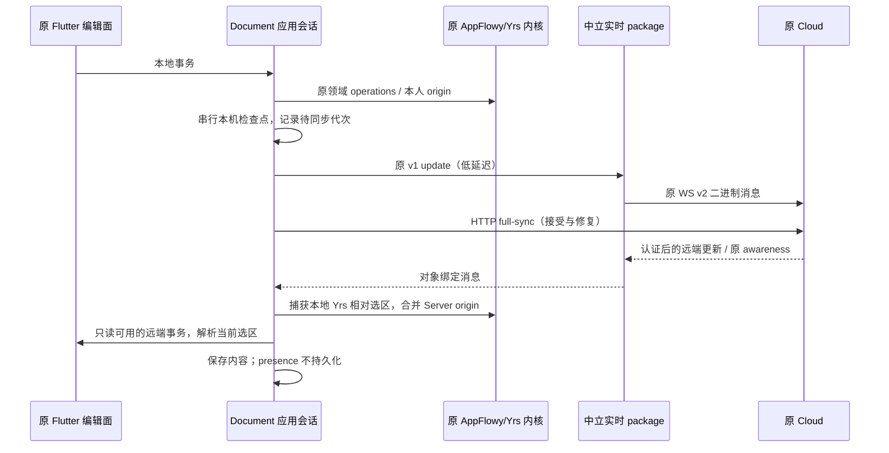

# P8：原 AppFlowy 实时协作、在线状态与编辑面接入

2026-11-06，CR-SD-REUSE-20261106 的 R4 增量。沿用 [产品/设计冻结](13-FROZEN-BASELINE.zh-CN.md)、[完整复用计划](27-SIYUAN-REUSE-AND-DELIVERY.zh-CN.md) 和 [50 项差距台账](siyuan-collaboration-parity.json)。本轮不改写 SD-BL-1.2、SD-MOB-1.3 或 P4–P7 证据，不宣称完整思源编辑/完整协作已交付。

## 已接入的运行能力

智能文档公共 SDK 插件可通过 `realtimeFactory` 注入 `DocumentRealtimeSession`。正文仍由原 AppFlowy Editor + Document/Y.Text 编辑和合并；新增的 `Muse-Client/packages/muse_appflowy_realtime` 只负责原 WS v2 协议、连接和原 Yrs Awareness。HTTP full-sync 继续承担明确的接受与修复边界。历史快照不创建网络或在线状态会话，公开资源字节不含凭证。

| 层 | 实现与复用 | 不承担的职责 |
| --- | --- | --- |
| 中立实时 package | AppFlowy 原 protobuf/ClientMessage/ServerMessage，Native/WASM 编解码，WS v2，Yrs Awareness | 不认识块、字段、表格、选区路径、资源缓存或编辑器 UI |
| 原协议 runtime | `smart_document/runtime/appflowy_realtime`，固定 Yrs 0.23.5；`vendor/appflowy_proto` 来自 Cloud 本地干净提交 `5b44ac485f6dc1a17bb7366027c300aa87868e59` | 不另定义一份近似 WS/Yjs 协议，不运行会修改 vendor 的原 build.rs |
| 文档应用适配 | `flutter/lib/src/realtime_session.dart`；对象 0 的更新、HTTP 修复、相对文字锚点、界面在线投影 | 不将 Dataset/Office 伪装为正文，也不把 presence 写入文档 |
| 原编辑面 | `EditorState.remoteSelections`、原 RemoteBlockSelectionArea/SelectionAreaPaint、原富文本与移动工具栏 | 不新增一套光标画布或富文本模型 |
| Cloud | 原 WS v2 actor、原 GuestAwareRealtimeAccessControl、PG 生命周期校验、原 Redis update/awareness | Redis RID 不等于写盘 ACK；本轮没有假造耐久确认 |

协议来源有 14 个文件和 2 个受控适配：独立 Cargo 依赖与已生成 protobuf 的可见性。`scripts/verify_realtime_protocol.py` 校验原始/适配文件和累积 patch hash。编辑器仍为固定 477 个运行文件、5 个受控补丁；已有 editor_state.dart 补丁增加只读远端投影，不扩大为整体升级。授权声明保留。

## 文档交互与冻结稿的对应

- Desktop/Web 在原文档顶部加入在线协作者头像入口，保留原连续编辑区和工具栏；点击进入在线协作者面板。它表示活跃会话，不能代替分享权限名单。
- Mobile 复用冻结的阅读态顶部区域和原底部悬浮功能区；编辑态 Aa/列表/对齐/八入口不另做一套。在线选区使用原文字组件的绘制几何，读取模式也能看到远端内容与选区。
- 用户名由 Host 按服务端认证 UID 提供可信 resolver；缺少资料时显示“协作者”。不把 awareness 中自报的名字、角色当认证身份。当前同一 UID 的多个设备会话尚未完整聚合，属于 CO-04 的明确缺口。
- 失去写权限立即阻止本地命令；仍有读权限时继续呈现远端内容。失去读权限后隐藏活动内容视图，本机副本保留。暂停/恢复网络不能恢复权限；只有新的认证对象能力响应可以恢复先前 HTTP 拒绝，已删除状态不可由普通能力响应解除。
- 连接中断后逐步重连；原 Manifest 用于重新核对，HTTP full-sync 修复与接受，presence 原 null 状态表示离开，30 秒单调时钟过期投影处理无正常离开的连接。

## 数据链路和不变量

本地变更代次与网络生命周期代次分别维护；较早请求成功只能接受它发送前的本地变更，不能把请求期间的新输入标为已接受。只有本地事务、领域命令及撤销/重做推进本地代次；接收远端更新不触发本地撤销或重复发送。

本机检查点串行写入，显式 flush 传播失败；后台失败会显示保存失败。失败关闭保持会话可恢复，并发 close 共享一次关闭过程。待同步标记可以跨进程恢复，在线成员与光标不能跨进程恢复。

原 EditorState 只转换远端结构路径，不转换文字偏移。UI 验收发现旧光标偏移会在 heartbeat 时覆盖正确的相对锚点。因此文档适配器在合并前使用已有 `captureTextRange` / Yrs StickyIndex 捕获端点，合并与原编辑面投影后重新解析；跨块端点分别捕获，失效文字身份不重定向到另一块。远端投影与 HTTP 合并共用串行投影队列。

原编辑器在 `editable=false` 时曾同时拒绝远端事务。已有受控 editor_state.dart 补丁改为只阻止本地事务，移除应用侧“临时开启编辑”的窗口。原 isRemote 路径仍不进入本地事务流和本地撤销记录。

## 实际发现并修复的 Cloud 边界

本轮在隔离本地 Cloud 中先复现了 WS v2 非工作区成员读取广播和写入新对象的缺陷，保留原失败。随后沿原授权服务修复：

1. WS v2 握手检查工作区读权限；对象不存在也不能跳过工作区授权。
2. CollabManager 复用已注入的 GuestAwareRealtimeAccessControl；不以统一拒绝 Guest 替代已有直接/祖先共享策略。输入、输出内容和 awareness 分别检查当前对象权限。
3. 原 `Result<bool>` 被调用方 `.is_ok()` 误当授权成功，现改为 `Result<()>`，避免 `Ok(false)` 放行。权限缓存仅作提示，允许结果不能替代当前授权。
4. 原权限缓存更新曾只升级、不降级；现允许权威降级覆盖。已注册对象的 PG workspace/type/tombstone 检查用于实时入口，awareness 的 Unknown=6 不会被误解释为正文类型。
5. 原 awareness 只保留认证连接自己的 client slot，actor UID/client ID 由服务端写入；不能伪造其他成员的槽位或角色。空状态沿用原离开语义。
6. 在原 protobuf 窄化之前拒绝超出 u8/u16 的 flags/RID，以及不支持的对象类型。Awareness 声明客户端数量在解码分配前限制，单条/总帧/分片聚合均有上限。

WS 浏览器 query token 是原 Cloud 接口的兼容要求；连接 URI 不输出到 UI、错误或证据。UID、Client ID 和 RID 使用字符串传递，避免 Web 的整数精度丢失。

原 Guest 分享 API 在单独测试工作区内验证了只读→读写→只读→撤权；没有发邮件，也没有改动生产用户权限。撤权后的接收端不会收到新内容广播。能力变化目前通过显式/20 秒周期 Manifest 重新取得；原权限消息结构存在但尚未形成跨实例的完整通知链，不能宣称已实现分布式立即撤权通知。

## 本轮验证和边界

| 检查 | 当前结果 | 证据范围 |
| --- | --- | --- |
| 原协议 Native 测试 | 4 项通过 | v1/v2、删除集、整数精度/窄化、quota、原 Awareness 时钟和离开 |
| 中立 Dart package | 2 项通过 | 编解码、原在线状态、对象作用域、64 位字符串 |
| 原 WS2 真实连接 | 7 项通过 | 非成员握手、原更新、认证 actor、伪造槽位过滤、null 离开、不修改文档 |
| 文档应用适配器 | 6 项通过 | 双账号更新、相对选区、本人撤销、只读接收、离开 |
| 真实 Guest 共享/权限 | 8 项通过 | 原共享 API、读写升级/降级、原始 WS 绕过拒绝、撤权后广播与 HTTP 拒绝 |
| macOS 真实 UI | 8 + 3 项通过 | 公开 SDK/资源、附着的 TextInputClient、成员面板、原选区 painter 的非空几何、重连、无凭证新进程恢复 |
| iOS 模拟器真实 UI | 8 + 3 项通过 | 同一插件和编辑面，阅读态在线选区、成员面板、重连/恢复；未安装 Android |
| 实际浏览器 UI | 8 + 3 项通过 | 原上下文菜单粘贴、原 WASM、两账号、原远端选区、实际成员面板、离开、真实页面重载/IndexedDB |

Native 输入使用已附着平台连接的 TextInputClient 回调，不等于物理输入法候选/组合态验收。浏览器自动化的直接键入未可靠进入 Flutter 输入连接；本轮明确通过原上下文菜单粘贴验收文字输入，不能据此声称 Web 键盘/IME 已全部验收。Flutter UI 当前为 JS 渲染编译加 Rust WASM 内容/协议内核，不宣称 Flutter UI 已切换 dart2wasm；上游 universal_html 的 wasm dry-run 提示仍保留。

中间失败记录保留：收集器回执标记错误、把本地新光标与旧远端锚点混用的断言、原文字偏移未映射导致的真实失败、iOS 空文字渲染盒命中断言。最终测试点击空正文的真实行级手势区域，并断言平台输入连接和内容结果；没有关闭命中断言或把失败改为通过。截图前等待原远端 SelectionAreaPaint 有有效几何。

## 接下来的执行顺序

| 顺序 | 工作 | 退出条件 |
| --- | --- | --- |
| R4.2 | 已注册对象订阅、跨实例权限通知、会话身份与 client ID 冲突、权限租约/断线边界 | 同一 Guest/成员在多进程服务节点上升级、降级、撤权；重放旧连接、旧能力和对象删除均不可绕过 |
| R4.3 | 持久操作收据/outbox、故障恢复与服务端领域校验 | 明确持久化 frontier、请求幂等和重放；进程/Redis/网络故障后不得误显示云端持久保存 |
| R3.2 | Dataset 原字段/筛选排序分组/五视图适配、独立行会话与文档嵌入 | 逐项思源 AV 语料、同屏渲染、权限不继承扩大、行先于根发布、独立撤销/焦点 |
| R4.4 | 原 Cloud 评论/回复/@、分享授权交互和协作历史 | 锚点、权限、通知、恢复及三端 UI 通过；与 presence 分离持久化 |
| R5 | 剩余思源编辑语料和高级元素 | 复用已有组件/算法，逐项关闭 SY-01–36；未知内容完整保留 |
| R6 | Agent/Office 领域协作与正式 Host 交付 | 独立内容 binding、预条件/幂等/恢复、既有 Office provider 和联合多端验收 |

本轮仅将 CO-04 等相关项推进为有证据的 partial。最终 `verify_parity.py --require-complete` 仍应拒绝；Android 保留用户要求的未安装/未验收状态，不为通过全量门而改写平台范围。持续开发不因该增量归档而结束。
