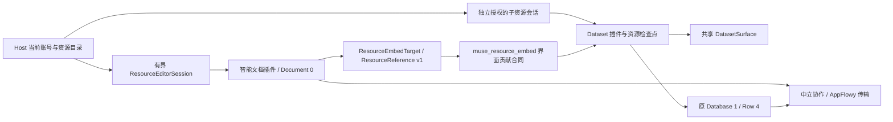

# P10：智能文档内数据库与独立资源界面贡献

本轮承接 [思源复用计划](27-SIYUAN-REUSE-AND-DELIVERY.zh-CN.md)、[数据库适配方案](29-DATABASE-ADAPTER-DESIGN.zh-CN.md)、[P9 字段增量](32-PHASE9-DATABASE-FIELDS.zh-CN.md)。产品、Desktop/Web/Mobile 交互及视觉冻结快照继续有效；这里记录实施细化，不以一轮增量替代完整 36 项编辑、14 项协作目标。

## 参考实现与技术选择

固定思源 3.8.9 / `d3af9d5782082b379d45a69eedf4ebcfe8ba6889`，读取原代码，不修改或构建该 vendor。`kernel/av/av.go` 中 AttributeView、View 与独立解析流程，`app/src/protyle/render/av/standalonePreview.test.ts` 的“独立预览不创建缺失数据库”，以及 `primaryFocus.ts` 的历史/只读焦点保护，作为本轮行为参考。思源的来源块、主键绑定、反链、筛选、分组和完整视图语义仍按原对齐计划交付，不能把基础 Grid 称为完整数据库。

复用原 AppFlowy Flutter 的 `database_view_block_component.dart` 和 `inline_database_menu_item.dart` 所采用的结构：`grid / board / calendar` 是无文字的引用块，通过 `parent_id / view_id` 连接独立数据库视图。沿用这些块名和定位字段；新增有版本的 `muse_embed` 扩展定位 Muse 资源。真正的编辑面复用已接通的 DatasetSurface 与原 Database/Row 核心，不重写表格、字段、存储或 CRDT。原 AppFlowy 组件依赖其私有 Folder/BLoC/Provider，不能直接整包搬进公共资源插件；替换的是该定位与界面贡献适配边界。

## 领域与依赖

`Muse-Client/packages/muse_resource_embed` 是独立 Flutter package，只依赖公共资源身份合同和 Widget：

- `ResourceEmbedTarget`：已有 ResourceReference、surface ID、有界字符串 selector。数据库使用 `dataset.grid` 与 `objectId/viewId`；未来 Office 页、媒体或应用可注册各自 surface 与 selector。合同不定义数据库行、正文块、HTTP、CRDT、权限或凭证。
- `ResourceEmbedHost`：Host 绑定当前资源/账号生命周期的选择与渲染能力。文档不能拿到全局资源 Provider、原始文件路径、账号凭证或任意 Host 命令。
- `ResourceEmbedPolicy`：父界面的交互上限；子资源必须另外授权。只读父文档收窄子界面写能力，不能授予原本没有的读写权限。历史父文档不连接可变的实时子资源。
- `ResourceEmbedScope`：让已渲染块能响应 Host 撤下解析器及阅读/编辑状态变化；不能依赖编辑器重新注册缓存的 block builder。

文档 Rust 核心只验证结构引用、协议、大小、原 view ID 与 selector 的一致性；不解释行/字段。原引用没有 Muse 扩展时保留并显示不可用，不猜测资源，不创建缺失数据库。引用不接受 transport URL、token 或任意 envelope 字段；使用公共资源身份而非文件路径。

DatasetEmbedRegistry 管理同一资源的共享子会话，多个块/视图不会各自创建一个可写本机所有者。最终释放先完成原数据保存与 SDK 资源检查点；保存失败保留所有者，并拒绝另开一个覆盖草稿的会话，Host 可显式重试关闭。独立 Dataset 资源编辑与嵌入均使用同一个 `DatasetResourceCheckpoint` 应用适配器，界面不自行写存储或调用 HTTP。

Host 仍需把独立窗口与内联界面接到同一个会话所有者。当前公开插件的直接重复打开会明确拒绝；不同入口之间自动加入已有可写会话、跨账号关闭屏障及完整资源注册表尚未开放，不能宣称已解决所有窗口生命周期。

## 交互与视觉落实

Desktop/Web 继续使用冻结的文档顶栏、编辑工具栏和连续正文区域；“插入内容 → 数据库 → 选择已有数据库”插入引用块。Mobile 从阅读态进入编辑，经键盘上方“插入”功能区进入同一选择流程，不另起一套编辑内核。

正文、图片/链接/表格与数据库可以共处块流。数据库块显示来源名称、固定视图、字段与记录、自己的撤销/重做、新增记录/字段及保存状态。共享 Grid 在块内横向滚动，记录区在有界高度内滚动，保留 44px 操作目标。父文档和子表格分别有状态与工具区；选项/单元格草稿继续由已有对话框拥有。

当前显式 view ID 不再回退到数据库第一个视图。视图删除、布局能力未安装、资源缺失/无权限都保留引用并显示明确提示；嵌入界面不允许通过视图切换偷换原引用。块菜单“移除引用”只删除正文中的定位块，不删除数据库、行或资源目录条目；正文撤销恢复同一块 ID 和目标。

只读交互上限同时应用到单元格、字段和数据库撤销按钮，不修改独立控制器的授权状态。生产级键盘撤销路由、来源块绑定、嵌入块拖拽/复制与移动端真实软键盘输入仍属于完整验收范围，不能凭桌面截图关闭这些项目。

## 同格撤销缺陷与修复

真实 UI 验收复现：首次填写原本不存在的单元格 → 对方读取后更新同格 → 本地撤销，原实现删除了首次写入创建的整个嵌套 Y.Map，对方值也变为空。已保留失败 UI 与独立 Rust 复现。

适配器现在通过原 `DatabaseRowBody.update_cells / CellsUpdate.insert_cell`，在不进入用户撤销帧的结构事务中准备空容器，再用原本地 origin 事务写用户值。值的合并与撤销仍由原 Yrs manager 执行；没有自写反向快照来覆盖远端。仅含 created/modified 元数据的空容器投影为逻辑未填写，保留原“空值”的值与前置条件语义。

修复后回归确认同格后续协作者的值保留、两方收敛，旧空值撤销/重做和独立字段协作不回退。单元格值仍为原原子值语义；多选不因此变成集合 CRDT，文本字段也不因此变成逐字协作。

## 验收与后续开发门

本轮已有原文档 Rust 20 项、数据库 Rust 10 项、共享移动/桌面界面回归，以及 macOS/iOS 实际插入、独立 Cloud 根/行、同格撤销、移除/恢复引用、两个公共资源检查点和无凭证新进程恢复。浏览器通过实际单元格表单与子表格工具栏验证，并重载两个独立 IndexedDB 副本。最终归档的回执、命令、失败记录、截图和源码指纹以本目录 execution 下的 P10 证据为准；完整产品门继续拒绝，Android 未安装。

继续按依赖顺序推进：

1. Dataset 类型 1/4 的实时适配、动态行依赖、乱序/缺失行恢复、会话所有者统一与独立 ACL；复用 P8 package，不能套用正文文字锚点。
2. 原日期类型及显式时区/全天/范围/DST，再接通原筛选、排序、分组与五种视图，逐项覆盖 18 字段语义；已有选项 CRUD、完整颜色/描述和导入映射仍开放。
3. 块引用/反链/嵌入查询、完整表格拓扑与公式/代码等 SiYuan 编辑差距，复用固定原代码和内核 API，持续补充跨端验收语料。
4. 跨实例即时撤权、可靠离线命令与服务端持久收据、评论/历史、Agent 与 Office 资源贡献。它们分别拥有领域协议，不能从一次 full-sync 或一次同屏渲染推导为完成。

以上均不缩减原产品目标；每个完成项必须具有真实 UI、独立用户/端、重开恢复与失败路径证据。

本机收尾回归还遇到 Flutter tester 首次加载原生动态库超过默认 30 秒：保留了超时失败，以及采样中 `FfiResolve → NativeAssetsDlopen → dyld` 文件/代码签名校验的调用栈。独立 HTTP 读取约为毫秒级，不能把这次冷加载超时归为网络数据损坏。使用有界 2 分钟、串行的本机回归完成检查；原生跨端读回使用有界 3 分钟并记录步骤耗时。没有修改系统安全校验。实际 macOS/iOS 产品 UI 用例仍在约 5 秒内完成测试主体，不把 tester 冷加载表现当成产品性能合格证明。
