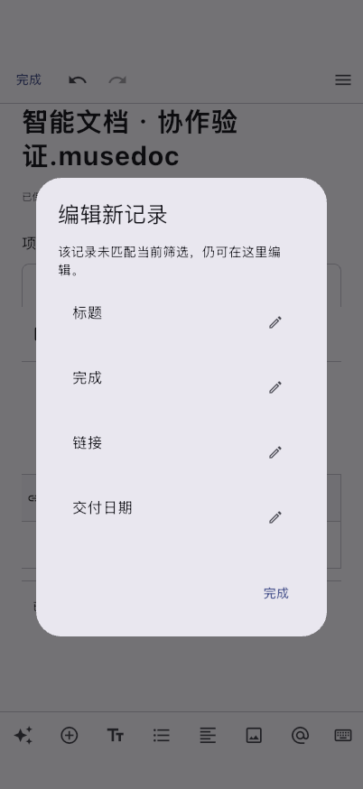
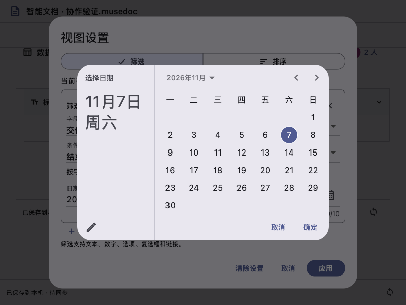
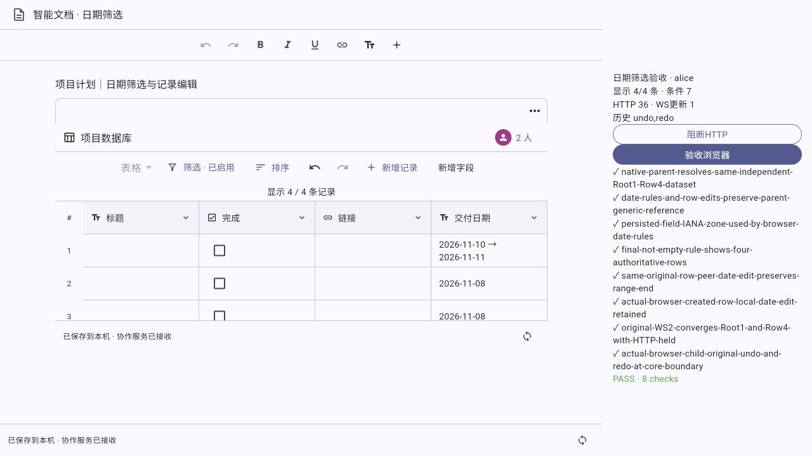

# P16：原日期筛选、记录预填充与隐藏记录编辑

承接 [P15 稳定规则与单项撤销](38-PHASE15-DATABASE-CONCURRENT-RULES.zh-CN.md)，487 份证据含 418 份源码/输入已冻结。继续复用固定 AppFlowy 原数据库和思源的产品/语义参照，不修改历史归档。

## 复用与技术路径

原客户端 17e24f8232488fdac1213b17445af7dd4fb07ad2 的 DateFilterPB/DateFilterStrategy，以及 Text/Number/Select 的 PreFillCellsWithFilter 已定位。思源 d3af9d5782082b379d45a69eedf4ebcfe8ba6889 的 av/filter.go、context_filter.go 和 value.go 用于核对端点、空值、相对日期和单位；接入前核验实际文件存在及语义，不只引用类型名。

日期条件继续原 0–15 编码与 DateFilterContent 秒级存储，首轮对齐开始/结束日期的绝对比较、区间、空值；执行时使用字段已验证的 IANA 时区，禁止原 Local 或设备时区造成跨端差异。民用日期输入的解释放在内容内核，Flutter 仅收集日历元组；未支持的提醒/格式、未知条件与原始编码继续保留只读。相对日期必须另有明确时钟上下文，不以设备 now 假装共享语义。

预填充复用原条件策略，加入精确 Decimal 溢出保护。AddRow 可接受稳定 viewId，在原 CreateRowParams 前填充原 Cell；明确的用户输入优先。多条件、否定和无法预填充的组合不能保证新记录自动可见，所以仍需要单独的记录读取/编辑入口。

## 交互与分层

原表格工具区、配置弹层、正文引用和移动键盘区沿用冻结设计。日期筛选显示开始/结束条件、民用日期与日历入口；显示字段时区，应用继续双 hash 保护。日期底层时间戳不作为用户输入。

新增记录尽量满足当前筛选；若仍不可见，明确反馈并提供编辑新记录入口，不用悄悄清除协作者共享筛选。空结果显示“没有符合筛选的记录”，和真实空表区分。记录读取是 Dataset 自己的用例，不从表格可见行推导，不把筛选当安全权限；宿主权限、实际对象 ACL 与 Row4 仍独立约束。

实现保持 decoder/纯条件、规则写入、记录投影、应用会话、传输、界面分离。原 Default API、节点身份、单项作者撤销、独立资源存储及原 WS2/Cloud 保持复用。

## 验收计划

1. 原条件/预填充测试与新的时区、DST、区间端点、epoch、精确数字和异常值保留用例。
2. 隐藏记录仍同步、预填充不改规则、无法预填充时能继续编辑，明确输入不被覆盖。
3. 真实 Cloud 的 macOS/iOS/Web 日期配置、同伴改动、过期草稿、原撤销/重做和无凭据重开。
4. Native→Web→Native 相同 Root1/Row4 往返，原 50 项门保持拒绝，Android 不安装。

已核对思源 GetByEndpoint：未启用结束日期时回退开始值；启用范围但未填结束值时结束端点为空。原 AppFlowy end.or(start) 对开放范围的行为不同，将由 Dataset 端点适配层明确对齐；不改原 DateCellData 或新增协议枚举。日期比较按日历日进行；相对日期另行使用明确时钟上下文。

## 本轮落地与验收

日期筛选已接入原 Rust 条件与 Flutter 弹层：原 0–15 编码、字段 IANA 时区、开始/结束端点、按日比较、反向区间归一，未配置条件忽略。严格拒绝非法日期、越界时间戳、未知条件；DST 午夜间隙与整日跳过有明确测试。日期草稿只收集 YYYY-MM-DD，原核保存秒级 DateFilterContent；打开后不编辑不会重写原时间戳。

Text/Number/Select 的原 PreFillCellsWithFilter 与日期种子策略复用固定客户端实现。PB、Local 和任务依赖替换为纯类型、字段时区与原 collab-database writer；数字 ±1 使用 checked Decimal。AND 取全部、OR 取首支，同字段多条件不猜测求解，明确输入覆盖种子。日期候选再次通过既有日期验证与原筛选器，越界或无法匹配的候选不写入。固定来源增至 15 个文件，21 项原测试和方法片段验证保留。

AddRow 的可选 viewId 留在 Dataset 命令内；readRow 是独立只读查询，验证原视图/记录引用。应用会话另检查关闭、不可用、删除和实际 ACL。表格和记录面板共享单元格投影及现有编辑器。空筛选结果与真实空表分开提示，隐藏新记录提供“编辑新记录”入口，不清除共享条件。数值字段的未知 format 不再静默回退为普通数字。

验证结果：Rust 核心 44 项，原筛选 21 项，Dataset 完整测试组 51 项（含现有真实 Cloud 测试、新增 320/430/1100 宽 UI 与记录权限检查）；macOS/iOS 模拟器各 8 项主流程、3 项无凭据重开；Web 主端 8、同伴 7、IndexedDB 重开 7、Native 从真实 Cloud 读回 4 项。

HTTP 阻断时，已有 Root1 筛选和 Row4 日期仍经原 WS2 同步。新对象先恢复创建端 HTTP 完成注册，再发布；接收端在 HTTP 阻断中收到并显示四行。此测试不表示新对象无需服务端注册，也不代表持久 ACK。网页使用 Rust WASM 与 Flutter JS，非 Flutter --wasm。应用 JS 只记录摘要，含合成测试凭据的编译包不进归档。

浏览器弹层自动化首次误命中、Native 默认 30 秒冷加载超时均保留诊断。稳定布局后实际提交及独立复跑的最终回执通过，不把首次失败计作通过。

冻结的 Desktop / SD-MOB1.3 布局继续沿用；日期、日历、记录面板按既有 44px 操作区和窄屏滚动策略补充。不修改旧产品、设计和验收归档。

## 仍然开放

完整 18 字段/5 视图、日期毫秒导入、相对时钟条件、日期不等于的原 OR 组合入口、中文排序、分组计算及来源块绑定未齐。原 row cell 键值合并仍非文本单元格字符协作；预填充无法保证任意嵌套或否定条件满足。

嵌套条件子节点意图合并、同 ID 并发创建、schema 迁移、Host 注册/权限继承、分布式即时撤权、多设备用户名单、协议范围订阅、durable ACK、评论/历史/Agent/Office 等继续推进。物理中文 IME 和软键盘几何未专项验收。Android 按用户要求不安装，完整 50 项功能门禁保持拒绝。
