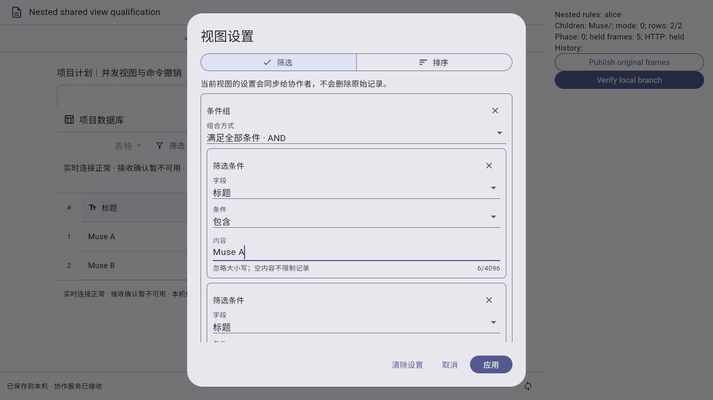
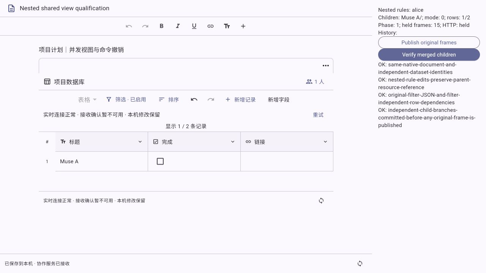
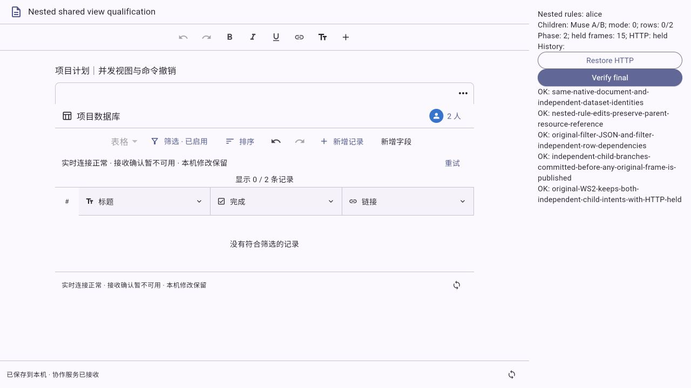

# P17：嵌套条件协作与存量安全边界

承接已冻结的 P16（501 份证据、439 份源码/输入），解决两人分别编辑同一 AND/OR 组内不同子条件时，整段 children 替换覆盖彼此意图的问题。先保留失败复现，再用原 Yrs Array/Map/移动和原 AppFlowy JSON 读取入口改进。筛选器、字段与原协作协议保持复用。

## 设计

新增组在创建时即使用共享 children 数组及带稳定 id 的共享子 Map；递归保留已有节点，只更新变化的子节点。叶子的 condition/content 仍按 P15 同一语义命令写入。父 AND/OR 模式仅在用户实际修改时写入，子节点编辑不回写旧父模式。原解码器通过 to_json 继续得到相同 FilterInner JSON，不新建另一套内容或合并模型。

存量 children 可能为 Any 原子数组，或原 FillRef 创建的数组但子元素仍为 Any Map。未经协调的两端同时把这些容器转换成新共享结构，会再造成覆盖。因此不能以“读取时自动升级”掩盖迁移问题：只在改变不兼容结构时明确拒绝，保留原值；未变化的旧组以及其他根条件/排序仍可保留操作。完整在线存量迁移需要服务端协调和版本门禁，作为显式待办，不把本地 hash 当全局锁。

## 交互与验收

沿用已有筛选条件组、AND/OR 选择、添加/删除条件界面，不增加另一套编辑面板。遇到旧容器时明确提示需要升级且当前条件未改变，不清空条件、不静默迁移。要覆盖：不同子条件同时修改、父模式与子项同时修改、不同子项新增/删除、排序、作者撤销及重开；真实 Cloud 双端在独立分支提交后通过原 WS2 合并。

先做核心复现与保存/迁移边界，再验证 macOS、iOS、Web UI。Android 延续用户“不安装”的要求。同 ID 新节点并发创建、类型转换冲突、全局迁移、完整 18 字段/5 视图、持久 ACK 与其余产品门禁仍单独跟踪，不因本轮增量完成而宣称完整保真。

## 本轮结果

已保留原实现的失败复现：两人改不同子项后，一人的修改被旧 children 整数组替换覆盖。新实现通过 50 项核心测试，包含双客户端顺序、同组不同子项修改、父模式与子项独立修改、空组内不同子项新增、删除与同伴修改、深层子项移动/重开、祖先组删除不复活、作者撤销、两种存量容器预检拒绝且原字节不变。Dataset 完整测试组 51 项通过，包含实际 Cloud 回归；原固定筛选和 Yrs 来源校验通过，没有修改其合并/编解码实现。

macOS 和 iOS 模拟器各通过 7 项 UI、3 项无凭据重开。两端先独立提交并暂存原协作帧，Alice 改左子项，Bob 改右子项，释放后双方值均保留；第二轮父组模式与同伴子项同时提交也保留。实际子表撤销/重做只改变作者的组模式，保留同伴子条件及父文档内容。

Web 主端 8 项、同伴 7 项、IndexedDB 离线 5 项、Native 从真实 Cloud 读回 4 项通过。网页也先核对未发布的两个分支，再发布原字节；HTTP 保持阻断时得到共同的两个子条件。界面仍是冻结设计对应的原条件组弹层，没有另造一套规则 UI。Rust WASM 的实际服务字节已核对摘要；含合成凭据的 Flutter JS 只记录摘要，不归档源码编译包。

## 兼容性限制

旧 Any children 与子项为 Any Map 的旧数组，修改子项前仍需协调升级；只改父模式或其他独立根节点可以继续。原 AppFlowy 客户端若用整体替换接口重写整组，仍可能替换新共享 children 容器：JSON 可读与二进制互通不等于所有旧写入器具备相同意图合并能力。后续需要写入能力协商和服务端迁移门禁，不能将本轮当作完整混合版本写入验收。

新增同 ID 节点碰撞、组/叶类型的并发转换、跨对象原子操作等仍待覆盖；本轮只增加明确验收的场景，不清除完整 50 项产品门禁的未完成状态。Android 未安装，物理中文 IME/软键盘几何未专项验收。
