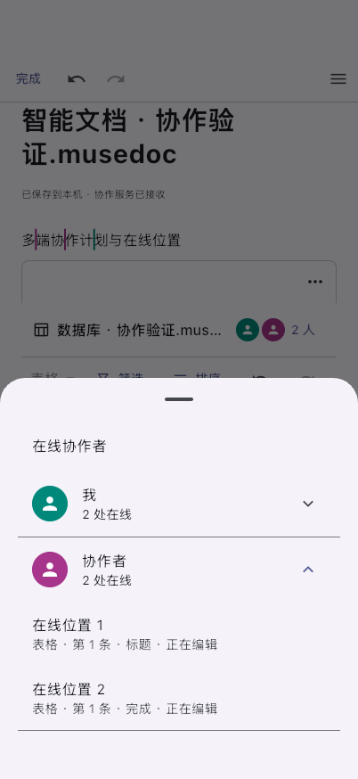
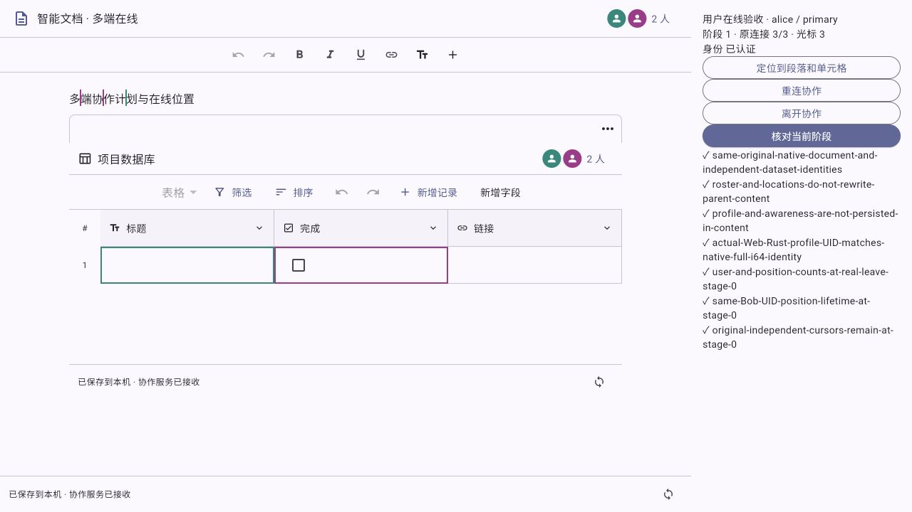
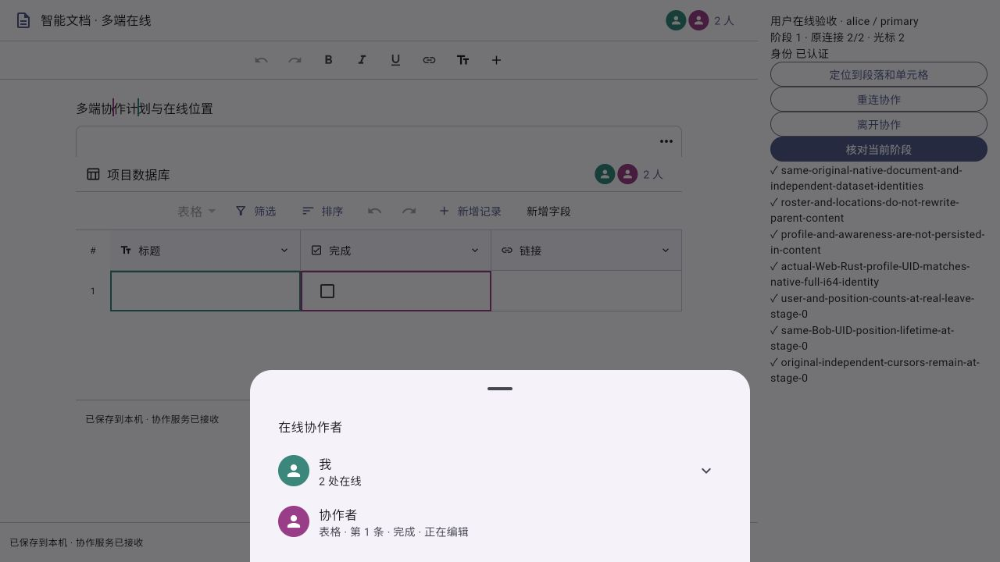
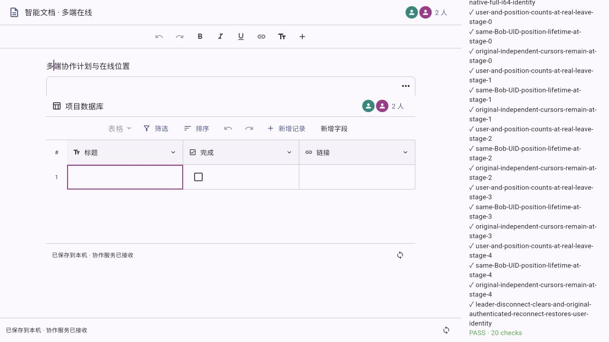

# P18：用户聚合与多端在线位置

承接 P17 冻结结果，补齐独立协作能力中的用户名单。沿用 WPS 对齐后的成员入口与底部名单面板，同一 UID 的多个在线位置聚合成一个用户；各位置的原光标和单元格状态仍分别保留。

## 领域边界与身份

聚合模型与纯函数放在 muse_collab_contract，不包含文档块、单元格、Flutter、AppFlowy 或权限枚举。原 Yrs Awareness 继续表达各会话的临时状态；名单是其派生投影，不产生另一套持久协作数据。muse_collab_widgets 负责成员展示，Document / Dataset 只提供已验证的远端 UID、会话与各自位置标签。

远端身份继续使用 Cloud 对 Awareness 的认证 UID/slot 归一。自身 UID 从同一 Cloud 的原 GET /api/user/profile 取得，不解码 JWT 后直接当作认证身份，也不接收 Awareness 自报姓名作为认证资料。原接口返回数字 UID，Web 的 JSON 数字可能丢失 64 位精度，因此用现有 Rust JSON 边界从原响应提取字符串 UID。只保留 UID；不把邮箱、profile、token 或在线状态写入内容快照。可信姓名仍走已有 Host resolver。

profile 请求不阻塞内容协作；失败时成员入口显示身份尚未确认，不猜测人数。身份回包用连接 epoch 隔离，断开、重连、关闭后旧回包不能恢复旧身份。网络请求限固定已验证 origin、认证 GET、响应大小与超时；不增加服务端权限或改协议。

暂时失败最多再尝试两次，间隔 5 / 10 秒；断开或关闭立即撤销自身在线身份并取消重试，不等待网络关闭完成。连接关闭的迟到结果也不能清除下一次连接的新身份。契约中的 actorId 是调用方当前协作域内的身份；本轮每个名单只消费同一已验证 origin / workspace / resource 的会话，不混合不同认证域的裸 UID。

## 交互

确认自身身份后，人数为去重后的在线用户总数，含自己。自己在其他窗口/端打开资源仍只计一人。名单按用户分组，每个用户展示多个在线位置，区分当前会话与其他会话；不将每条连接声称为一台物理设备。位置详情由资源领域生成，未获授权或无有效位置时仅显示在线，不显示草稿。

相同用户多个光标采用稳定用户颜色，保留独立选区和会话生命周期。关闭其中一个位置后该用户仍在线；最后一个位置离开后才移除用户。断开后的在线状态遵循原 TTL 和连接边界。

## 验收计划

验证纯聚合的重复、顺序、冲突与上限；64 位 UID 精度、profile 大小/状态/格式错误、关闭和重连后的迟到身份回包；共享 UI 的窄屏和展开列表。真实 Cloud 同时开启 Alice 与 Bob 多个会话，检查去重人数、各位置、逐个离开、断线恢复，以及身份和在线数据不进入内容缓存。macOS/iOS/Web 分别验收，Android 延续不安装要求。

本轮不替代共享 ACL 名单，不宣称分布式即时撤权、durable ACK 或完整产品已验收。

## 本轮落地与结果

上述模型、原 profile UID 解码、连接 epoch 隔离、有限重试和共享 UI 已落地。原 WS2/Yrs 协议与 Cloud 二进制保持不变。契约包不依赖 Flutter 或具体内容模型，成员面板只消费已验证身份与资源提供的位置标签；同一 UID 的文档光标、表格边框和成员头像使用稳定颜色。

验证结果：Realtime Rust 6 项（含完整 i64 UID、无关 profile 字段丢弃、非法响应和边界）、中立契约 5 项、共享 UI 5 项（含 320/430/1100 宽、多位置离开和身份冲突）、实时适配包 4 项（含原协议、连接/关闭迟到身份、认证 GET、重定向与未知长度超限响应）。Dataset 完整组 51 项、文档选定组 43 项，以及单独运行的原 Cloud 重启用例 1 项通过。相关包和 Native/Web 入口静态分析通过。

macOS / iOS 模拟器各通过 8 项主流程和 3 项无凭据重开。真实 Cloud 同时接入 Alice 当前/另一位置、Bob 两个位置；文档与内嵌数据库都显示两人，保留三个远端选区/单元格位置。逐个关闭 Bob 的位置后分别保留/移除该用户；关闭自己的另一位置仍显示一人。重连清除再认证身份，资源检查点不含 profile、token 或 Awareness，离线重开没有在线会话。

Web 用四个独立窗口重复该流程：主端 20 项，Bob 两端和本人另一窗口各 5 项，IndexedDB 离线重开 4 项，Native 读取相同 Cloud 对象与回执 4 项。五阶段记录为：远端位置 3/2/1/0/1，用户总数 2/2/1/1/2，Bob 的位置数 2/1/0/0/1。Web 从原 profile 得到的字符串 UID 与 Native 完整身份一致，三套实际服务的 WASM/JS glue 已逐字节核对摘要。包含合成凭据的 Flutter 应用 JS 只记录摘要。

## 测试调度与限制

首次将文档完整套件和 Dataset 并行运行，文档的重启用例重启了本轮所有的 Cloud，导致一条 Dataset 请求被中断；原失败日志保留，串行/隔离后的对应检查通过。文档旧 `media_web_readback_test` 另依赖之前浏览器文件选择器上传的指定图片，其当前前置对象不可用；本轮不计其通过，P6 冻结图片证据保持原样。P18 文档计数明确为 43 + 1，不声称全部 45 项通过。

当前验收规模是两个用户、四个位置，未代替大规模性能与故障验收。姓名仍走既有可信 Host resolver，默认显示“协作者”，未实现完整组织目录或头像服务。公开共享 ACL、跨实例即时撤权、权限继承、持久 ACK/outbox、Office 在线范围及其余编辑保真项目继续开放。Windows/Linux、物理中文 IME 与软键盘几何未专项验收，Android 未安装。完整 50 项功能门禁仍保持未完成。
