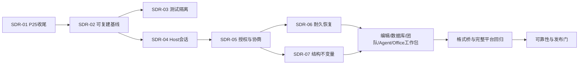

# 更新开发计划与执行入口

版本：**SD-PLAN-20261107-R1**。依据 [进度评审](49-PROGRESS-REVIEW-20261107.zh-CN.md)。本文件接替旧计划中“当前下一批”的执行优先级；不覆盖已冻结的产品、设计、SD-F1 或历史执行档案。机器可读工作包见 [development-backlog.json](development-backlog.json)，完整功能范围仍由 [50 项家族账本](siyuan-collaboration-parity.json) 管理。

## 1. 当前起点

最新已冻结切片 P24；P25 Native 已通过，但 Web 同对象全链、重启回读与执行归档未完成。完整目标未缩减。先按用户要求提交当前可审查代码并给出交接；代码检查点可以包含明确标识的 WIP，不能替代下列退出门槛。

旧 6–8 人、18–28 周只是原受限 0.1 规划假设，未证实团队已到位。当前按一个实现流与一个验证流限 WIP；不设虚构负责人或完成日期。建议采用 5 个工作日的滚动检查周期，起日和容量落实后再排日历。

## 2. 先执行的三个工作包

### SDR-01：关闭 P25 块公式验证

范围仅是当前块公式切片，保持原 AppFlowy math_equation/formula 和固定 Flutter renderer。行内/完整 KaTeX 等继续留在 SY-07 缺口。

1. 确认当前提交与原生回执匹配；提交准备中的纯风格修复单列记录，不将其当 Web UI 验收。
2. 使用 [P25 macOS 回执](progress/20261107/p25/macos/formula-e2e.json) 的同一 objectId/formulaId 准备 Web 公共配置；凭据只在 .build 私有文件中，绝不写入源码或提交。
3. 两浏览器真实操作：原公式编辑与远端正文分支先分别成立，再释放原 HTTP/WS；验证旧草稿拒绝、作者 undo/redo、第二公式插入。
4. 验证 IndexedDB 离线重开；两端离开后，仅重启任务自有 Cloud，再无缓存 Native 回读同一对象。
5. 核对原包/字体/ABI/Native/WASM 摘要；保留原始失败，归档截图、日志、完整源输入。此前复制的进度回执不能代替完整执行冻结。

**退出：** 本切片全部平台用例完成、源码与产物对应、文档/视觉关联、执行验证器通过；P25 方可记已冻结。SY-07 仍因行内/完整保真等保持 partial。

### SDR-02：建立受控可复建基线

先交付按仓库/职责拆分的本地提交和交接清单，明确哪些是 P24 已冻结能力、哪些是 P25 WIP。排除 .build、target、build、私有配置、token、生成应用 JS；上游原始包/字体作为可验证来源有意保留。已有其它产品改动不混入。

P25 收尾后，形成跨仓版本锁，在干净检出/隔离环境重建客户端、Web 和 Cloud。固定 package、Cargo/pubspec lock、受控补丁、运行时和生产开关；明确回退。**本地提交完成只关闭代码检查点子项，未干净复建前 SDR-02 仍待验证。**

### SDR-03：隔离测试输入与验收层级

按 unit/component/service/UI/manual 分类；每次运行有独立对象/命名空间、显式准备和固定回执。保留旧浏览器文件选择器探针全部断言，在新 fixture 上重建真实上传→Native 回读链。统一失败、未运行与外部前置不满足的报告，不能让常规测试偶然依赖几周前的浏览器状态。

## 3. 之后的优先级与依赖

| 工作包 | 优先级 | 交付 / 退出重点 |
| --- | --- | --- |
| SDR-04 | P0 | 生产 Host registry、对象解析、单 owner 与子 surface 生命周期；实际 Host 验证 |
| SDR-05 | P0 | 服务端所有写入口授权/领域校验、继承权限、多实例撤权、能力协商 |
| SDR-06 | P0 | durable ACK、持久 outbox、幂等重试、崩溃恢复、删除/恢复屏障 |
| SDR-07 | P0 | 稳定移动/缩进/拆合，单父/无环/可达及跨端并发负例 |
| SDR-08 | P1 | 标记/代码/行内公式/快捷输入/折叠等日常编辑差距 |
| SDR-09 | P1 | 可变富文本表格、合并拆分、跨格粘贴和拓扑协作 |
| SDR-10 | P1 | 数据库完整字段/布局、关系计算、分组、来源块和明确协作语义 |
| SDR-11 | P1 | 图片全生命周期、系统来源、通用附件与音视频 |
| SDR-12 | P1 | 稳定引用/嵌入/IAL/反链、查找索引和受限查询 |
| SDR-13 | P1 | 私有分享、锚点评论/@、通知与完整在线位置 |
| SDR-14 | P1 | 产品版本历史、只读预览、资产清单和恢复屏障 |
| SDR-15 | P1 | Agent 受限查询、真实读集、幂等命令/作业、冲突重读与定位 |
| SDR-16/17 | P1 | 高级元素与插件注册/渲染/命令/工具栏合同、未知与卸载策略 |
| SDR-18 | P1 | Markdown/SiYuan 格式桥、固定语料往返与可恢复包 |
| SDR-19 | P1 | 真实 Office 独立资源 provider，同屏与本领域协作 |
| SDR-20/21 | P0 发布门 | 真实目标平台/设计回归、容量/性能、故障与多实例运行保障 |
| SDR-22 | P0 发布门 | 全家族、发布/灰度/恢复及独立评审；完整 gate 必须通过 |

P0 表示发布/基础阻断，不声称已经发生生产事故。详细前置、原 T 任务、角色、验收和缺口在 JSON 中；没有到位的人名不填实际负责人。



图只展示主依赖，完整有向无环图以机器账本为准。可以提前做语料盘点、接口评审和测试准备；尚未具备前置时不得开启未经验证的写入能力。

## 4. 状态、完成定义与变更控制

状态统一为 planned、ready、in_progress、verification_pending、done、deferred。某工作包 done 不自动关闭关联 SY/CO 家族；家族需要完整功能和所有要求平台证据。执行 P 编号作为历史证据，不再混充产品里程碑。

一个实现工作包关闭至少需要：

- 范围、前置、责任角色和验收条件明确，产品/设计行为能追踪到代码。
- 原模型/组件复用与领域边界可评审，所有写入口符合既定授权/校验合同。
- 正例、负例、失败恢复和目标平台验证完成；失败、手动前置和未运行显式保留。
- 代码版本、依赖/补丁、测试输入与产物摘要对应；文档及回退材料更新。
- 独立评审职责有承接人；当前没有承接人时不能自行推定已完成独立审核。

新增元素、引擎/协议 profile、权限或持久化语义变更要补 ADR/变更记录与旧版本样本；不因用户希望尽快完成而降低功能家族或最终多端门槛。

## 5. 测试与运行入口

命令在 smart_document 目录执行，Flutter 子包按示例显式指定工作目录：

```sh
python3 scripts/verify_parity.py
python3 ../docs/smart-document/v1/scripts/verify_board_evidence.py
python3 scripts/verify_math_vendor.py
cargo test --locked --manifest-path rust/Cargo.toml
cargo test --locked --manifest-path dataset/rust/Cargo.toml
(cd flutter && flutter test --exclude-tags=manual-browser-filepicker)
(cd dataset/flutter && flutter test)
```

数学 Native 切片使用 `python3 scripts/verify_formulas.py --device macos` 或交接文档中明确的 iOS 模拟器 ID。命令会构建独立验证 App；Android 不安装、不运行。完整门 `python3 scripts/verify_parity.py --require-complete` 当前应返回 1，不能视作常规构建失败或改成假通过。

旧执行档案用默认验证检查完整性；对旧档案加 --source 会与演进后的源码不一致，不能修改档案“修复”。重建新证据应创建新执行目录。Cloud 重启、fixture 更新和 UI 测试必须顺序执行，避免人为打断验证。

## 6. 排期和接力规则

建议每个滚动检查周期选不超过可兑现容量的工作包；开始前填写 O/M/P 三点估算，以 (O+4M+P)/6 估算有效人日，再结合实际角色和净容量排关键路径。当前只给候选范围 SDR-01→02→03，不给未经核定的日历承诺。

每次交接必须给当前提交、未提交差异、已通过/失败/未运行、复现命令、活动服务、敏感文件位置规则、下一条任务与退出条件。具体入口见 [详细交接](51-DEVELOPMENT-HANDOFF.zh-CN.md)。
