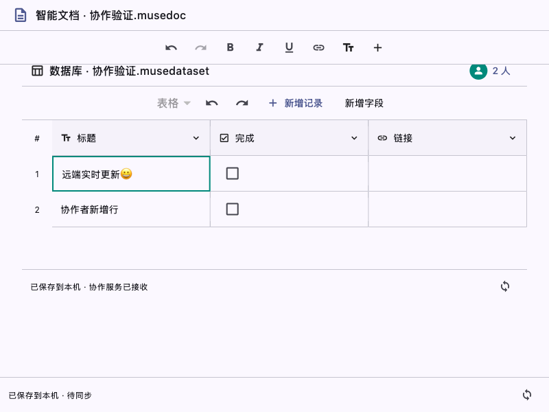
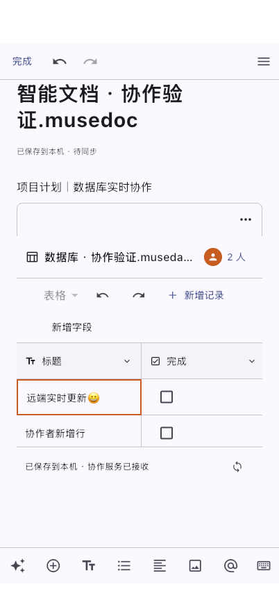
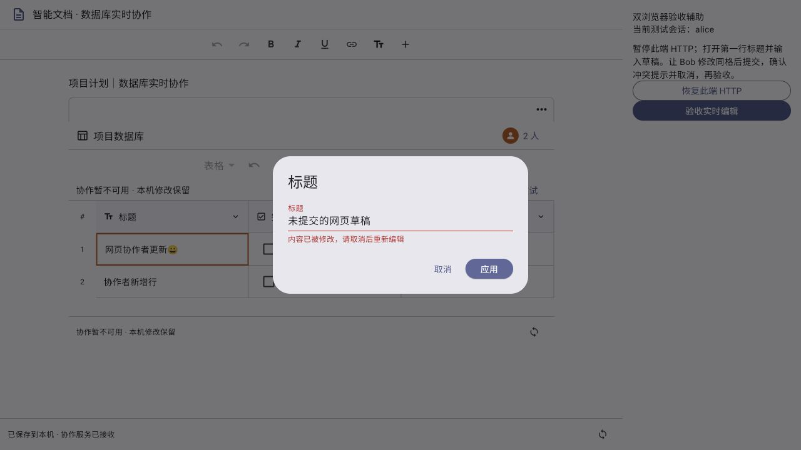

# P11 独立数据库实时协作

复用原 WS2、Yrs Awareness、Database 1/Row 4、共享 Grid 和公共资源会话。Native 6 项真实通路检查、实际 Guest 7 项；macOS/iOS 各 8 项 UI、3 项新进程恢复。
双浏览器 Alice 9 项、Bob 7 项、重载 5 项；Native→Web→Native 4 项。同格草稿冲突保留真实 AX 文本和截图，实际 core undo/redo 被观测而未替换。

bridge_macos 是浏览器继续编辑的原生来源，macos/ios 是最终状态文字与同一功能的回归。source 保存自有代码快照，原版依赖仍由固定 revision/清单/补丁确定。
原 WS2 为工作区广播，当前客户端关注前 128 行，未把它称为协议级订阅。完整 SiYuan/协作门保持拒绝，Android 未安装。

