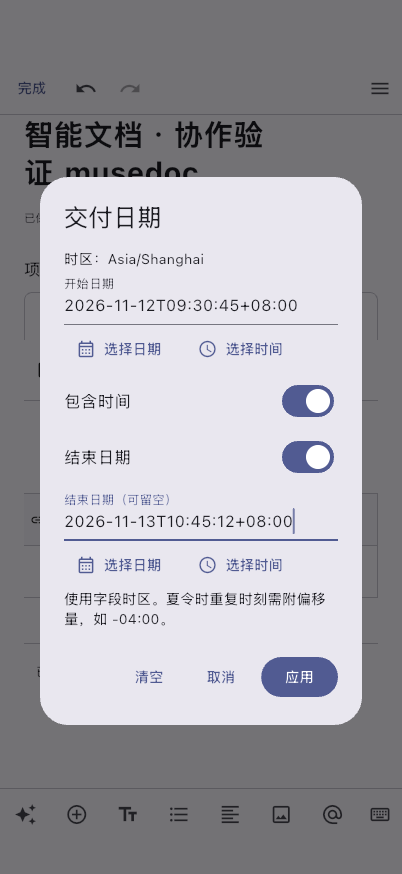
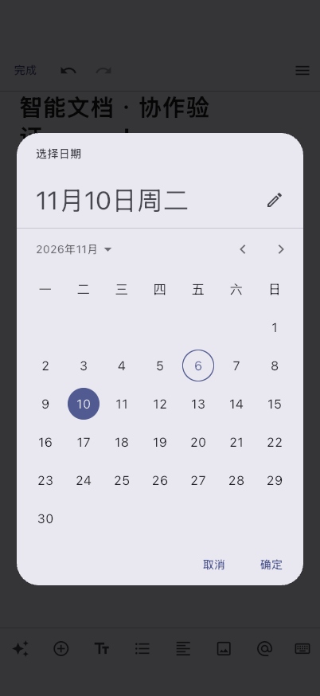
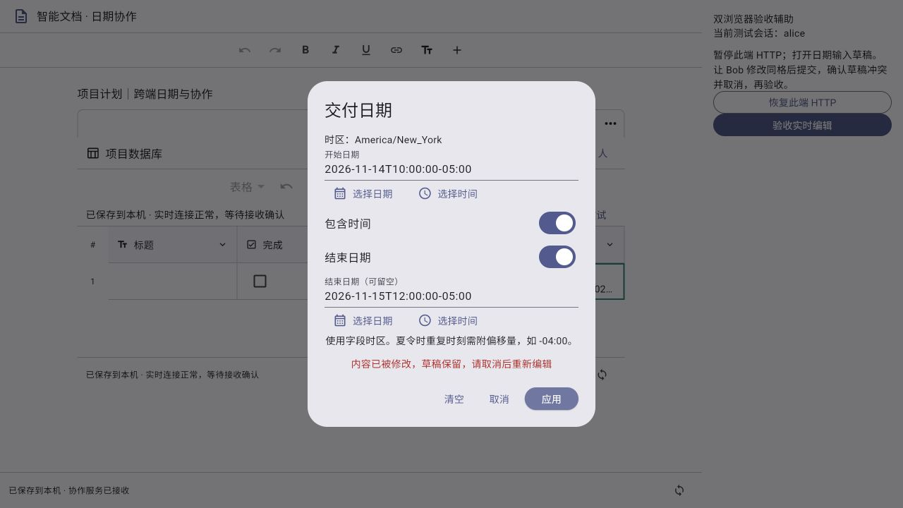

# P12 原日期字段与嵌入键盘边界

原 DateTypeOption/DateCellData、独立 Root 1/Row 4 和 WS2。Rust 14 项，Dataset 本地 25 个独立用例，正文 32 项，公共 SDK 3 项；macOS/iOS 各 7 项 UI、3 项无凭据新进程。

浏览器 Alice 9、Bob 7、IndexedDB 恢复 5、原生读回 4。bridge_macos 是浏览器继续编辑的实际对象来源（6 项，早于最终选择器 UI）；macos/ios 为最终 UI/source 回归。diagnostic 保留输入宽度缺陷及失败/取消记录，不计验收通过。source 为自有源码快照，runtime-artifacts 保存已核验的日期 WASM/glue。完整思源/协作门仍拒绝，Android 未安装。

