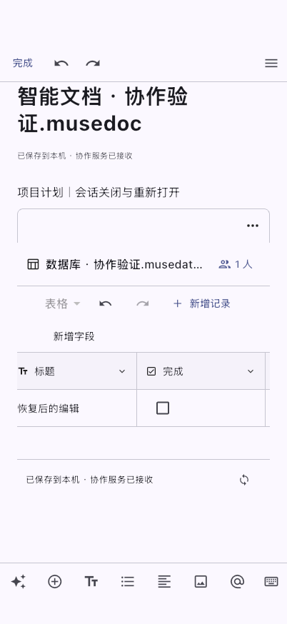
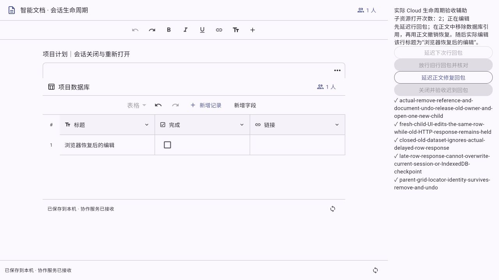
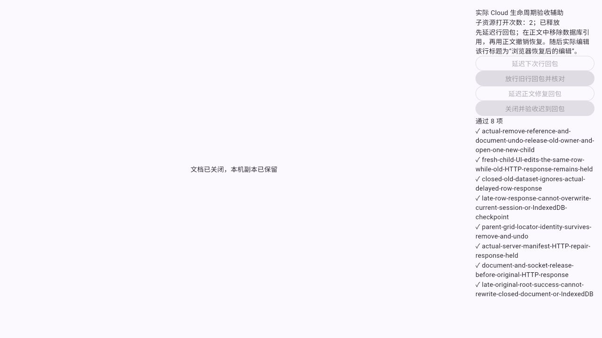

# P13 会话关闭与异步权限边界

保留原文档 5 项、数据库 6 项失败复现。新增生命周期分别 6/8 项，本地完整组 38/33 项；Dataset SDK 3 项、原文档真实 Cloud 4 组。Document SDK 没有独立单测文件，不计通过；公开会话由实际应用路径验证。

macOS/iOS 各 6 项 UI、3 项无凭据新进程。macos 是网页继续编辑的同一实际对象来源；网页 8 项、IndexedDB 重开 4 项、Native 读回 4 项。响应来自原服务器，缓冲期间还没有发生传输超时，迟到成功/失败都必须遵守会话代次。

source 含自有源码及 PNG/zstd 测试输入。诊断日志不计为成功验收。生产 Host 统一资源目录/会话池、完整思源和协作门仍未通过，Android 未安装。

