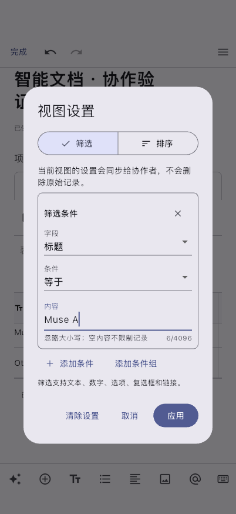
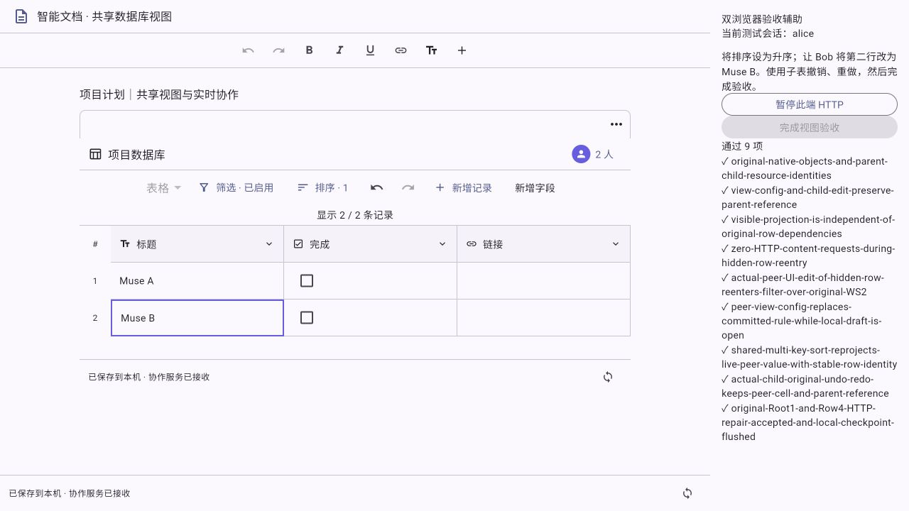
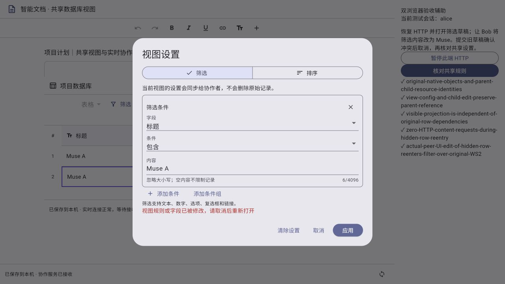

# P14 原数据库共享视图规则

复用固定 AppFlowy 客户端纯筛选器和原测试，使用原 Root1/Row4/WS2。原规则 14 项、内容核心 25 项、数据库本地完整组 36 项、公共 SDK 3 项；macOS/iOS 各 7 项实际 UI 与 3 项新进程恢复。网页 9 项、协作者 4 项、IndexedDB 重开 4 项、Native 读回 4 项。

macos 是网页继续编辑的同一原生对象来源。筛选显示与协作依赖分离；真正挡住 HTTP 后，隐藏行仍通过原 WS2 更新并重新显示。保留原错误配置、字段/单元格编码，旧草稿不得覆盖同伴新配置。浏览器主要验收单主排序键，多键优先级由核心测试覆盖。

诊断中的缺字段/缺标题和错误测试文件名属于测试准备错误，不计成功。完整产品仍未验收，Android 未安装。

