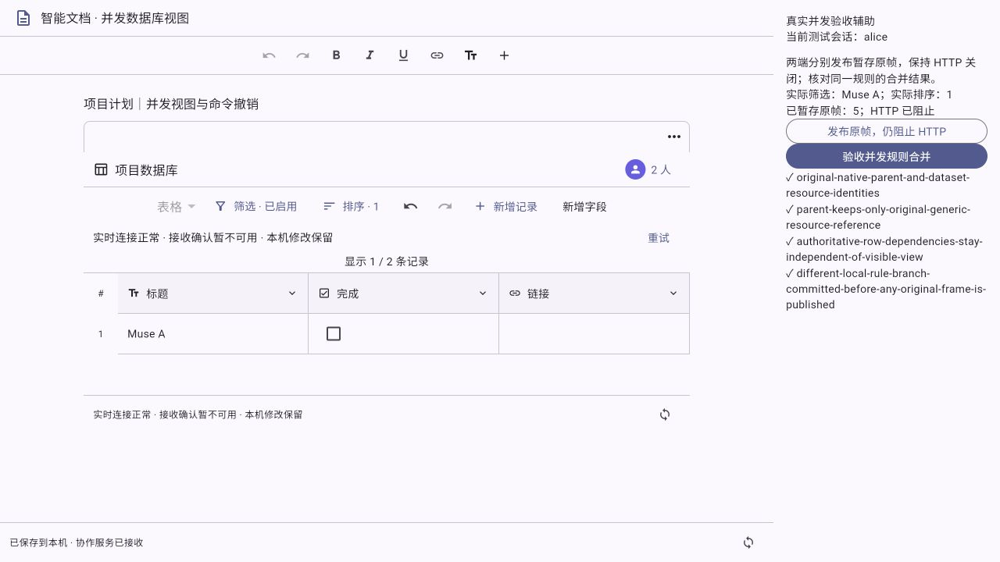
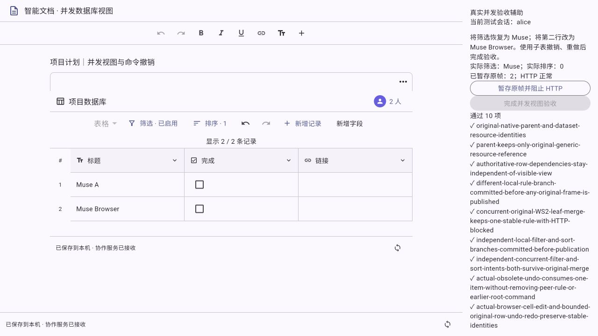

# P15 原稳定规则节点与单项撤销

原整数组替换 2 项失败、原撤销跳过当前命令 1 项失败已保留。使用原 ArrayExt/Map/move_to；Yrs 0.23.5 校验发布包的 64 个原文件，只增加可选单项弹栈 API，原默认 API 与反演/合并/编解码保持原样。原撤销测试 19 项、内容核心 34 项、本地完整组 38 项、公共 SDK 3 项、实时包 2 项通过。

macOS/iOS 各 7 项 UI、3 项无凭据新进程。网页主端 10 项、同伴 8 项、IndexedDB 重开 5 项、Native 读回 4 项。两端先各自在未发布原字节流的分支提交，再通过原 WS2 合并；HTTP 在合并阶段被阻止。macos 是网页相同对象来源。

应用 JS 仅记录摘要，不复制含合成测试凭据的编译包；实际浏览器 WASM 与运行时摘要逐字节匹配。诊断中的依赖/CMake、客户端帧误用服务端解码及辅助区刷新属于测试准备/呈现问题，不计成功。完整产品仍未验收，Android 未安装。

