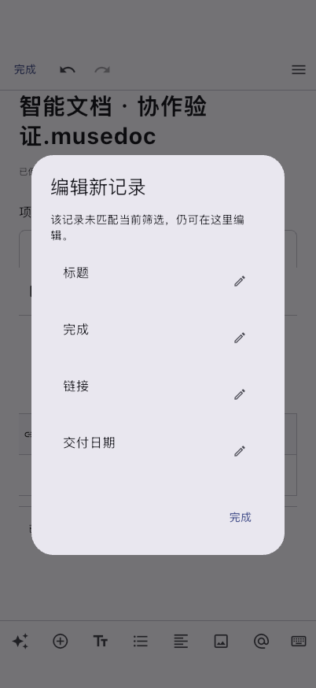
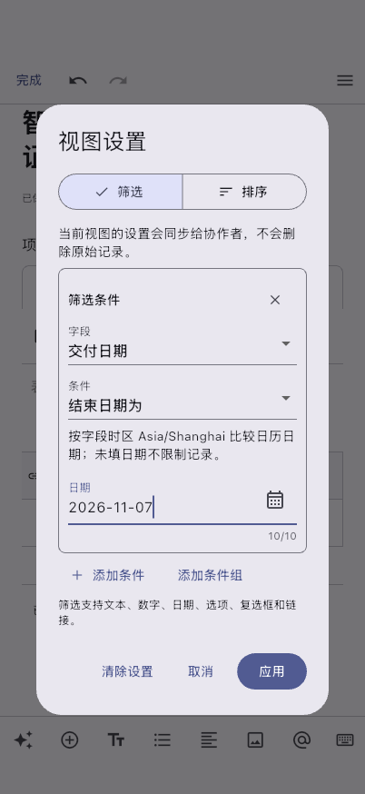
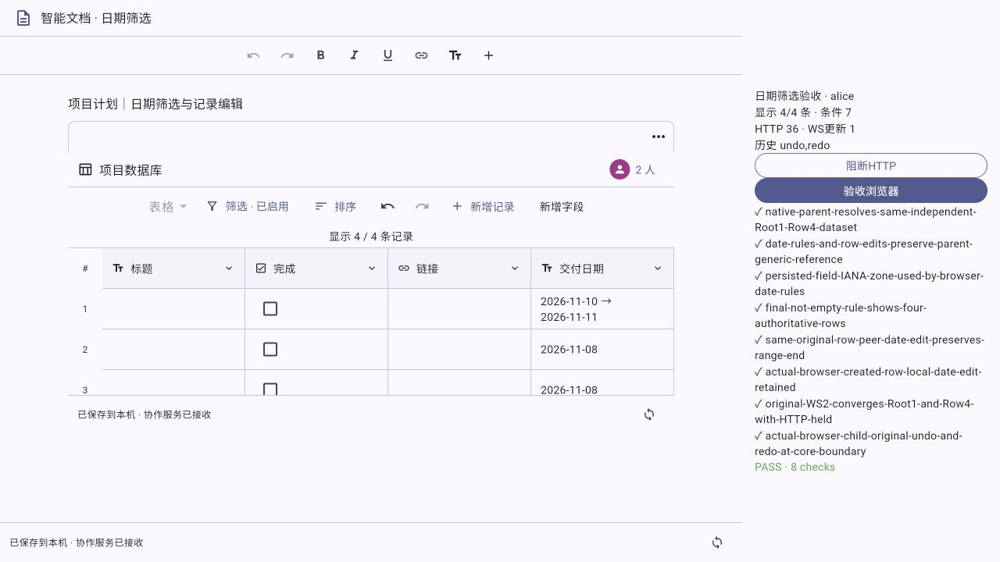

# P16: original date rules, seed decisions and hidden record editor

See the linked P16 design addendum for product scope and Chinese interaction specification. Original filter tests: 21; core: 44; complete Dataset package: 51. macOS/iOS: 8 UI + 3 fresh-process each. Web: 8 / peer 7 / offline 7; Native real-Cloud readback: 4.

Working source snapshots and fixed upstream extraction are fingerprinted. Application JS containing synthetic credentials is represented only by a digest. Diagnostic timeout and automation reflow are not passes. Full product remains NOT COMPLETE; Android unrun.

