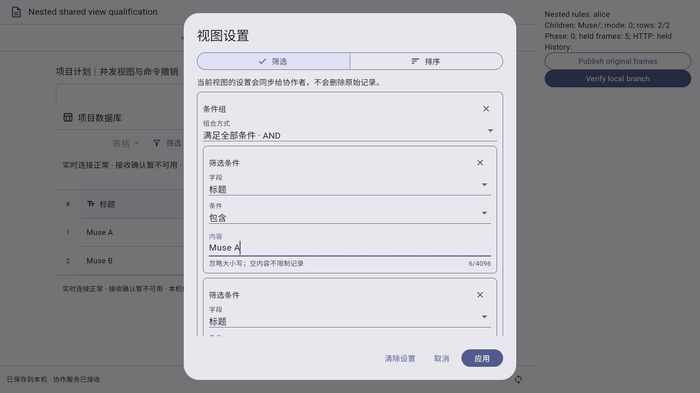
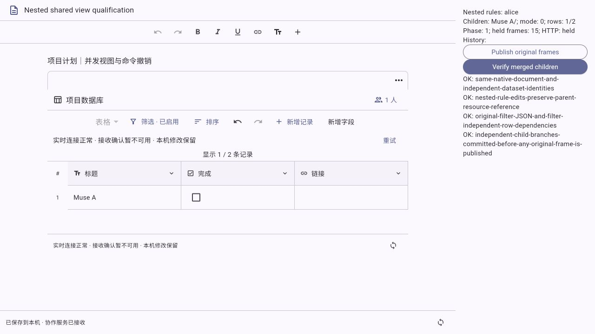
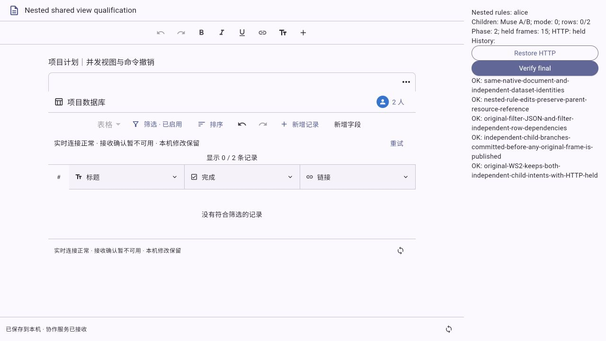

# P17: nested original shared rules

Original atomic-children intent-loss reproduction retained. Shared Array/Map children retain stable identities; legacy child mutation is explicitly refused before mutation. Core 50 and full Dataset package 51 pass. macOS/iOS each 7 UI + 3 fresh-process. Web 8, peer 7, offline 5, Native real-Cloud readback 4. Full product NOT COMPLETE; Android unrun.

