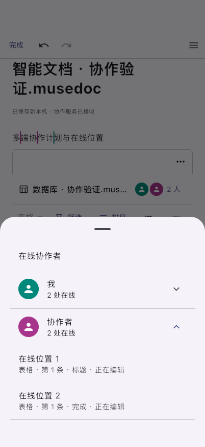
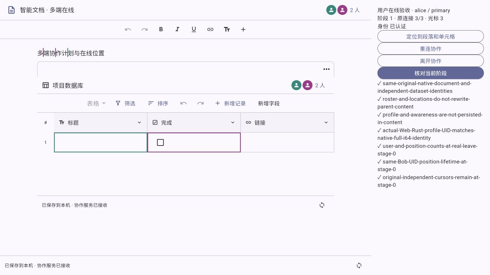
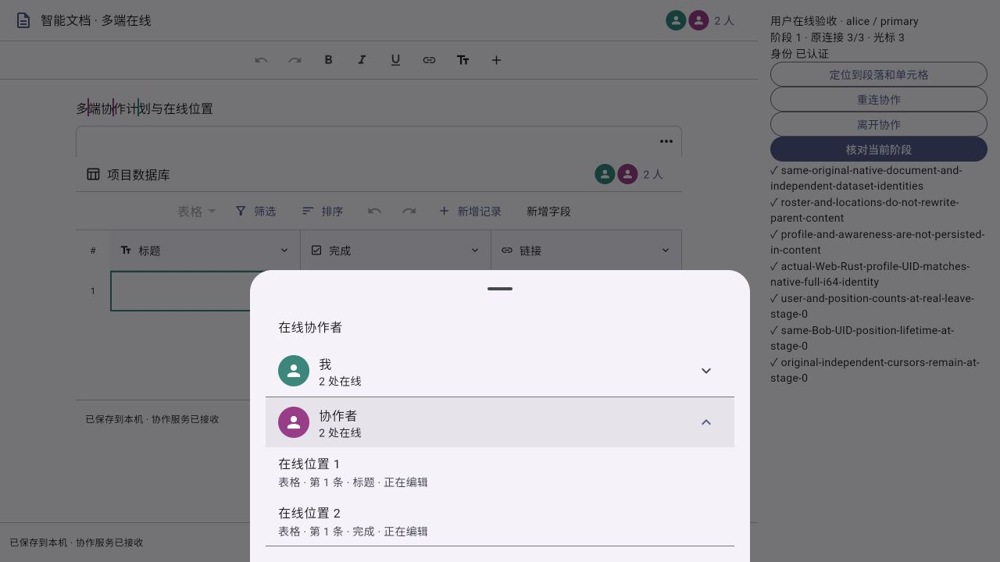
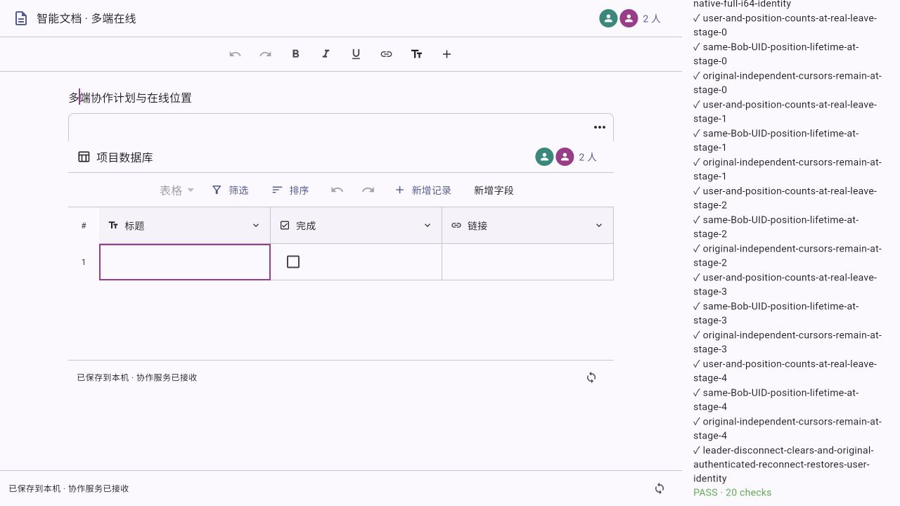

# P18: authenticated user roster and multiple live positions

Rust identity decoder 6; neutral contract 5; shared UI 5; realtime adapter 4. Dataset 51, selected Document 43 and isolated Cloud restart 1 pass. macOS/iOS each 8 UI + 3 fresh-process; browser primary 20, three other positions 5 each, offline 4, Native real-Cloud readback 4. Original Cloud binary remains unchanged.

Initial concurrent restart failures and old manual browser-media prerequisite are retained as diagnostics, never passes. Profile/online state stays transient. Application JS with synthetic credentials is digest-only. Full product NOT COMPLETE; Android unrun.

