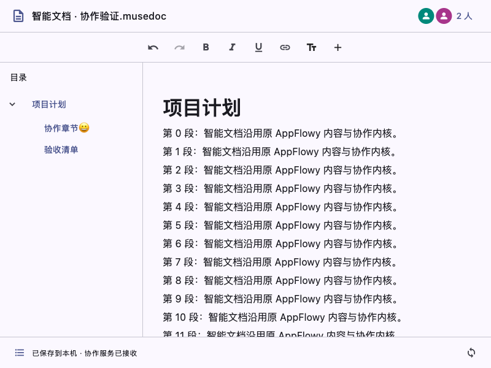
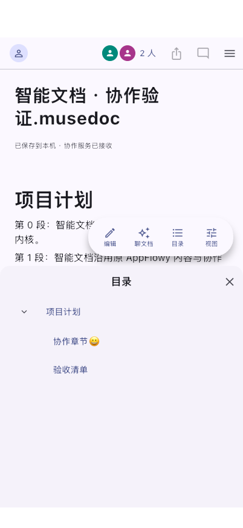
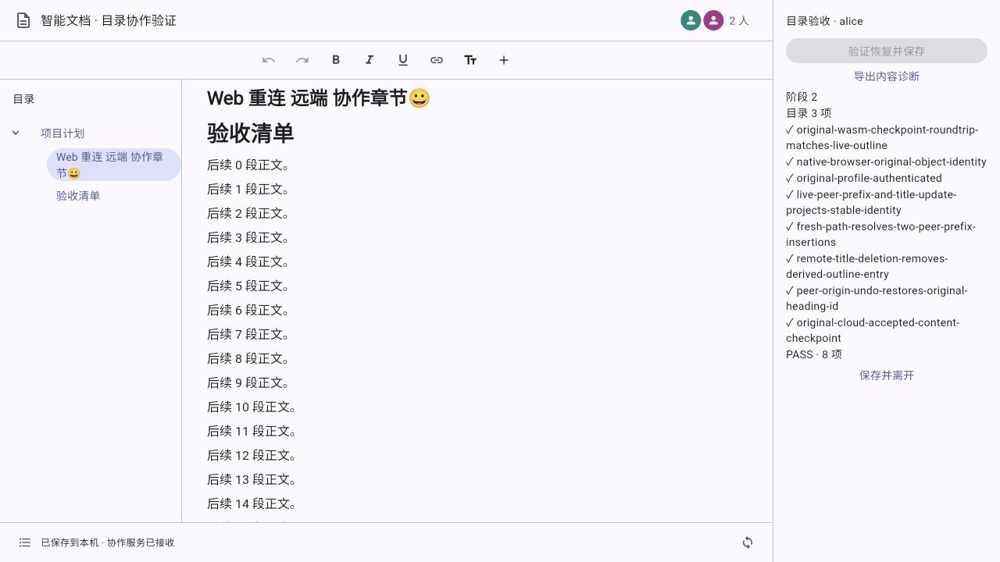

# P19：协作正文目录与原删除尾部修复

Document Rust 27、Dataset Rust 50；原 Yrs 完整库 305 通过 / 1 沿用上游 ignored；Document 46 + 独立 Cloud 重启 1、Dataset 51、公共 Dataset SDK 3。macOS/iOS 各 8 UI + 3 重开；Web 8、Bob 5、离线 4、Native Cloud 读回 4。

固定原 AppFlowy/SiYuan 参考，保持原协议；Cloud 本轮重新构建，含同一 GC 删除尾部修复。早期失败保存在 diagnostic，不计作通过。应用 JS 与测试身份不复制进证据。完整产品 NOT COMPLETE，Android 未运行。

