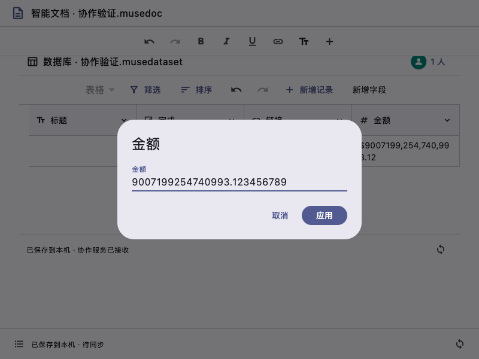
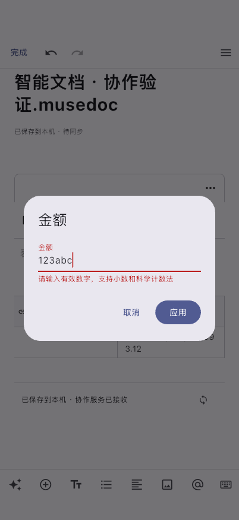
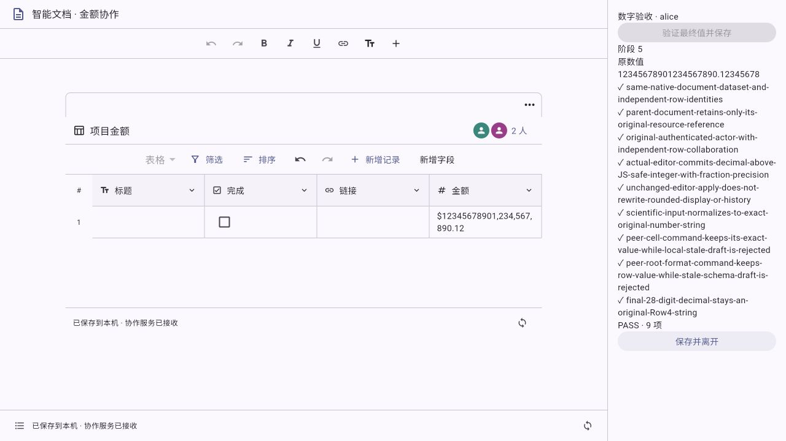

# P20：数字原值、显示与协作草稿分离

Dataset Rust 56、Flutter 54、公共 SDK 3；macOS/iOS 各 8 UI + 3 重开。Web 9、Bob 5、离线 5；Cloud 独占服务重启后 Native 同对象回读 4。

固定原 AppFlowy/SiYuan 参考，保持 Database1/Row4 和原数字字符串；本轮无新协作协议。Cloud 二进制沿用 P19 GC 修复。显示长金额分组仍有差异，未据此宣称数字格式全部对齐。早期失败保存在 diagnostic，不计作通过；应用 JS 与测试身份不复制进证据。完整产品 NOT COMPLETE，Android 未运行。

