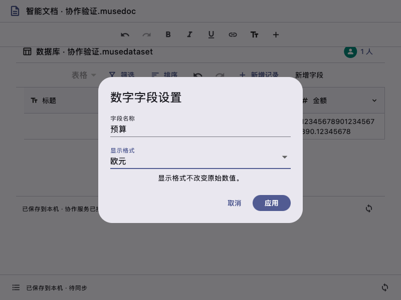
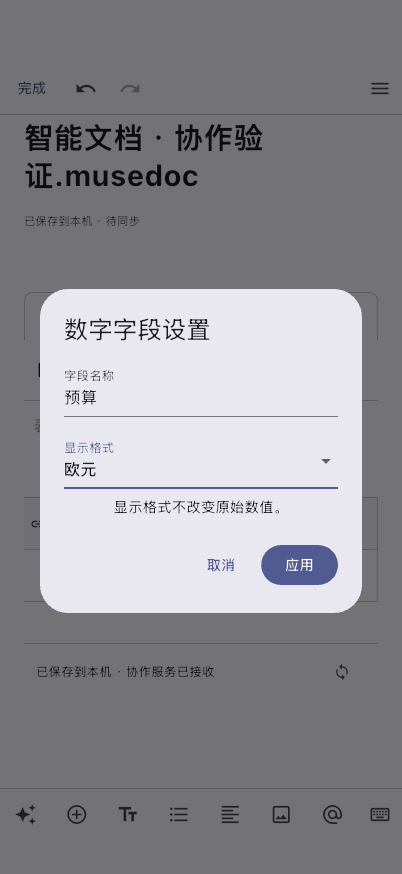
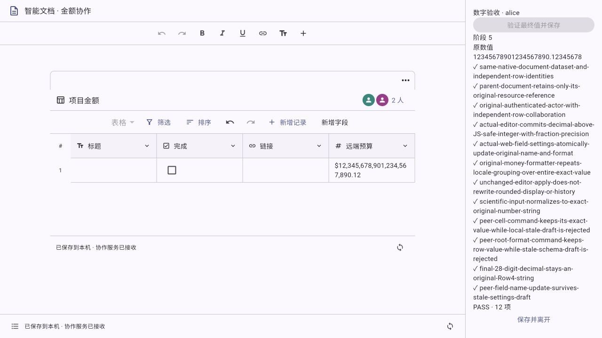

# P21：数字字段设置与完整金额分组

Dataset Rust 58、Flutter 57、公共 SDK 3；macOS/iOS 各 11 UI + 3 重开。Web 12、Bob 6、离线 5；Cloud 独占服务重启后 Native 同对象读回 4。

名称/格式在原字段事务中应用；金额继续复用原 Money/LocalFormat/Formatter，只重复原地区分组至 Decimal 容量。原 Database 76 文件 / 7 可逆补丁，资格探针保留 6。原始失败保存在 diagnostic，不计作通过；应用 JS 与测试身份不复制进证据。完整产品 NOT COMPLETE，Android 未运行。

