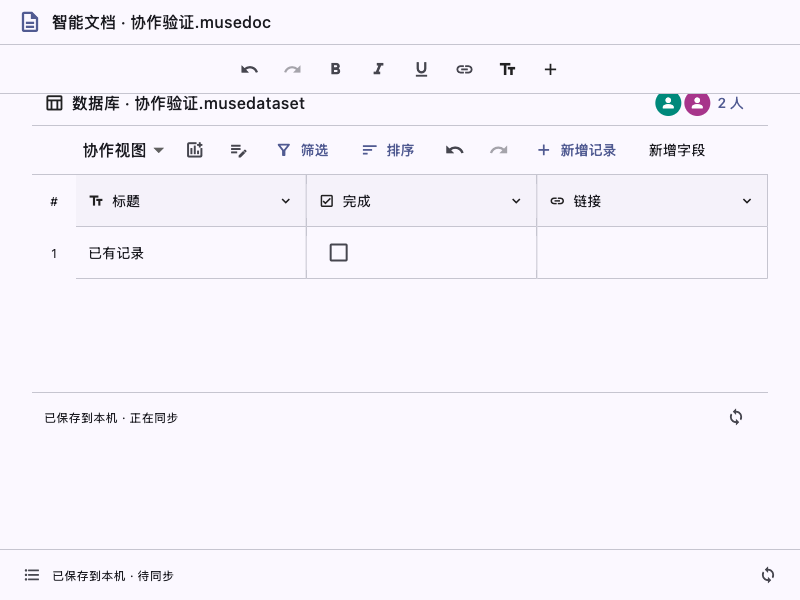
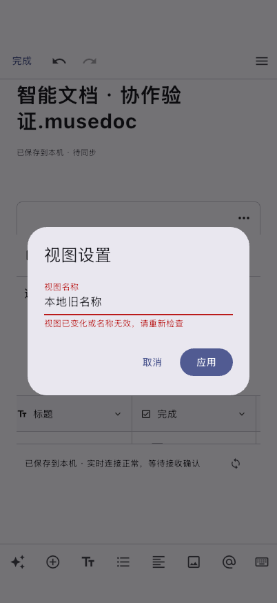
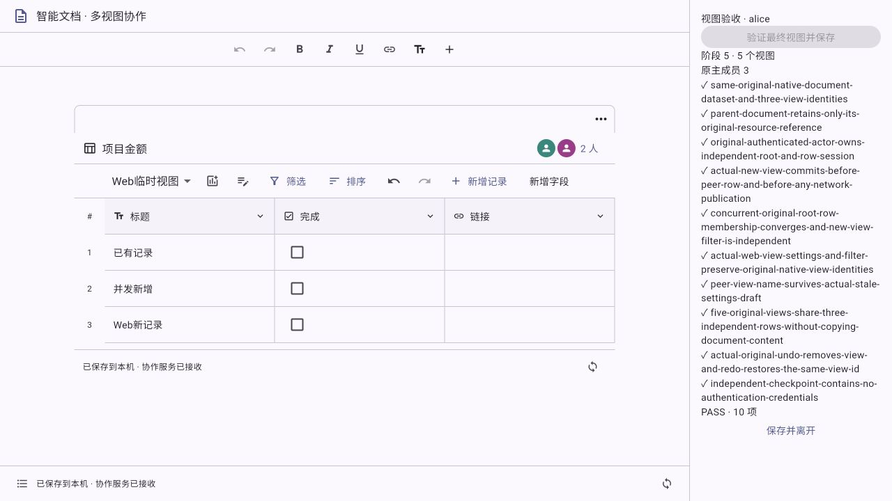

# P22：共享数据库的独立视图身份

Dataset Rust 62、Flutter 60、公共 SDK 3；macOS/iOS 各 9 UI + 3 重开。Web 10、Bob 8、离线 5；Cloud 独占服务重启后 Native 同对象回读 6。

原 CreateLinkedView/Root1/Row4、独立筛选、主成员投影、稳定选择及原 Awareness。Alice 4 视图/2 行、Bob 3 视图/3 行在发布前各自提交，最终 5 视图共享 3 个独立行。原漏行负例与补充位置检查前的旧运行保留在 diagnostic，未算作最终验收。应用 JS 和身份凭据不归档。完整产品 NOT COMPLETE，Android 未运行。

