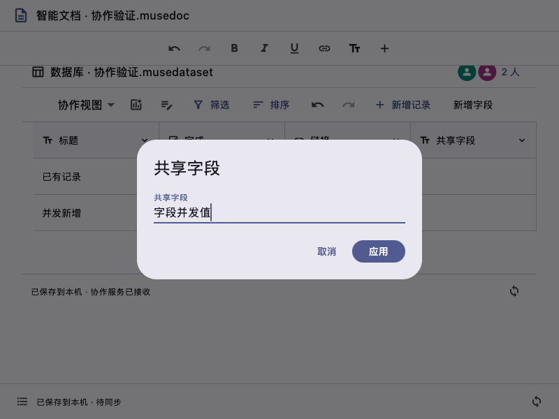
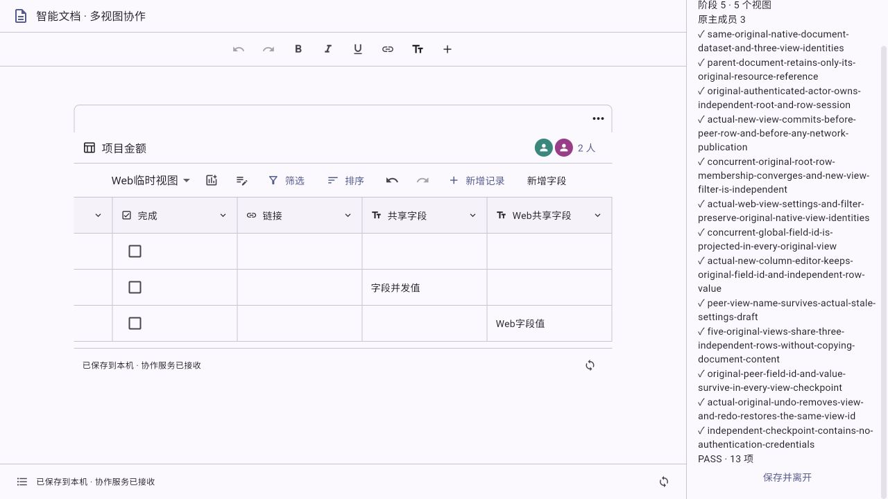

# P23：多视图共享字段与原记录编辑

Dataset Rust 63、Flutter 60、公共 SDK 3；macOS/iOS 各 11 UI + 3 重开。Web 13、Bob 9、离线 5；Cloud 重启后 Native 同对象回读 7。

原 FieldMap 为 schema 真源，视图顺序只派生显示；Grid、记录详情和规则预检共用同一字段集合。新视图/字段/记录分支独立提交后合并，五个视图共享五个原字段、三条独立记录；原生与 Web 行值同时保留。原漏列负例和两次 iOS 定位失败保存在 diagnostic，不计作通过。最终使用可见区域内真实滑动并严格命中单元格。应用 JS 和身份凭据不归档。完整产品 NOT COMPLETE，Android 未运行。

