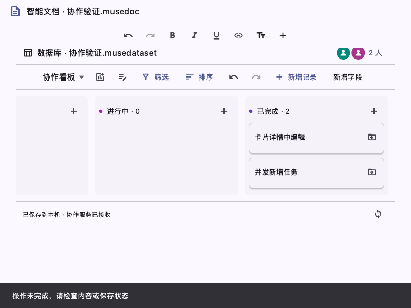
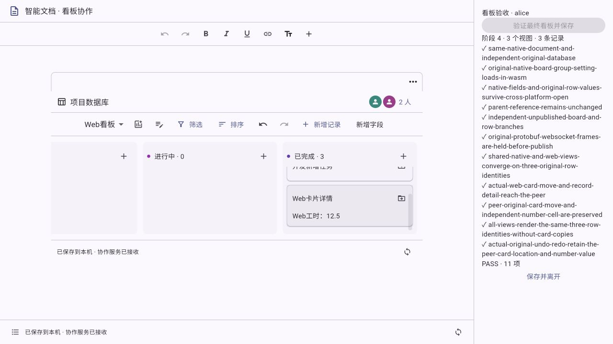

# P24：原记录的单选分组看板

Dataset Rust 66、Flutter 64、公共 SDK 3；macOS/iOS 各 9 UI + 3 重开。Web 11、Bob 10、离线 6；Cloud 重启后 Native 同对象回读 7。

原 GroupSetting 与 Option ID 派生列，卡片引用原行；移动与详情共用原 Row4。真正独立分支合并，过期移动拒绝，原撤销/重做保留远端分组与数字。早期构建间投影变化的重开失败保存在 diagnostic，不计作通过。应用 JS 和凭据不归档。完整产品 NOT COMPLETE，Android 未运行。

