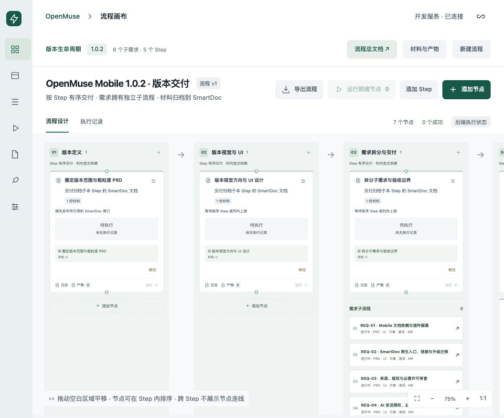
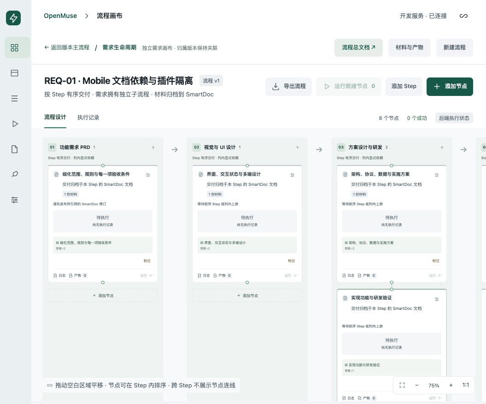
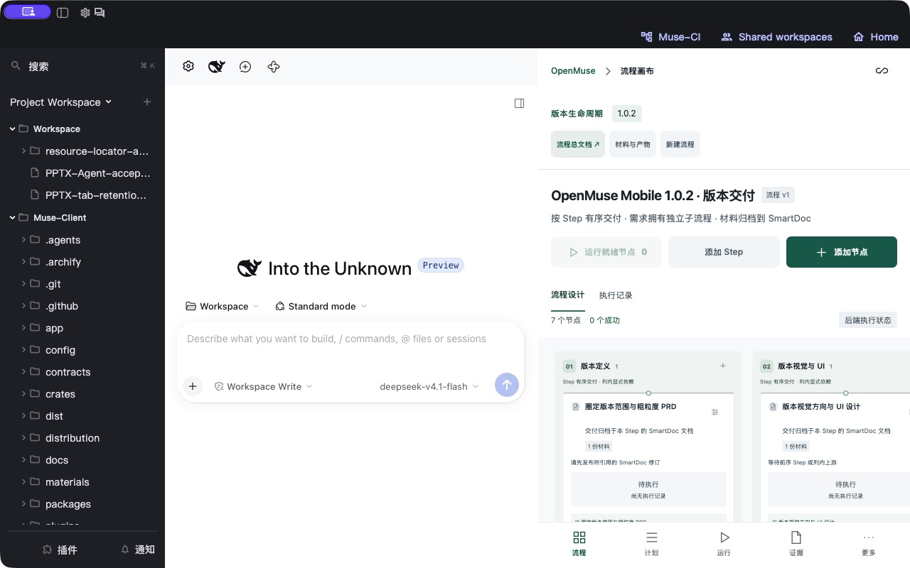
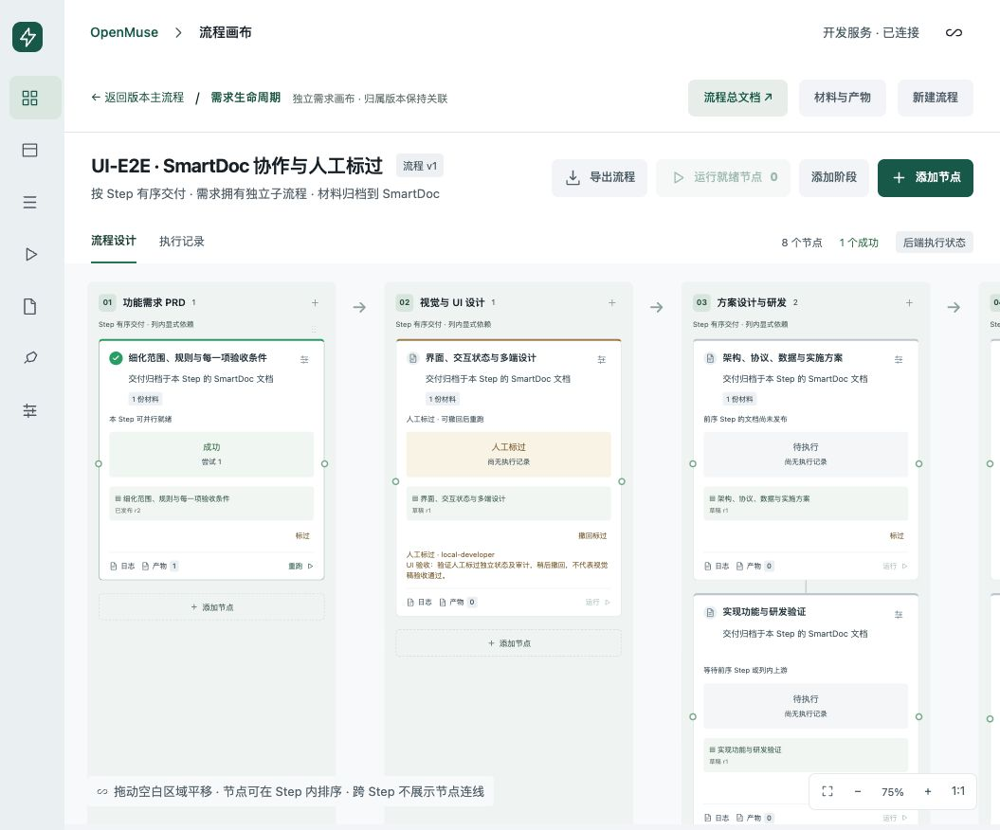
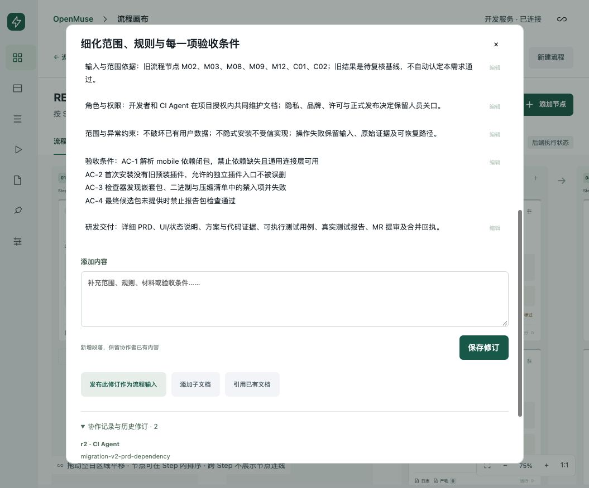

# Muse-CI 0.2.0 生命周期交付与验证报告

日期：2026-11-19。实现范围、交互与合同以 [产品规范](07-LIFECYCLE-AND-SMARTDOC.zh-CN.md) 为准；逐项前置、步骤和预期见 [21 项测试用例](08-LIFECYCLE-TEST-CASES.zh-CN.md)。本报告说明生命周期功能验证，不代表 Mobile 整改已通过提审。

## 本轮交付

| 对象 | 实现与使用方式 |
| --- | --- |
| 版本主流程 | 版本定义 → 版本视觉/UI → 需求拆分与交付 → 版本回归 → 版本上架；粗粒度 PRD、回归用例和报告各有独立文档 |
| 需求子流程 | 详细 PRD → 视觉/UI → 方案与研发 → 测试 → MR 提审与合并；独立画布、身份、修订和交付目录 |
| 画布 | 横向 Step 顺序；竖排节点只显示同 Step 依赖，无依赖可并行；主流程通过需求卡片进入子画布并返回 |
| 人工标过 | 原因、人员、时间和配置修订留痕；独立 marked 状态，可撤回；不生成成功 Attempt，不能替代测试或外部回执 |
| 原生 SmartDoc | 复用现有 WASM 引擎和 Yrs docState；总文档、Step 文档、子文档链接、材料引用、修订、发布和 .sydoc 下载 |
| Agent 协作 | 人与应用委托 Agent 共用权限和修订检查，按块贡献，记录作者和委托成员；支持撤回新编辑权限 |
| 执行证据 | 已发布文档固定为不可变输入；实际 Runner 结果写入交付文档；上游变化使受影响结果过期 |
| 双端 Host | 插件包升级到 0.2.0；Desktop DSH 右侧保留横向画布，Mobile 为 Step 分组列表；新增业务工具均留在插件后端 |

## 实际整改任务整理

[打开 Mobile 1.0.2 版本主流程](http://127.0.0.1:4180/?project=1068714fc62cac7d440972070efe42c8)。国内 Android、中国区 iOS、Google Play、美区 iOS 作为计划渠道。

六个需求分别覆盖依赖/插件隔离、SmartDoc 入口及迁移、来源与许可、AI 隐私及品牌、设备及四渠道回归、签名和上架材料。Agent 已贡献各需求的范围、验收、交互、方案及用例草稿。文档仍保留真实草稿状态，未自动认定产品或设计审核完成。

原项目 `db29cc8e05c2609607efac6224b8ea30` 的 v695、50 节点和执行历史保留。迁移可重复执行，不复制旧执行为新流程成功。详见 [迁移回执](evidence/lifecycle-v2/mobile-migration.json)、[历史基线](evidence/lifecycle-v2/legacy-baseline.json)。

已导出七个流程的 **62 份原生 SmartDoc**，按版本/需求、Step/节点组织。离线入口为 [归档索引](evidence/lifecycle-v2/smartdoc-archive/INDEX.json)，包含文档身份、修订、父级、路径及 SHA-256。在线总文档及文档 ID 是持续编辑的权威；导出是时点快照。`muse://ci` 子文档链接在 CI 文档面板解析，离线位置从索引查找。

## 验证结果

| 验证层 | 实际结果 | 证据与边界 |
| --- | --- | --- |
| 后端单元/合同 | 35 项通过，0 失败；TypeScript 检查通过 | 原生引擎、修订冲突、Agent 撤权、门禁、标过失效、材料与 MR adapter |
| 插件图模型 | 22 项通过，0 失败 | 同 Step 依赖、排序、并行、配置及执行图兼容 |
| MCP + PostgreSQL + Temporal | 25 个检查点通过 | [真实集成报告](evidence/lifecycle-v2/backend-e2e-report.json)；含真实原生发布、Worker 归档、冲突、子需求事务回滚、重启和幂等；未调用外部模型或正式发布 |
| 实际 Web 交互 | 创建主/子流程，编辑并发布原生 PRD，运行节点成功，标过/撤回，创建子文档，进入子画布/返回均验证 | [后端交互回执](evidence/lifecycle-v2/web-ui-receipt.json) 包含真实事件和 Attempt；独立验收项目，不改写上架任务结果 |
| Desktop 安装包 | 当前安装 MCPB 的真实 Host 冒烟 1 项通过 | 0.2.0；DSH 右侧截图见下；窄 Desktop 分栏按 Host platform 保持横向画布 |
| 共用 Dart Host 运行时 | 5 项通过 | 实际后端发现、Schema、鉴权边界、嵌套 Agent 编辑及原生格式读回；未新增 Host CI 生产业务 |
| Android 普通入口 | 已连接物理 PKM110；普通 main 恢复国内账号，首页点击 CI，原生 WebView 经 MCP 查询真实后端通过 | [设备报告](evidence/lifecycle-v2/android-acceptance-results.json)、[工具里程碑](evidence/lifecycle-v2/android-ci-normal-entry-e2e.json)；已恢复日常 QA 1.0.2+111816 |
| Mobile 布局 | Web 390×844 无页面横向溢出，5 Step、6 子需求入口可用 | [窄屏截图](evidence/lifecycle-v2/web-mobile-version.png)；此截图为响应式 Web，不冒充手机截图 |

其中一次启用人工截图确认的设备运行在镜像关闭后等待截图确认超时；其业务连接里程碑已达到，但该次运行不记通过。随后关闭可选截图确认，普通入口测试重新通过，以上 Android 报告来自最后一次通过的运行。

## 交付物与使用限制

开发包：`plugins/muse-ci/dist/muse-ci-0.2.0.mcpb`，SHA-256：`81da495fd26c787bd60771e55c1eff47b247dc0d0fbee50804bb003fee02f9ff`。当前为本地开发安装，没有市场审核或生产远端部署声明。

SmartDoc 已使用真实原生引擎和格式；当前 CI 面板提供段落/链接投影编辑，尚未嵌入完整 Flutter 富文本组件、表格/公式 UI 或云端在线光标/Presence。Agent 是受项目成员委托的应用协作者，尚不是独立云账号。

MR 已有受信仓库/分支绑定与 GitHub/GitLab 平台实际状态核验；本机未绑定真实仓库凭据。自动推送、创建 MR、提交评审和执行合并尚未接入，adapter 模拟响应测试不能作为真实合并证据。版本上架节点同样等待实际签名包和渠道执行器/回执。iOS 真机本轮未验证；手机后端目前通过 USB 连接本机 CI，离开此环境需远端服务和鉴权部署。

## 界面验收

