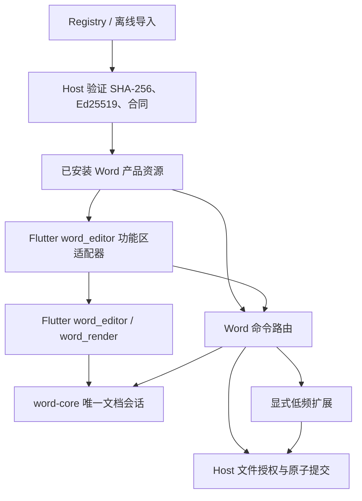

# 技术架构与多端交付

## 运行分层

插件提供声明，Host/`word_editor` 提供解释器与 UI 组件，`word-core` 执行文档变更。`word_editor` 不能把 Ribbon JSON 当作编辑命令的实现；它只呈现已协商能力并把用户动作交给命令路由。`word-core` 返回权威修订号、选择状态与渲染指令，Flutter 不自行分页。

## 平台交付矩阵

| 平台 | 内核与编辑表面 | 产品包安装 | 扩展执行 |
| --- | --- | --- | --- |
| macOS/Windows/Linux | Rust 原生库 + Flutter AOT，Host 内嵌；同一编辑器源码可构建独立窗口程序 | MCPB 下载或离线导入，验证签名并保存在应用数据目录 | MCP stdio Node 工具；只处理显式、低频任务 |
| Android | Rust `.so` + Flutter Widget 随 Host；需要时可在应用发行阶段采用平台组件拆包 | 已审核 MCPB 的静态资源进入应用私有目录；不执行 Node | 同一纯 JS 逻辑须由受控脚本运行时适配，或由预置 Host 能力实现；未接入前禁用 |
| iOS | Rust 静态/动态链接产物 + Flutter Widget 随 Host | 已审核的配置、模板与字体资源进入应用私有目录 | 首版仅受控声明或 Host 预置能力；下载执行代码的审核适配另列门禁 |
| Web | Flutter Web + Rust `word-core` WASM；两个产物分别构建 | 资源包下载校验并缓存；无网络时使用本地已安装版本 | 显式调用的受控 JS Worker；不得走每次按键路径 |

“一套代码”指共用 `word-core`、`word_editor` 与本插件的声明/扩展源码，允许按平台生成不同产物。Desktop 下载的 Dart UI 不能注入现有 Flutter AOT 进程；内嵌 UI 改版随 Host 构建更新。独立窗口可用同源 Flutter Desktop 程序交付，但它和 Host 的写入权必须由同一文档会话/租约协议协调。

## 当前仓库基线与缺口

- `ioffice` 已有 FRB `WordSession` 的打开、排版和部分编辑原型；Web WASM 运输仍后置。`TextDocument::save` 等 DOCX 保存路径保留 `todo!`，不能把“离线输入”当作“离线编辑保存”。[MVP 状态](../../../../ioffice/samples/docx-mvp-render/README.md)、[保存缺口](../../../../ioffice/libs/word-core/src/cn/wps/moffice/writer/core/TextDocument.rs)。
- `word_editor` 的旧样例工作区仍有硬编码 File/Home/View；新 `WordProductShell` 已可解释签名插件的 `chrome.json` 与 `ribbon.json`，Host 的 Word 产品路径使用新壳。完整菜单、上下文标签、状态快照和移动端布局仍待实现。[旧样例 UI](../../../../ioffice/samples/libs/word/word_editor/lib/src/word_workspace.dart)、[产品壳](../../../../ioffice/samples/libs/word/word_editor/lib/src/word_product_shell.dart)。
- Host 已支持编入应用的 Flutter 编辑器 Widget 和文件类型路由；市场包当前不能动态加载新的 Dart Widget。需要新增 Word 产品资源加载器、签名信任、能力门禁和命令适配。[Host 编辑器接口](../../../../Muse-Client/packages/openmuse_plugin_sdk/lib/openmuse_plugin_sdk.dart)。
- Mobile 当前 A2UI 基础目录只支持少量展示组件，不适合作为 Word 编辑画布；Word 画布继续使用 `ioffice` Flutter Widget。[Mobile 目录](../../../../Muse-Client/packages/openmuse_mobile_plugin_runtime/lib/src/mobile_widget_catalog.dart)。

## 安装与可信边界

1. Registry 的 `fileSha256` 校验传输结果；Host 在解包前限制压缩包大小、条目数、路径和解压总量。
2. `catalog.json` 列出包内每个资源的字节数与 SHA-256；`catalog.signature.json` 用 Ed25519 对原始 `catalog.json` 字节签名。Host 从本机可信发布者目录取公钥并验签，再核对文件集合和摘要。当前仓库 `scripts/verify.mjs` 是包验证参考实现，Host 还需实现本地可信密钥管理。
3. Host 先在暂存目录验证合同和平台兼容，再原子切换安装收据；旧版本保留到新版本首次启动通过。卸载只撤销产品资源与扩展授权，用户文档不放在插件目录。
4. Desktop MCPB 内的 Node Server 只发布静态产品资源和一个显式字数统计工具；Mobile/Web 不运行 Node，而是读取同一已签名文件。MCPB 是现有 Desktop 市场运输格式，Word 资源 Profile 是本插件公开合同，Host 需新增消费方。

## 文档会话与保存

Host 颁发不透明资源句柄和写入租约；`word_editor` 打开 `WordSession`，文档模型只存在内核。命令提交携带 `baseRevision`，内核拒绝过期编辑；导出 DOCX 后 Host 使用临时文件与原子替换提交，并记录新资源修订。独立窗口与内嵌窗格同时打开同一文档时，共享会话或由 Host 强制单写者。崩溃恢复依赖内核事务日志或可重放草稿，由 Host 存储；插件目录不能承担用户数据持久化。

字体二进制未来由包摘要固定，Host 将同一字体字节注入内核度量与 Flutter 绘制，避免布局和画面使用不同字体。系统字体回退只在双方一致且已标记质量降级时采用。模板 JSON 由内核一次性实例化为文档操作；插件不能拼接 OOXML 文件。
