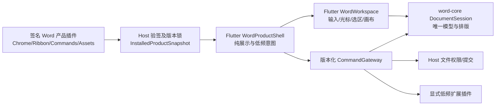

# GenOffice Docs 壳层复刻：架构、差距与迭代计划

## 目标与“1:1”的验收含义

以仓库内 `plugins/genoffice-pptx/vendor/genoffice/apps/docs` 当前源码和用户提供的 1365×860 桌面截图为视觉、信息架构和低频交互参照。完整目标是顶部快速操作与 Ribbon、中间分页工作区、底部状态栏及其菜单/弹层，在同样窗口尺寸、缩放和语言下逐项对照。文档正文仍由 `word-core` 唯一排版；不能为了视觉相似引入 GenOffice 的 Tiptap 文档树或 DOM 分页，也不能把待实现命令伪装为可用。

这里的“1:1”分两条验收线：**壳层**比对几何、层级、标签、图标语义、焦点和交互路径；**文档**使用 `word-core` 与独立 DOCX 参考输出比对，不要求复制 GenOffice 当前的排版错误。视觉参照中的 Genspark 商标入口替换为 Muse AI；第三方图标/字体只在逐项确认许可证后才加入签名资源包。

## 源码定位与边界

| GenOffice 位置 | 实际职责 | OpenMuse 处理 |
| --- | --- | --- |
| [`Ribbon.tsx`](../../genoffice-pptx/vendor/genoffice/apps/docs/src/renderer/components/Ribbon.tsx) | 常规/上下文标签、快速操作、按钮、菜单及直接调用 Tiptap `Editor` | 抽取布局和行为规格；Flutter 重建，不移植 ProseMirror 调用 |
| [`ribbon-tabs.tsx`](../../genoffice-pptx/vendor/genoffice/apps/docs/src/renderer/components/ribbon-tabs.tsx) 及各 `ribbon-*-tab.tsx` | 插入、绘图、设计、布局、引用、审阅、视图、表格/图片等工具 | 按页签建立控件清单与稳定命令 ID，逐项接入能力 |
| [`ribbon-format-state.ts`](../../genoffice-pptx/vendor/genoffice/apps/docs/src/renderer/components/ribbon-format-state.ts) | 从 ProseMirror 文档和选区推导功能区状态 | 由 `word-core` 的选择/格式快照提供，Flutter 只显示 |
| [`App.tsx`](../../genoffice-pptx/vendor/genoffice/apps/docs/src/renderer/App.tsx) | 文档打开、编辑器实例、分页测量、页面与页眉页脚、状态栏 | 会话/文件归 Host，编辑与排版归 `word-core`，页面绘制归 `word_render` |
| [`styles.css`](../../genoffice-pptx/vendor/genoffice/apps/docs/src/renderer/styles.css) | 顶栏、80px Ribbon、灰色工作区、24px 状态栏、弹层样式 | 数值纳入签名 `chrome.json`；Flutter 组件解释，不复制 CSS |
| `apps/shell/src/main/tab-manager.ts` | Electron `WebContentsView` 标签/独立窗口 | Host Flutter 窗格/原生窗口；不使用 WebView 承载 Word 编辑器 |

源码显示 `Ribbon` 必须接收 Tiptap `Editor`，`App` 用同一实例渲染 `EditorContent` 和计算 Ribbon 状态。直接引用 React 组件会形成第二文档模型和第二输入/选区/撤销路径。因此复刻的是产品壳的**外观与交互合同**，不是复用 React 运行时。

## Everything is plugin 的领域模型

- **ProductPackage / InstalledProductSnapshot**：不可变的已签名资源和安装收据。切换插件版本只发生在会话边界；会话期间不热替换布局。
- **ChromeDefinition / RibbonDefinition / CommandContribution**：插件声明颜色、尺寸、页签、分组、控件、状态栏槽位、命令和功能门禁。没有命令或未通过能力协商的控件只有不可用展示，不产生假操作。
- **EditorSession / DocumentRevision / SelectionFormatSnapshot**：Host 和 `word-core` 持有会话、权限、修订、选择和格式状态。插件不可缓存可变正文树；Flutter 只消费快照。
- **EditorViewState**：缩放、当前页、功能区当前标签、焦点和弹层由 Flutter 维护；这些不是文档持久状态。
- **ExtensionContribution**：AI、转换、字数等扩展通过版本化、显式命令注册。每次键入、滚动、分页、绘制不经过扩展服务。

Host 预编译的是通用的 Flutter Word 表面解释器和 Rust 内核运输层；市场安装的 Word 产品插件决定是否出现 Word 入口、采用哪套壳层资源和开放哪些命令。未来其它产品插件可以复用同一解释器，或由 Host 注册另一种原生 Surface Provider。产品插件不能下载 Dart AOT 代码注入运行中的 Host。

## 视觉与交互规格

| 区域 | GenOffice 基线 | 本产品的权威数据与行为 |
| --- | --- | --- |
| 快速操作/标签行 | 白色约 36px；保存、撤销、重做、自动保存；开始、插入、绘图、设计、布局、引用、审阅、视图；蓝色文字下划线 | `chrome.json.quickAccess`、`ribbon.json.tabs`；Mac 参照图隐藏“文件”标签，文件打开仍由 Host 文件入口提供；不可用操作置灰 |
| Ribbon 主带 | 固定 80px；组间 1px 分隔；窄窗内部横向滚动，切换页签不改变文档起点；macOS 隐藏组标题，其他桌面平台显示 | `ribbon.json` 的组/控件；`WordProductShell` 按布局种类渲染；菜单、分裂按钮、样式库与上下文页签逐阶段补齐 |
| 首页 | Muse AI、转换、剪贴板、字体双行、段落双行、样式卡片 | 首页控件目录已声明；图标目前用 Flutter Material 替代，需逐项校准路径、尺寸、hover 和可访问名称 |
| 工作区 | 浅灰 `#e7e7e7`，顶部约 26px，页间约 28px，底部约 140px 滚动空间，纸页居中与阴影 | 资源尺寸交给 `WordWorkspace`；纸张宽高和页内容始终来自 `word-core`，页面及光标由 Flutter 绘制 |
| 状态栏 | 浅灰 24px；左侧页码、字数、修订/状态；右侧视图图标、缩放减号/滑杆/加号/百分比 | 页数和字数来自内核会话，缩放是本地 ViewState；修订能力未接入时显示不可用状态；窄窗隐藏次要槽位 |
| 弹层与焦点 | 菜单贴附按钮，Esc/外部点击关闭；功能区操作保持文档选区 | 需要 Flutter Overlay/FocusScope 和选择锚点合同；命令提交携带当前会话修订，不能靠 DOM 选区 |

参照源码：`styles.css` 的 `.ribbon-tabs`、`.ribbon-body`、`.editor-scroll`、`.status-bar`；`Ribbon.tsx` 的 `TABS`、`HOME` 区、上下文标签；`App.tsx` 的 `<footer className="status-bar">`。截图固定在 1365×860、中文、100% 缩放、浅色模式。视觉金图要分别遮罩正文区和壳层区，报告壳层像素差异、几何偏差、文字截断与无障碍语义；正文保真另用 DOCX 金文件与独立阅读器校验。

### 逐标签控件台账

以下按 GenOffice 源码中的组顺序建立销项清单。`ribbon.json` 已补常规与上下文页签入口，`menus.json` 为源码 62 个下拉键建立 63 棵菜单树（含图片旋转入口）；[逐菜单台账](08-RIBBON-MENU-INVENTORY.zh-CN.md)记录源码位置、菜单 ID 与层级。**这仍不代表菜单视觉和功能完成**：静态菜单样本还需要动态状态、图库样式与命令接入。每组完成时须补悬停/按下/禁用、快捷键、选择状态、错误反馈和触控语义。

| 标签/上下文 | GenOffice 源码中的组或能力 | 本次落地 | 下一门禁 |
| --- | --- | --- | --- |
| 开始 | AI、转换、剪贴板、字体、段落、样式；Windows 另有编辑组 | 六组轮廓、两行字体/段落与样式卡片 | G2：组合框、颜色/列表库、分裂按钮、样式图库；G4：真实选区格式 |
| 插入 | 页面、表格、插图、文本、链接、批注、页眉页脚、符号 | 常见下拉菜单树及入口已声明 | G3：补齐控件位置、图库/表格网格、插入弹层与上下文跳转 |
| 绘图 | 选择、绘图工具、笔设置、清除 | 钢笔/荧光笔/橡皮擦占位 | G3：工具状态、墨迹层命令及撤销 |
| 设计 | 文档格式、页面背景 | 主题/页面背景占位 | G3/G4：主题颜色/字体、水印、页面颜色 |
| 布局 | 页面设置、段落、排列 | 页面设置首批占位 | G3/G4：节/页边距/纸张、段距、对象排列 |
| 引用 | 目录、脚注、引文与索引 | 目录/脚注/引文占位 | G3/G4：目录更新、引文源与域结果 |
| 审阅 | 校对、语言、批注、修订、比较、保护 | 校对/批注/修订占位 | G3/G4：修订与协作状态单一来源、权限门禁 |
| 视图 | 视图、缩放、外观、显示、窗口 | 源组顺序及图标已呈现；页面/阅读、数值与页宽/整页缩放、正文网格线可用 | G3/G5：Web/大纲、多页、深色页面、标尺/导航与窗口操作 |
| 上下文标签 | 表格设计、表格布局、图片格式、形状格式、页眉页脚 | 五个标签和对应菜单已声明，默认隐藏 | G3：由 `SelectionFormatSnapshot.context` 决定出现，不由插件猜测文档结构 |
| 底部状态栏 | 页数、字数、修订、视图切换、缩放 | 页数和缩放有效；字数/修订/其它视图有不可用呈现 | G5：接入内核快照和状态栏操作 |

## 复刻任务与门禁

| 阶段 | 交付仓库 | 具体任务 | 完成条件 |
| --- | --- | --- | --- |
| G0 清单与合同 | `plugins/word` | 锁定参照源码、八个常规标签、首页控件清单、`chrome.json`/`ribbon.json` 校验、来源与资源许可证记录 | 包验签通过；非法尺寸/引用被拒；每个控件有 ID、能力状态、测试条目 |
| G1 桌面壳骨架 | `ioffice` + `Muse-Client` + 本插件 | 原生 Flutter 顶栏、固定 Ribbon、分页工作区、状态栏；Host 加载签名定义；桌面窄窗横向滚动 | 1365×860 与 1280×800 能打开 DOCX 且壳层三段尺寸正确，无 WebView、无假可用按钮；截图差异登记 |
| G2 视觉细节 | `ioffice` + 本插件 | 精确 SVG/矢量图标、组合框、样式卡片、分裂按钮、hover/focus/disabled、溢出滚动条、暗色和窗口装饰差异；把静态 `grid` 升级为 GenOffice 的色阶、图库卡片与预览 | 首页与参照逐区人工复核；自动图像对比将不匹配区域列为可追踪任务；键盘 Tab/提示正确 |
| G3 全页签与上下文 | `ioffice` + 本插件 | 按 62 项菜单台账逐项校准内容及多级轨迹；字体、最近样式、引文等改为只读快照提供器；表格、图片、形状、页眉页脚上下文标签由选区快照驱动 | 每一参照控件都有布局、状态来源和命令/明确禁用原因；菜单 Esc/外部关闭、焦点回归通过 |
| G4 命令与选择状态 | `word-core` + `word_editor` + Host | `SelectionFormatSnapshot`、命令路由、撤销/重做、格式、列表、表格及 Host 文件操作；持续使用同一内核修订 | 选择变化后按钮状态正确；禁用命令无副作用；编辑→导出→重开通过；逐字输入零插件 IPC |
| G5 状态栏与多端 | `ioffice` + Host + 本插件 | 实际字数、修订状态、视图模式、Go To、缩放对话框；320/390/600/768/1365px 布局；独立窗口与内嵌窗格 | Desktop/Mobile/Web 各端按能力显示；离线重开；输入法、触控、屏幕阅读器与缩放测试通过 |

G0/G1 的**骨架代码已落地**，并增加了签名菜单树、递归弹层、桌面/平板/折叠屏/手机四档 Ribbon 密度。`0.1.3` 实现触控菜单逐级导航、44px 触达区域、Mac/非 Mac 分组标题规则及与文字同宽的页签下划线。`0.1.4` 将产品数据模型从 Flutter 壳组件分离，加入带类型的网格展示：GenOffice 主题色 10×6、标准色 10 格、高亮色 5×3、表格 10×8 悬停预览，以及样式/封面/艺术字/符号/形状图库。源码审计比对 62 个下拉入口，并校验 50 个符号、12 个封面、12 个艺术字和 7 组 109 个形状；GenOffice 形状源码注释写“104”，实际数据为 109，审计以实际数组为准。形状图库轮廓由源码几何生成并签名，Flutter 直接绘制其路径；`npm run sync:shape-previews` 可重生，流水线检查是否与源码一致。封面图库已按源码采用四列和纸页缩略图框架。`0.1.5` 修正“布局 → 位置”为源码的嵌入型加 3×3 位置九宫格。`0.1.6` 按源码把文件转换和两处页码位置恢复成平铺选项；项目符号、编号和多级列表使用三列图库与九格级别行。`0.1.7` 补齐三列首字下沉图库、八项单列公式图库及受签名校验的预览文字；最近/文档预设待只读快照提供器接入后再显示。递归组件保留为通用插件合同，但不虚构 GenOffice 当前菜单层级。尚未达到完整 1:1：部分控件仍是 Material 图标，样式缩略图的具体内容尚未与源逐项对齐（封面 12 项已在 0.1.10 对齐），公式预览尚非 MathML 排版，字体列表和最近颜色仍是静态资源，准确选区格式和字数未接入。相关编辑能力在资源中保持无命令或关闭功能门禁。G2–G5 应按控件台账逐项销项，不能用“看起来像 Word”宣称完成。

## 联合开发、测试与发布

1. 每次改 GenOffice 参照版本，运行 `npm run audit:genoffice` 对照七个 Ribbon 源文件中的下拉键、台账与签名菜单引用，并校验符号、封面、艺术字、形状和色板的源数组数量；该审计已纳入一键流水线。之后更新控件台账和金图；壳层外观变更只改插件资源时递增插件 patch，解释器新增兼容控件时递增 `word_editor` minor，破坏性 schema 提升 `editorSurfaceMajor`。
2. `npm run word:plan -- --platform desktop` 检查组合版本；`npm run word:e2e -- --platform desktop --scope render --suite quick` 一键构建签名插件、内核、Flutter Host 并在 OpenMuse 中打开样本文档。新增壳层金图用例应纳入同一报告，记录 Host/插件/内核源码摘要和窗口尺寸。
3. PR 门禁：插件配置/验签测试、Flutter 壳组件测试、Host 安装与打开 DOCX、截图结构检查；候选版再跑复杂 DOCX、原生窗口/嵌入窗口、移动端与 Web 离线矩阵。G4 之后追加编辑保存门禁。
4. 发布先冻结三仓修订、签名资源与截图证据；Host 验证版本与能力后原子切换插件安装收据。失败退回旧包。UI 资源更新不能中途改写已有编辑会话。

`npm test` 的签名用例使用临时测试密钥，结束后恢复既有 `dist` 签名产物；它不能覆盖待人工验收的开发/发布包。`npm run audit:genoffice` 仅供源码对照，不纳入市场安装包。

参考现有[开发计划](04-DEVELOPMENT-PLAN.zh-CN.md)、[合同](03-CONTRACT.zh-CN.md)和[持续迭代流水线](06-CONTINUOUS-DELIVERY.zh-CN.md)。

## 0.1.5 验证记录

- 一键流水线运行 `2026-10-22T15-20-42-286Z-66d6c14a`：插件资源校验、源码下拉入口审计、内核 FFI、Flutter 测试、macOS Host 构建及原生应用启动均通过。原生应用日志确认 DOCX 渲染与 DSH 面板加载；桌面测试检查真实页码二级菜单和九宫格。
- macOS Debug 包与 Android Debug APK 都内置同一已签名 `word-0.1.5.mcpb`，包内字节与流水线产物一致。macOS 深度签名校验通过。
- Android API 34 模拟器安装 APK 后，离线打开已有的 `complex-sample.docx`，状态栏显示第 1 页、共 28 页；“文件 → 转换”触控菜单能进入下一级并返回。连接的 OPPO PKM110 真机仍由系统拦截 ADB 安装，返回 `-99` / `OPLUS_ADB_INSTALL_CANCEL`，故该真机运行验收待设备侧允许安装后补做。

## 0.1.6 验证记录

- 一键流水线运行 `2026-10-22T15-36-16-234Z-66d6c14a`：签名资源、62 个下拉入口与 63 棵菜单树、项目符号 6/编号 8/多级列表 8 个源预设、内核 FFI、Flutter 组件、macOS Host 构建、原生打开 DOCX 和 DSH 面板均通过。桌面截图包含项目符号图库与九格级别行。
- macOS Debug ZIP 和 Android Debug APK 均内置同一份已签名 `word-0.1.6.mcpb`；包内插件字节与流水线产物相同。macOS 深度签名校验通过。
- Android API 34 模拟器安装新版 APK，离线打开 `complex-sample.docx` 后显示 28 页；“文件”菜单的四个转换项处于同一层，项目符号图库及级别行能在手机底部弹层中打开。真机 ADB 安装仍受 OPPO 系统策略限制，未把模拟器结果记为真机通过。

## 0.1.7 验证记录与下一批任务

- 一键流水线 `2026-10-22T16-59-07-971Z-66d6c14a` 通过资源校验、GenOffice 源码审计、插件签名测试、Rust FFI、Flutter 壳组件、macOS Host 原生构建和启动、DOCX 渲染、DSH 面板检查。审计核对 62 个源码下拉入口、63 棵产品菜单树及 8 个内置公式。桌面端到端测试打开并检查首字下沉、公式弹层。
- 重新构建 macOS Debug ZIP 与 Android Debug APK。两端包内 `word-0.1.7.mcpb` 均与签名源包逐字节一致；macOS 深度签名校验通过。Android API 34 ARM64 模拟器安装新版 APK，在 Wi-Fi 和蜂窝数据均关闭后，从本地 Downloads 重新打开 `complex-sample.docx`，页面渲染并显示共 28 页；触屏弹层三项首字下沉和八项公式及末尾“插入新公式”均可到达。
- 下一批 G2/G3：为 63 棵菜单逐项做源截图和键盘/触控轨迹对照；用源 SVG/矢量图替换 Material 图标，继续逐项复刻样式缩略图，并对封面做 GenOffice 运行金图比较；公式预览改成与源 MathML 几何一致的本地数学布局；动态字体、最近颜色和当前选区状态通过只读快照提供；完成命令门禁与状态栏数据后再宣告 1:1。已知 OPPO 真机 ADB 安装受系统策略拦截，当前仅把 Android 模拟器结果记为通过。

## 0.1.8 壳层对齐与视觉证据

- 根据 GenOffice `styles.css` 校准 Ribbon 底部 5px 横向滚动轨道、中央画布 `26px 24px 140px` 内边距和纸页双层阴影；状态栏保持 24px、缩放滑杆 110px。新增原生 Flutter 缩放弹窗，对照 `ZoomDialog.tsx` 的 200/100/75 预设、两列适配项及 10–500% 输入。插件签名 `chrome.json` 声明缩放范围和预设，`word_editor` 的 ViewState 执行缩放，插件不进入逐字输入或排版路径。
- 一键流水线 `2026-10-22T17-47-33-453Z-66d6c14a` 全部通过：签名包校验、62 个源码下拉入口/63 棵菜单树审计、Rust FFI、Flutter 壳与缩放组件测试、macOS 原生 Host 构建、DOCX 渲染、离线重开、独立/内嵌窗口及 DSH 面板。Android API 34 ARM64 模拟器在离线状态下安装 APK、打开 `complex-sample.docx`、显示 28 页，缩放弹窗可打开且选择 100% 后状态和纸页同步变化。
- [本轮视觉对比证据](10-VISUAL-COMPARISON-0.1.8.zh-CN.md)保存 0.1.7/0.1.8 桌面同窗口截图，以及 0.1.8 桌面/Android 缩放与 Android 实际 DOCX 渲染截图。此轮未取得同版本 GenOffice 运行金图，不宣称像素级 1:1；图标、图库、动态状态、适配缩放和当前选区合同仍在 G2–G5 清单中。

## 0.1.9 源图标资源与视觉证据

- 对照 GenOffice `components/icons.tsx`，用可复现提取器将 63 个已映射的 SVG 图标放进签名 `icons.json`；快速操作、Ribbon、状态视图优先消费这份资源，旧产品包和未映射图标保留回退。第三方 Apache-2.0 许可与 NOTICE 随包提供。
- `npm run audit:icons` 纳入一键门禁，Host 对图标资源与产品包一并验签，Flutter 解释器不把插件接入文档输入/排版高频路径。0.1.9 / `word_editor` 0.4.5 的端到端运行 ID 为 `2026-10-23T03-59-34-816Z-66d6c14a`，DOCX、离线、原生窗口、嵌入窗口、DSH 门禁通过。
- [0.1.9 视觉对比](11-VISUAL-COMPARISON-0.1.9.zh-CN.md)给出同窗口前后截图和区域变化量；中央文档区没有像素变化。仍需源运行金图、剩余图标、动态菜单与控件状态，不能把该结果解释为完整 1:1。

## 0.1.10 封面图库源预设

- 按 `cover-pages.ts` 的 12 个封面段落数组生成签名预览数据，Flutter 按 `CoverThumb` 的 88×116 纸页和 twips 缩放规则原生绘制。插件只定义展示数据；正文模型、输入和排版仍在 `word-core` / Flutter 编辑表面。
- [本轮前后视觉证据](12-VISUAL-COMPARISON-0.1.10.zh-CN.md)显示 12 张封面的实际颜色、对齐、边框、背景和段距差异。源数据审计、签名校验及双端构建结果在本轮报告中记录。该项消除封面图库通用缩略图替代，但不代表所有 Ribbon 菜单达到完整 1:1。
- 触屏图库按屏宽重排为 1–4 列；393 逻辑像素的 Android 模拟器以三列呈现，纵向滚动可触达全部 12 张。最终端到端运行 `2026-10-23T06-39-33-439Z-66d6c14a` 通过，macOS Debug ZIP 和 Android Debug APK 均嵌入同一签名包；离线打开本地 8 页 DOCX 与多级封面菜单的设备截图和摘要见[本轮视觉证据](12-VISUAL-COMPARISON-0.1.10.zh-CN.md)。

## 0.1.11 艺术字源预设

- GenOffice Docs 和 Slides 共享 `WORDART_PRESETS`；把 12 项填充、描边、粗斜体作为签名展示配方同步到插件，`word_editor` 按源 4×3、44px 卡片和 26px 字形绘制。源数据漂移审计进入一键流水线，展示模型不持有文档或编辑状态。
- [本轮三方视觉证据](13-VISUAL-COMPARISON-0.1.11.zh-CN.md)包含旧/新 Flutter 同窗口截图及源 CSS 独立参考。下一项优先处理动态样式图库：由内核/Host 提供只读文档样式快照，插件提供布局与命令声明；不能把文档样式预制为固定插件卡片。

## 0.1.12 快速样式图库与只读快照合同

- 根据 `style-gallery.ts` 将开始页签的固定两张卡片改为 `document.quickStyles` 图库入口；签名插件只保存 GenOffice 的四项缺省预览，文档样式由只读 `WordStyleSnapshot` 覆盖。Flutter 实现优先级、默认正文、字符样式及隐藏后使用显示规则，按源尺寸绘制内联卡片、溢出按钮和完整菜单；小屏以触控弹层重排。
- [本轮视觉对比与验收证据](14-VISUAL-COMPARISON-0.1.12.zh-CN.md)给出改动前后、源 CSS 独立参考、桌面与 Android 截图。真实 DOCX 样式表和选区状态尚未由 Rust FFI 导出；下一项是 `word-core` 的版本化只读快照与样式应用命令，再核对源运行金图。

## 0.1.13 文档样式快照进入原生会话

- `word-core` 保存打开时解析的 DOCX 样式表只读投影，FFI 提供版本化快照；`word_editor` 用真实文档样式替换插件四项缺省预览，并在无样式表时回退。Android 与桌面继续消费同一签名产品配置，展示细节见[本轮视觉证据](15-VISUAL-COMPARISON-0.1.13.zh-CN.md)。

## 0.1.14 文档字数进入状态栏

- 将 GenOffice 状态栏的字数规则映射为 `word-core` 主文档会话的只读区间统计；编辑面打开文档时显示真实总数，编辑与选区变动后节流刷新。产品包只定义展示文案。Desktop 与 Mobile 的前后视觉证据、构建和验证记录见[本轮视觉证据](16-VISUAL-COMPARISON-0.1.14.zh-CN.md)。
- 下一步按 `style-gallery.ts` 接通选区激活样式、编辑后实时使用样式、应用样式命令与 FontHost 字体解析；同时采集同文档 GenOffice 运行图，形成可量化的布局与像素差异。顶部 Ribbon 其余菜单、中间编辑能力和底部修订等状态尚需逐项验收，不能把当前源 CSS 对照当作整体 1:1 验收。

## 0.1.15 字数统计弹窗

- 对照 GenOffice 的八行统计弹窗、440 像素桌面宽度、状态栏可点击入口及源“视图”页签，删除插件里多出的统计 Ribbon 组。`word-core` 0.1.1 和 FFI 0.1.1 提供只读统计快照，Flutter 编辑面 0.4.11 负责响应式弹窗，插件 0.1.15 只声明文案、行顺序及受门禁的低频命令。前后桌面/窄屏及 Android 离线证据见[本轮视觉对比](17-VISUAL-COMPARISON-0.1.15.zh-CN.md)。

## 0.1.16 页码定位面板

- 对照 `App.tsx` 状态栏页码按钮及 `FindPanel.tsx`、`goto.ts`，把页码定位作为已签名产品命令和 Flutter 编辑表面视图动作。桌面贴近源码右上角面板位置，移动端改用底部面板；绝对与相对页码都可滚动到目标页。其他结构目标仍需内核快照，前后视觉与双端结果见[本轮证据](18-VISUAL-COMPARISON-0.1.16.zh-CN.md)。

## 0.1.17 阅读视图

- 对照 `App.tsx` 视图页签和状态栏的同一组模式控制，以及 `styles.css` 阅读模式隐藏功能区、纸页顶部 44px 留白和右上退出按钮的规则。签名产品包新增 `word.view.readMode`、`word.view.printLayout` 两项低频视图命令与退出文案；Flutter 编辑表面共享视图状态，支持桌面与手机进入、退出及 Esc。内核的文档模型和分页保持唯一；Web 版式与大纲依赖后续专用布局实现。本轮截图与双端包见[视觉证据](19-VISUAL-COMPARISON-0.1.17.zh-CN.md)。

## 0.1.18 视图缩放组

- 对照 `ViewTab` 的源控件顺序补齐缩放弹窗、100%、页宽、整页入口与 GenOffice 原 SVG。签名产品插件提供命令及图标；Flutter 编辑表面根据实际视口宽高计算适配比例，状态栏和缩放弹窗读取同一视图状态。无双页排列能力的“多页”与独立“分页预览”明确禁用。前后视觉、双端包与测试记录见[本轮证据](20-VISUAL-COMPARISON-0.1.18.zh-CN.md)。

## 0.1.19 视图页签后半段与网格线

- 按 GenOffice `ViewTab` 的顺序补齐“外观、显示、窗口”组及七个源 SVG。签名产品包声明 `word.view.gridlines`；Flutter 编辑面保存低频视图状态，`word_render` 按唯一内核给出的页面边距绘制 24px 对齐网格，不改文档和排版。绘制像素测试进入一键流水线。深色模式、标尺、导航窗格、窗口操作只展示不可用控件，待真实状态和能力合同实现后逐项启用。[本轮前后视觉与平台证据](21-VISUAL-COMPARISON-0.1.19.zh-CN.md)持续记录差距。

## 0.1.20 多页视图

- 对照 GenOffice `multipage.ts` 与 `App.tsx` 的 `zoomFit('multi')`：签名产品包启用“多页”命令，Flutter 编辑表面按视口与纸张宽度排列页面，保持源行为的手动缩放后仍使用多页排列、页宽和整页命令退出多页；双列中的右侧活动页与状态栏页码同步。手机窄屏回退到可读的单列，分页数据和绘制命令继续由唯一 `word-core` 产生。桌面同文档截图、命令校验与构建记录见 [0.1.20 视觉对比](22-VISUAL-COMPARISON-0.1.20.zh-CN.md)。

## 0.1.21 深色页面

- 对照 GenOffice `editor/dark-page.ts` 的屏幕颜色矩阵、`#1e1e1e` 纸张和 `styles.css` 的 `#3d3d3d` 工作区。签名插件声明低频 `word.view.darkMode`；Flutter 编辑面保存视图状态并切换画布；`word_render` 在屏幕绘制时重映射文字、矩形、线条颜色，图片保持原色。原始 `word-core` 命令、文档模型、分页与导出数据均不变。命令仅在真实文档打开时可用，桌面/窄屏共享同一编辑面实现。本轮前后截图与 macOS 包见[0.1.21 视觉证据](23-VISUAL-COMPARISON-0.1.21.zh-CN.md)。
- 下一轮优先完成标尺的只读几何和可写缩进合同，再实现导航窗格的标题/页码索引和检索接口。GenOffice 的页面预览、Web 版式、大纲、窗口操作依赖独立的视图和 Host 能力合同；逐项建立金图后验收。完整 1:1 仍需同文档 GenOffice 运行截图及多级菜单逐项对照。

## 0.1.22 水平标尺第一阶段

- 对照 GenOffice `components/Ruler.tsx` 与 `styles.css`，签名插件启用“视图 → 显示 → 标尺”低频命令。Flutter 编辑面使用 `word-core` 输出的实际页宽和页边距计算刻度，按区域偏好显示厘米或英寸，绘制灰色边距区、文本起点双向刻度、默认半英寸制表位指示，并随页面缩放。单页视图中标尺与纸页左边缘对齐；多页视图隐藏，保持源 `App.tsx` 行为。正文绘制命令与文档模型不因切换而变。
- 当前标尺是**只读几何**：源工程的首行/悬挂/左右缩进标记、显式制表位及页边距拖动，尚缺来自 `word-core` 当前节、当前段落的版本化读写合同，因此不伪造这些值或提供无效拖拽。下一阶段先在内核导出节几何、段落缩进和制表位快照，再提供经内核提交的编辑命令；移动端触控手柄、键盘步进及视觉金图随后验收。[本轮对比与测试](24-VISUAL-COMPARISON-0.1.22.zh-CN.md)记录现状。
